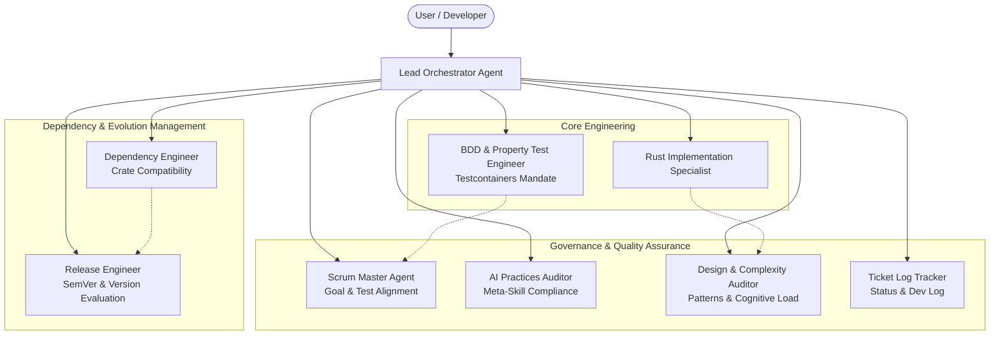

# Multi-Agent Architecture & Operating Guidelines

## Overview
This document defines the agent ecosystem, roles, interfaces, governance principles, and execution protocols for autonomous and collaborative software engineering in this project (`embedag`).

The architecture adopts state-of-the-art AI development paradigms:
- **Separation of Concerns**: Single Responsibility Principle for autonomous agents and skills.
- **Specification-Driven Synthesis**: Explicit behavioral and technical constraints derived directly from requirements (`doc/` and project user stories).
- **Feedback Loops & Verification Gates**: Autonomous validation through static analysis, code complexity verification, automated coverage validation, containerized integration testing, and alignment auditing.
- **Context & Token Economy**: Minimalistic, targeted skill prompts loaded on-demand to prevent attention degradation and hallucinations.

---\n
## Agent Topology & Hierarchy

---\n
## Autonomous Agent Profiles

### 1. Lead Orchestrator
- **Role**: Coordinates multi-agent workflows, evaluates user prompts, synthesizes subagent reports, and sequences execution pipelines.
- **Tools**: Subagent delegation, filesystem operations, git integration, workflow scheduling.
- **Execution Protocol**:
  1. Inspect requirements, active skills, and system context.
  2. Invoke specialized auditor or engineering agents.
  3. Validate results through verification metrics.
  4. Present concise, verifiable results with citations.

### 2. Dependency Compatibility Engineer (`crate-compatibility`)
- **Role**: Audits external crates in `Cargo.toml`, analyzes dependency graph conflicts, ensures compatibility across the Rust ecosystem, and executes non-breaking version upgrades.
- **Governing Skill**: [crate-compatibility](file:///Users/yasuomaidana/RustRoverProjects/embedag/.agents/skills/crate-compatibility/SKILL.md)
- **Primary Tools**: `cargo tree`, `cargo upgrade`, `cargo check`, `cargo update`.

### 3. Release & SemVer Evaluator (`semver-version-evaluator`)
- **Role**: Assesses public API modifications, breaking changes, and release readiness according to Semantic Versioning (SemVer 2.0.0). Determines if version increments must be PATCH, MINOR, or MAJOR.
- **Governing Skill**: [semver-version-evaluator](file:///Users/yasuomaidana/RustRoverProjects/embedag/.agents/skills/semver-version-evaluator/SKILL.md)
- **Primary Tools**: `cargo semver-checks`, `git diff`, API AST inspections.

### 4. Architecture & Complexity Auditor (`pattern-complexity-auditor`)
- **Role**: Evaluates software design patterns (e.g. Typestate, RAII, Builder, Visitor, Strategy in Rust), enforces idiomatic patterns, inspects cyclomatic/cognitive complexity, and guards against anti-patterns.
- **Governing Skill**: [pattern-complexity-auditor](file:///Users/yasuomaidana/RustRoverProjects/embedag/.agents/skills/pattern-complexity-auditor/SKILL.md)
- **Primary Tools**: `rust-code-analysis-cli`, `cargo clippy`, structural inspection.

### 5. AI Practices & Meta-Skill Auditor (`ai-practices-auditor`)
- **Role**: Validates that all AI agents, skills, and prompt instructions adhere to state-of-the-art AI development practices: structured YAML frontmatter, deterministic constraints, token optimization, no hallucinations, and guardrail enforcement.
- **Governing Skill**: [ai-practices-auditor](file:///Users/yasuomaidana/RustRoverProjects/embedag/.agents/skills/ai-practices-auditor/SKILL.md)
- **Primary Tools**: Skill schema validator, markdown static analysis.

### 6. Agile Scrum Master & Goal Alignment Specialist (`scrum-master-alignment`)
- **Role**: Acts as the automated Scrum Master. Ensures that every test suite (unit, integration, doc-test, property-test) directly traces back to project milestones, user stories, acceptance criteria, and technical specifications in `doc/`. Mandates containerized testing via Testcontainers for persistent layer changes.
- **Governing Skill**: [scrum-master-alignment](file:///Users/yasuomaidana/RustRoverProjects/embedag/.agents/skills/scrum-master-alignment/SKILL.md)
- **Primary Tools**: Test mapping tracers, specification parsers, coverage alignment metrics.

### 7. Knowledge Graph & Architecture Mapping Specialist (`graphify`)
- **Role**: Converts repository content, source files, and supporting artifacts into a persistent knowledge graph to explain relationships, dependencies, architecture, and impact paths across the codebase.
- **Governing Skill**: [graphify](file:///Users/yasuomaidana/.gemini/config/skills/graphify/SKILL.md)
- **Primary Tools**: graph query tools, repository traversal, relationship analysis, evidence mapping.

### 8. Autonomous Ticket Lifecycle Developer (`ticket-lifecycle-developer`)
- **Role**: Guides and executes the complete 8-step ticket development lifecycle for the next undone project ticket: requirement clarity check, ticket decomposition, TDD test definition, design pattern audit, feature implementation, test passing validation, complexity refactoring, and dev status updating.
- **Governing Skill**: [ticket-lifecycle-developer](file:///Users/yasuomaidana/RustRoverProjects/embedag/.agents/skills/ticket-lifecycle-developer/SKILL.md)
- **Primary Tools**: `cargo test`, `cargo clippy`, `cargo fmt`, `DEV_STATUS.md` tracker.

### 9. Project Ticket Log & Status Tracker (`ticket-log-tracker`)
- **Role**: Scaffolds, synchronizes, and maintains an ultra-concise, non-verbose markdown ticket log (`DEV_STATUS.md` / `TICKET_LOG.md`) to track project status, milestone progress, and active tickets extracted from `doc/01_Development_Plan.md`.
- **Governing Skill**: [ticket-log-tracker](file:///Users/yasuomaidana/RustRoverProjects/embedag/.agents/skills/ticket-log-tracker/SKILL.md)
- **Primary Tools**: Markdown log synchronizer, specification parser, `DEV_STATUS.md` tracker.

---

## Operating Protocols & Best Practices

1. **Test-First & Specification Traceability**:
   - Every implementation must have explicit automated tests verifying business goals.
   - Trace tests to requirements before marking tasks complete.

2. **Continuous Static Verification**:
   - Zero Clippy warnings (`-D warnings`).
   - Automated formatting verification (`cargo fmt --check`).
   - Enforce cyclomatic complexity limits ($\le 15$ per function) and cognitive complexity limits ($\le 20$).

3. **Autonomous Skill Loading**:
   - Agents must only load skills directly pertinent to their current sub-task to maintain maximum context window hygiene and instruction fidelity.

4. **Reporting Integrity**:
   - Reports must clearly distinguish verified CLI outputs from assumptions.
   - Do not claim tests pass or coverage targets are met without executing and verifying the respective commands.

5. **Mandatory Persistence Verification (Testcontainers)**:
   - All code modifying the persistence layer (`embedag-diesel` or future database adapters) must include automated integration tests backed by **[Testcontainers for Rust](https://rust.testcontainers.org)** (`testcontainers`).
   - Mocking or testing exclusively against SQLite is strictly insufficient for certifying PostgreSQL and vector search functionality.
   - The CI gate `persistence-testcontainers` must pass before persistence tickets can be marked Done.
