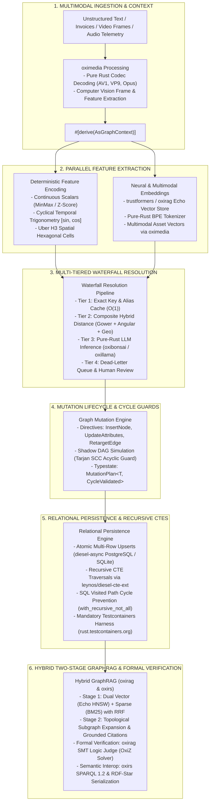

# Master Architectural Specification & System Catalog

| Metadata           | Details                                                                                                                  |
|:-------------------|:-------------------------------------------------------------------------------------------------------------------------|
| **Document ID**    | `00_MASTER_SPECIFICATIONS`                                                                                               |
| **Domain**         | Master System Architecture & Global Specifications Catalog                                                               |
| **Responsibility** | Global Architectural Blueprint, Core Invariants, KitaSan Open Source Stack Integration, and Modular Specifications Index |
| **Target Crates**  | Entire `embedag` Workspace (`embedag-core`, `embedag-derive`, `embedag-llm`, `embedag-diesel`, `embedag-rag`, `embedag`) |
| **Status**         | Definitive Master Specification                                                                                          |

---

## 1. Executive Summary & Architectural Vision

`embedag` is an enterprise-grade, **100% written in Rust** framework for **deterministic and probabilistic Directed
Acyclic Graph (DAG) construction, multimodal entity resolution, relational persistence, and hybrid GraphRAG (
Retrieval-Augmented Generation)**.

Unlike naive vector search or rigid flat taxonomies, `embedag` models real-world business domains as **multi-parent
directed acyclic graphs**, resolving fuzzy, multimodal input records (such as unstructured invoices, product catalogs,
sensor telemetry, video frames, and conversational text) into mathematically verified, cycle-free hierarchical
topologies.

### 1.1 Core Architectural Tenets

1. **100% Pure Rust & Zero FFI**: Zero runtime dependencies on C/C++ runtimes (e.g. `llama.cpp`, CMake, FFmpeg C
   libraries) or Python. The entire machine learning inference, tokenization, computer vision, vector search, and graph
   traversal stack compiles natively with standard `cargo build`.
2. **Priority 1 Foundation (The KitaSan Open Source Stack)**: Primary machine learning inference, computer vision,
   semantic web, and GraphRAG capabilities are powered strictly by the **KitaSan open-source ecosystem (`cool-japan` /
   COOLJAPAN OÜ)**:
    - `cool-japan/oxibonsai`: Zero-FFI pure Rust sub-2-bit (1-bit and ternary) LLM execution engine with pushdown
      automaton logit masking.
    - `cool-japan/oxillama`: Sovereign pure Rust alternative to `llama.cpp` for GGUF model loading, multi-quantized
      inference (Q4_0..Q8_0, K-quants, I-quants), and 25 model architectures built upon `SciRS2`, `OxiBLAS`, and
      `OxiFFT`.
    - `cool-japan/oxirag`: Four-layer pure-Rust RAG engine featuring Echo (vector store & similarity), Speculator (draft
      verification with SLM), Judge (SMT-based logic verification with SMT-LIB via the `OxiZ` solver), Layer 4 GraphRAG
      (BFS/N-hop queries), and context-aware prefix caching.
    - `cool-japan/oxirs`: Modular Semantic Web platform providing SPARQL 1.1/1.2 query execution (`oxirs-arq`), durable
      on-disk TDB2 storage (`oxirs-tdb`), RDF-Star, and GraphML/JSON-LD serialization.
    - `cool-japan/oximedia`: Patent-free multimedia and computer vision framework (pure Rust clean-room reconstruction
      of FFmpeg + OpenCV) providing royalty-free codec decoding (AV1, VP9, VP8, Opus, FLAC), video frame extraction, and
      forensic image analysis.
    - *Strict Open-Source Boundary*: Only free Apache-2.0 open-source repositories from `cool-japan/cool-japan` are
      utilized; commercial licensed vertical workspaces (`autors`, `med`, `cad`, etc.) are strictly excluded.
3. **Multi-Parent DAG Topologies**: Entities can belong to multiple conceptual parents simultaneously (e.g., a product
   node belonging to both *Confectionery -> Chocolate* and *Dietary -> Gluten-Free*), strictly guarded against circular
   loops.
4. **Separation of Determinism and Probability**: Numerical, temporal, and spatial attributes are transformed using
   deterministic mathematical encoders (MinMax, Z-score, cyclical trigonometry, Uber H3 grid indexing), preventing
   probabilistic LLM hallucinations and floating-point arithmetic errors.
5. **Cycle Guards & Typestate Safety**: Cycles are prevented across two independent defense barriers:
    - Compile-time typestate contracts (`MutationPlan<T, CycleValidated>`) and in-memory Tarjan Strongly Connected
      Components (SCC) validation.
    - Database-level cycle prevention in recursive SQL CTEs powered by [
      `leynos/diesel-cte-ext`](https://github.com/leynos/diesel-cte-ext) (`RecursiveCTEExt`, `with_recursive`,
      `with_recursive_not_all`) with array path tracking.
6. **Hexagonal Architecture (Ports & Adapters)**: Domain logic in `embedag-core` is strictly decoupled from storage
   implementations (`GraphRepository` trait) and inference runtimes (`LlmProvider` trait).
7. **Mandatory Containerized Persistence Verification**: Relational persistence adapters and future database backends
   are mandatorily tested against real disposable Docker containers managed via
   **[Testcontainers for Rust](https://rust.testcontainers.org)** (`testcontainers`). Testing against mocks or relying
   solely on SQLite is strictly prohibited for verifying PostgreSQL and vector search functionality.

---

## 2. End-to-End System Architecture

---

## 3. Modular Specification Catalog (Single Responsibility & Domain)

To guarantee high cohesion, maintainability, and clean domain boundaries, the documentation suite is partitioned into 22
dedicated specifications:

| ID   | Specification Document                                                                                                                                                    | Domain                         | Primary Architectural Responsibility                                                                               |
|:-----|:--------------------------------------------------------------------------------------------------------------------------------------------------------------------------|:-------------------------------|:-------------------------------------------------------------------------------------------------------------------|
| `00` | [00_MASTER_SPECIFICATIONS.md](file:///Users/yasuomaidana/RustRoverProjects/embedag/doc/00_MASTER_SPECIFICATIONS.md)                                                       | Master Architecture            | Master blueprint, system tenets, KitaSan open-source stack & diesel-cte-ext integration catalog.                   |
| `01` | [01_Development_Plan.md](file:///Users/yasuomaidana/RustRoverProjects/embedag/doc/01_Development_Plan.md)                                                                 | Project Governance             | Scrum milestones, epics, user stories, acceptance criteria, test specifications.                                   |
| `02` | [02_Workspace_Crate_Topology.md](file:///Users/yasuomaidana/RustRoverProjects/embedag/doc/02_Workspace_Crate_Topology.md)                                                 | Workspace Architecture         | Crate boundaries, dependency graphs, test dependencies, and isolation layers.                                      |
| `03` | [03_Architectural_Design_Patterns.md](file:///Users/yasuomaidana/RustRoverProjects/embedag/doc/03_Architectural_Design_Patterns.md)                                       | Design Patterns                | Idiomatic Rust patterns, hexagonal ports, typestates, CTE builder pattern, Testcontainers pattern.                 |
| `04` | [04_Core_Domain_and_Entity_Contracts.md](file:///Users/yasuomaidana/RustRoverProjects/embedag/doc/04_Core_Domain_and_Entity_Contracts.md)                                 | Domain Contracts               | Core traits: `AsGraphContext`, `NodePayload`, `GraphTarget`, `GraphClassifier`.                                    |
| `05` | [05_In_Memory_DAG_and_Arena_Topology.md](file:///Users/yasuomaidana/RustRoverProjects/embedag/doc/05_In_Memory_DAG_and_Arena_Topology.md)                                 | Graph Topology                 | `MemoryDag<T>`, generational indices, `petgraph`, arena memory layout.                                             |
| `06` | [06_Procedural_Derive_Macros.md](file:///Users/yasuomaidana/RustRoverProjects/embedag/doc/06_Procedural_Derive_Macros.md)                                                 | Metaprogramming                | `embedag-derive`, `#[derive(AsGraphContext)]`, syn/quote compile-time AST generation.                              |
| `07` | [07_Deterministic_Feature_Encoding.md](file:///Users/yasuomaidana/RustRoverProjects/embedag/doc/07_Deterministic_Feature_Encoding.md)                                     | Feature Engineering            | Mathematical feature encoders: scalars, cyclical time, and Uber H3 spatial cells.                                  |
| `08` | [08_Neural_and_Multimodal_Embeddings.md](file:///Users/yasuomaidana/RustRoverProjects/embedag/doc/08_Neural_and_Multimodal_Embeddings.md)                                 | Neural & Multimodal            | Local embeddings via `trustformers`/`oxirag`, `oximedia` multimedia/CV pipelines.                                  |
| `09` | [09_Mixed_Modality_Representation_and_Similarity.md](file:///Users/yasuomaidana/RustRoverProjects/embedag/doc/09_Mixed_Modality_Representation_and_Similarity.md)         | Similarity Engine              | `UnifiedNode<T>`, composite hybrid distance (Gower + Angular + H3), LLM delta cards.                               |
| `10` | [10_Structured_Extraction_and_Schema_Derivation.md](file:///Users/yasuomaidana/RustRoverProjects/embedag/doc/10_Structured_Extraction_and_Schema_Derivation.md)           | Extraction Schemas             | Universal schema synthesis (`schemars`), `ExtractionDirective`, Draft-Then-Decode.                                 |
| `11` | [11_Pure_Rust_LLM_Inference_and_Constrained_Decoding.md](file:///Users/yasuomaidana/RustRoverProjects/embedag/doc/11_Pure_Rust_LLM_Inference_and_Constrained_Decoding.md) | LLM Inference                  | `oxibonsai` sub-2-bit PDA logit masking & `oxillama` GGUF multi-quant pure Rust execution.                         |
| `12` | [12_Multi_Tiered_Waterfall_Resolution.md](file:///Users/yasuomaidana/RustRoverProjects/embedag/doc/12_Multi_Tiered_Waterfall_Resolution.md)                               | Entity Resolution              | 4-tier waterfall: exact match, hybrid distance, LLM arbitration, human review.                                     |
| `13` | [13_Topological_Cycle_Detection_and_Guards.md](file:///Users/yasuomaidana/RustRoverProjects/embedag/doc/13_Topological_Cycle_Detection_and_Guards.md)                     | Topological Invariants         | Cycle prevention algorithms: Tarjan SCC, `would_create_cycle`, typestate validation.                               |
| `14` | [14_Dynamic_Graph_Mutations_and_Diffing.md](file:///Users/yasuomaidana/RustRoverProjects/embedag/doc/14_Dynamic_Graph_Mutations_and_Diffing.md)                           | Change Management              | `GraphDiff`, Mutation Directives execution lifecycle, shadow DAG simulation, upserts.                              |
| `15` | [15_Relational_Persistence_and_Schema_Engine.md](file:///Users/yasuomaidana/RustRoverProjects/embedag/doc/15_Relational_Persistence_and_Schema_Engine.md)                 | Persistence                    | `GraphRepository` port, Diesel schema, PostgreSQL `pgvector`, SQLite, batch transactions.                          |
| `16` | [16_Hierarchical_Recursive_CTE_Traversals.md](file:///Users/yasuomaidana/RustRoverProjects/embedag/doc/16_Hierarchical_Recursive_CTE_Traversals.md)                       | SQL Graph Queries              | Recursive CTE queries via `leynos/diesel-cte-ext`, path tracking, depth limits, indices.                           |
| `17` | [17_Hybrid_Vector_and_Lexical_Retrieval.md](file:///Users/yasuomaidana/RustRoverProjects/embedag/doc/17_Hybrid_Vector_and_Lexical_Retrieval.md)                           | Retrieval Fusion               | Stage 1 search: `oxirag` Echo vector store, BM25 sparse lexical tokens, RRF fusion.                                |
| `18` | [18_Topological_Subgraph_Expansion_and_GraphRAG.md](file:///Users/yasuomaidana/RustRoverProjects/embedag/doc/18_Topological_Subgraph_Expansion_and_GraphRAG.md)           | GraphRAG Synthesis             | Stage 2 subgraph expansion, `oxirag` Layer 4 GraphRAG, SMT logic judge (OxiZ solver).                              |
| `19` | [19_External_Ecosystem_and_KitaSan_Stack.md](file:///Users/yasuomaidana/RustRoverProjects/embedag/doc/19_External_Ecosystem_and_KitaSan_Stack.md)                         | Vendor Evaluation              | Deep technical audit of `cool-japan/oxibonsai`, `oxillama`, `oxirag`, `oxirs`, `oximedia`, `diesel-cte-ext`.       |
| `20` | [20_Multi_Database_Extensibility_and_Future_Adapters.md](file:///Users/yasuomaidana/RustRoverProjects/embedag/doc/20_Multi_Database_Extensibility_and_Future_Adapters.md) | Future Adapters                | Native adapters: `oxirs` (TDB2 / SPARQL 1.2), SurrealDB, Neo4j, LanceDB.                                           |
| `21` | [21_Heavy_Graph_Handling_and_Topological_Pagination.md](file:///Users/yasuomaidana/RustRoverProjects/embedag/doc/21_Heavy_Graph_Handling_and_Topological_Pagination.md)   | Graph Scalability & Pagination | Streaming traversal iterators, degree pagination (hub slicing), differential cycle check, windowed recursive CTEs. |
| `22` | [22_Dependency_Resolution_and_Merkle_Delta_API.md](22_Dependency_Resolution_and_Merkle_Delta_API.md) | Dependency Resolution & Deltas | Slim `core,matcher` API: deterministic toposort / levels / reverse_deps / critical_path, BLAKE3 Merkle diff, AST similarity graphs. |

---

## 4. Key Performance Indicators & Non-Functional Requirements

1. **Compilation & Binary Invariant**:
    - Compiles cleanly on `x86_64` and `aarch64` (Apple Silicon / Linux) with zero C dynamic libraries.
    - `cargo build --workspace` succeeds with zero warnings under `#![deny(missing_docs)]` and strict clippy settings
      (`fail0 + Clippy0`).
2. **Deterministic Encoding Latency**:
    - Scalar normalization, cyclical trigonometry, and H3 cell derivation run in $< 5\,\mu\text{s}$ per record.
3. **In-Memory Graph Mutation Throughput**:
    - Inserting nodes and validating DAG invariants on an active shadow graph runs in $< 50\,\mu\text{s}$ for subgraphs
      up to $10,000$ nodes.
4. **End-to-End Query Latency**:
    - Two-stage Hybrid GraphRAG queries (vector search + CTE expansion + prompt assembly) complete in $< 15\,\text{ms}$
      on PostgreSQL.
5. **Persistent Integration Test Fidelity**:
    - 100% of relational persistence features (`embedag-diesel`) must pass on live containerized PostgreSQL instances
      with `pgvector` enabled via [Testcontainers for Rust](https://rust.testcontainers.org) in CI.
