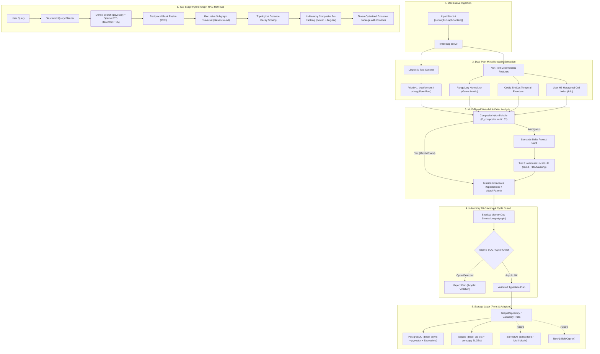

# Master Architecture & Technical Specification

## 1. Executive Summary & Vision
`embedag` is an enterprise-grade, 100% pure Rust framework providing an ergonomic, type-safe pipeline to:
1. **Convert and map arbitrary data structures into Directed Acyclic Graphs (DAGs)** using a hybrid blend of deterministic feature encoders and constrained Large Language Models (LLMs), with the **KitaSan stack (`oxibonsai`, `trustformers`) as Priority 1**.
2. **Handle live dynamic graph updates & mutations** atomically and safely, ensuring that when incoming entities modify existing nodes or branch relationships, the acyclic DAG invariant is strictly preserved.
3. **Resolve mixed-modality records (text and non-text continuous/temporal/spatial data)** deterministically, using bounded composite metrics (Gower + Angular + H3) and pre-computed numerical delta prompt cards for LLM inference.
4. **Persist and query these graphs efficiently** using relational backends (PostgreSQL and SQLite) via Diesel, recursive Common Table Expressions (CTEs via `diesel-cte-ext`), and hybrid vector/full-text Graph-RAG retrieval.
5. **Easily extend to multi-model and native graph databases** (such as SurrealDB and Neo4j) through storage-agnostic capability ports.

---

## 2. End-to-End System Architecture

---

## 3. Comprehensive Documentation Index (Sequential 00–12)

The technical documentation is organized in a strictly consecutive 2-digit sequence:

- **[00_MASTER_SPECIFICATIONS.md](file:///Users/yasuomaidana/RustRoverProjects/embedag/doc/00_MASTER_SPECIFICATIONS.md)**: Master technical blueprint and executive summary (this document).
- **[01_Development_Plan.md](file:///Users/yasuomaidana/RustRoverProjects/embedag/doc/01_Development_Plan.md)**: Agile engineering plan featuring 7 Milestones, 14 Epics, and 34 Tickets with explicit acceptance criteria and automated test suites.
- **[02_Crate_Ecosystem_and_Dependencies.md](file:///Users/yasuomaidana/RustRoverProjects/embedag/doc/02_Crate_Ecosystem_and_Dependencies.md)**: Multi-crate workspace topology (`embedag-core`, `embedag-derive`, `embedag-llm`, `embedag-diesel`, `embedag-rag`, `embedag`) and full dependency evaluation matrix with KitaSan stack as Priority 1.
- **[03_Design_Patterns.md](file:///Users/yasuomaidana/RustRoverProjects/embedag/doc/03_Design_Patterns.md)**: Idiomatic Rust and ML research patterns (Hexagonal Architecture, Index Arenas, Typestate Transitions, Draft-then-Decode, RRF, CTE Visitors).
- **[04_Core_Domain_and_DAG_Abstraction.md](file:///Users/yasuomaidana/RustRoverProjects/embedag/doc/04_Core_Domain_and_DAG_Abstraction.md)**: Core trait specifications (`AsGraphContext`, `GraphTarget`, `NodePayload`, `GraphClassifier`), `MemoryDag` arena, and lazy node hydration.
- **[05_Deterministic_Feature_Encoding_and_Multimodal.md](file:///Users/yasuomaidana/RustRoverProjects/embedag/doc/05_Deterministic_Feature_Encoding_and_Multimodal.md)**: Continuous scalar normalization, 2D cyclical time ($\sin/\cos$), pure Rust Uber H3 hexagonal indexing (`h3o`), and `trustformers` embeddings.
- **[06_LLM_Extraction_and_Constrained_Decoding.md](file:///Users/yasuomaidana/RustRoverProjects/embedag/doc/06_LLM_Extraction_and_Constrained_Decoding.md)**: Pure Rust `oxibonsai` local inference engine, universal `schemars` JSON Schema extraction, Pushdown Automaton logit masking, and KV cache reuse.
- **[07_Graph_Resolution_Diffing_and_Cycle_Guards.md](file:///Users/yasuomaidana/RustRoverProjects/embedag/doc/07_Graph_Resolution_Diffing_and_Cycle_Guards.md)**: 4-tier waterfall resolution (Alias Store $\to$ Hybrid Distance $\to$ `oxibonsai` LLM $\to$ Human Review), in-memory diffing, and Tarjan's SCC cycle guards.
- **[08_Relational_Persistence_Diesel_Postgres_SQLite.md](file:///Users/yasuomaidana/RustRoverProjects/embedag/doc/08_Relational_Persistence_Diesel_Postgres_SQLite.md)**: Relational junction schemas, `diesel-async` savepoints, SQLite BLOB vectors, and typed `WITH RECURSIVE` queries via `diesel-cte-ext`.
- **[09_Hybrid_Graph_RAG_and_Query_Engine.md](file:///Users/yasuomaidana/RustRoverProjects/embedag/doc/09_Hybrid_Graph_RAG_and_Query_Engine.md)**: Two-stage retrieval, typo-resilient RRF ($k=60$), topological distance decay, bounded subgraph expansion, and citation evidence packaging.
- **[10_External_Repositories_and_KitaSan_Stack.md](file:///Users/yasuomaidana/RustRoverProjects/embedag/doc/10_External_Repositories_and_KitaSan_Stack.md)**: Deep architectural analysis and integration roadmap for the **KitaSan stack** (`cool-japan/oxibonsai`, `cool-japan/trustformers`, `cool-japan/oxirs`) and `leynos/diesel-cte-ext`.
- **[11_Multi_Database_Extensibility_and_Future_Adapters.md](file:///Users/yasuomaidana/RustRoverProjects/embedag/doc/11_Multi_Database_Extensibility_and_Future_Adapters.md)**: Future database adapter evaluation (SurrealDB, Neo4j, LanceDB, Oxigraph), capability sub-traits (`GraphStorage`, `VectorIndex`, `AliasStorage`), and high-value roadmap capabilities (schema evolution, graph exports, community detection).
- **[12_Dynamic_Graph_Updates_and_Mixed_Modality_Resolution.md](file:///Users/yasuomaidana/RustRoverProjects/embedag/doc/12_Dynamic_Graph_Updates_and_Mixed_Modality_Resolution.md)**: 7-stage dynamic mutation lifecycle, shadow DAG cycle validation, unified mixed-modality representation, composite hybrid distance formula, and semantic delta prompt synthesis.

---

## 4. Key Performance Indicators & Non-Functional Requirements
1. **100% Pure Rust & Zero-FFI (Priority 1)**: Standardizing on `oxibonsai` and `trustformers` ensures compilation requires zero C/C++ compilers or external dynamic runtimes.
2. **Zero Runtime Borrow Panics**: Guaranteed via `petgraph` index arenas.
3. **Zero Infinite Loops**: Guaranteed via double cycle-checking (in-memory Tarjan SCC + SQL path tracking).
4. **Sub-Millisecond Fast Path**: Tier 1 alias resolution executes in $< 1\text{ms}$ with 0 LLM tokens.
5. **Sub-15ms Recursive Traversals**: Multi-hop subgraphs up to depth 5 retrieved in single database round-trips via CTEs.
6. **Code Complexity Limits**: Cyclomatic Complexity $\le 15$, Cognitive Complexity $\le 20$, 0 compiler/clippy warnings.
7. **Test Coverage Standard**: Minimum 85% branch and line coverage across all workspace crates.
