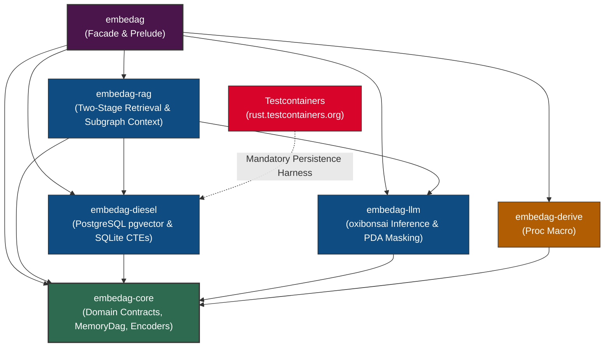

# Workspace Crate Topology & Architectural Boundaries

| Metadata           | Details                                                                                                            |
|:-------------------|:-------------------------------------------------------------------------------------------------------------------|
| **Document ID**    | `02_Workspace_Crate_Topology`                                                                                      |
| **Domain**         | Workspace Architecture & Crate Boundaries                                                                     |
| **Responsibility** | Internal Workspace Crate Topology, Scopes, Isolation Layers, and Dependency Directionality                         |
| **Target Crates**  | All Workspace Crates (`embedag-core`, `embedag-derive`, `embedag-llm`, `embedag-diesel`, `embedag-rag`, `embedag`) |
| **Status**         | Definitive Architectural Specification                                                                             |

---

## 1. Executive Summary & Architectural Role

`embedag` is structured as a modular Cargo workspace designed around **Hexagonal Architecture (Ports and Adapters)**. To guarantee separation of concerns, fast incremental compilation, and minimal dependency pollution, domain contracts are decoupled from database drivers, machine learning runtimes, and macro expansions.

No circular dependencies are permitted. Leaf crates (`embedag-core`) contain zero foreign database or inference dependencies. Higher-level adapter crates (`embedag-diesel`, `embedag-llm`, `embedag-rag`) depend strictly on `embedag-core` or each other through well-defined unidirectional interfaces.

---

## 2. Workspace Crate Topology & Dependency Graph



---

## 3. Internal Crate Scopes & Responsibilities

### 3.1 `embedag-core` (The Domain Core)
- **Role**: Pure domain contracts, data models, in-memory graph representation, deterministic mathematical encoders, and ports.
- **Key Types & Traits**: `AsGraphContext`, `NodePayload`, `GraphTarget`, `GraphClassifier`, `MemoryDag<T>`, `UnifiedNode<T>`, `GraphRepository`, `LlmProvider`.
- **Invariants**:
  - Zero heavy database drivers (no `diesel`, no `tokio-postgres`).
  - Zero C/C++ FFI dependencies.
  - Zero heavy neural inference frameworks.
  - Compiles in $< 2$ seconds.

### 3.2 `embedag-derive` (Procedural Macros)
- **Role**: Compile-time code generation for zero-boilerplate domain integration.
- **Key Macros**: `#[derive(AsGraphContext)]`, attributes `#[graph(key)]`, `#[graph(scalar)]`, `#[graph(temporal)]`, `#[graph(geo)]`.
- **Dependencies**: `syn` (v2), `quote` (v1), `proc-macro2` (v1).

### 3.3 `embedag-llm` (LLM & Constrained Inference Adapter)
- **Role**: Zero-FFI local inference, schema derivation, and constrained logit masking.
- **Primary Engine**: `cool-japan/oxibonsai` (Priority 1 pure Rust inference engine).
- **Secondary Engine**: Fallback cloud API adapters or `fastembed` where enabled via Cargo feature flags.
- **Key Modules**: Pushdown automaton (PDA) logit mask generation, `schemars` JSON schema reflection, Draft-Then-Decode cognitive scratchpad.

### 3.4 `embedag-diesel` (Relational Persistence Adapter)
- **Role**: Concrete implementation of `GraphRepository` using Diesel for PostgreSQL and SQLite.
- **Key Technologies**: `diesel-async` (for PostgreSQL pooling), `diesel` with bundled `libsqlite3-sys` (for SQLite), `pgvector` for vector embeddings, and `leynos/diesel-cte-ext` for recursive SQL CTE queries.
- **Mandatory Testing Harness**: **[Testcontainers for Rust](https://rust.testcontainers.org)** (`testcontainers = "0.27"`, `testcontainers-modules = { version = "0.15", features = ["postgres"] }`). Real containerized PostgreSQL + `pgvector` execution is mandatory for all persistence integration tests.
- **Invariants**: Supports atomic multi-row upserts (`INSERT ... ON CONFLICT`) and recursive cycle-defensive CTE traversals verified against containerized databases.

### 3.5 `embedag-rag` (Hybrid Retrieval & Query Engine)
- **Role**: Two-stage hybrid GraphRAG orchestration.
- **Pipeline**:
  1. Dense vector HNSW similarity combined with BM25 sparse lexical tokens via Reciprocal Rank Fusion (RRF).
  2. Multi-hop topological subgraph expansion with exponential distance decay.
  3. Grounded evidence packaging and citation attribution.

### 3.6 `embedag` (Facade Crate)
- **Role**: Top-level developer ergonomic entry point. Re-exports the entire stack under a clean prelude, gated by Cargo feature flags (`diesel`, `oxibonsai`, `rag`, `derive`).

---

## 4. Workspace Feature Matrix

```toml
[workspace]
members = [
    "crates/embedag-core",
    "crates/embedag-derive",
    "crates/embedag-llm",
    "crates/embedag-diesel",
    "crates/embedag-rag",
    "crates/embedag",
]
resolver = "2"
```

| Crate | Default Features | Optional Features |
| :--- | :--- | :--- |
| `embedag-core` | `std` | `serde`, `h3o`, `chrono` |
| `embedag-derive` | - | - |
| `embedag-llm` | `oxibonsai` | `fastembed`, `cloud-fallback` |
| `embedag-diesel` | `postgres-async`, `sqlite` | `pgvector`, `cte-ext` |
| `embedag-rag` | `full` | `bm25`, `metrics` |
| `embedag` | `all` | `minimal`, `sqlite-only`, `pg-only` |

### 4.1 Mandatory Test Dependencies Matrix

| Target Layer | Test Harness | Crates / Tools | Mandate & Purpose |
| :--- | :--- | :--- | :--- |
| **Relational Persistence** (`embedag-diesel`) | Containerized Integration Tests | `testcontainers = "0.27"`<br/>`testcontainers-modules = { version = "0.15", features = ["postgres"] }` | **Mandatory**: Verifies real PostgreSQL migrations, `pgvector` HNSW indexes, `SAVEPOINT` rollbacks, and recursive CTE execution in ephemeral Docker containers. |
| **In-Memory DAG & Core** (`embedag-core`) | Unit & Property Tests | `proptest`, `quickcheck` | Verifies topological invariants, Tarjan SCC cycle checks, and mathematical normalization bounds without I/O. |
| **Metaprogramming** (`embedag-derive`) | Macro AST Tests | `trybuild` | Verifies compile-pass and compile-fail diagnostics for procedural attribute macros. |

---

## 5. Architectural Invariants & Governance

1. **Unidirectional Dependency Direction**: Adapter crates depend on `embedag-core`; `embedag-core` never imports adapters.
2. **Feature Gate Isolation**: Compiling `embedag-core` without database features must never trigger SQL compilation.
3. **No Dynamic Runtime Linkage**: Every workspace crate must link statically, ensuring a single self-contained binary artifact.
4. **Mandatory Containerized Persistence Verification**: Persistent layer adapters must provide integration test suites backed by real throwaway Docker containers managed via [Testcontainers for Rust](https://rust.testcontainers.org). No PR touching persistence code may be merged without passing containerized tests in CI.
