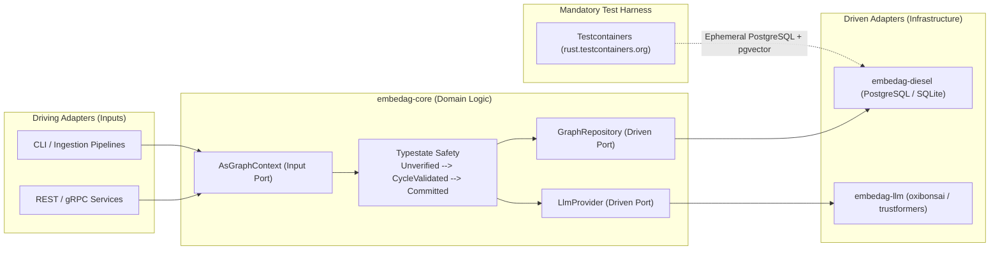

# Architectural & Rust Design Patterns

| Metadata | Details |
| :--- | :--- |
| **Document ID** | `03_Architectural_Design_Patterns` |
| **Domain** | Software Design Patterns & Quality Guardrails |
| **Responsibility** | Catalog of Architectural Design Patterns, Rust Idioms, and Code Complexity Limits |
| **Target Crates** | Entire `embedag` Workspace |
| **Status** | Definitive Architectural Specification |

---

## 1. Executive Summary & Design Philosophy

`embedag` adheres to rigorous, idiomatic Rust design patterns that enforce compile-time safety, zero-cost abstractions, deterministic execution, and low cognitive complexity. This document outlines the architectural patterns and quality metrics enforced across all codebase contributions.

---

## 2. Core Architectural & System Patterns



---

### 2.1 Hexagonal Architecture (Ports & Adapters)
- **Motivation**: Ensure domain logic (`embedag-core`) remains unaffected by changes in database drivers, vector indexes, or inference engines.
- **Implementation**:
  - Core defines abstract traits: `GraphRepository` (storage port) and `LlmProvider` (inference port).
  - External crates implement adapters: `embedag-diesel` implements `GraphRepository`; `embedag-llm` implements `LlmProvider`.
- **Benefit**: Enables testing the entire domain with zero database or network dependencies via in-memory mock repositories.

### 2.2 Index-Based Generational Arena Pattern (`petgraph`)
- **Motivation**: Prevent reference cycles, raw pointers, and complex lifetimes (`'a`) associated with standard heap-allocated node graphs (`Rc<RefCell<Node>>`).
- **Implementation**:
  - `MemoryDag<T>` uses `petgraph::graph::DiGraph<T, EdgePayload>`.
  - Nodes and edges are stored in contiguous `Vec` arenas indexed by lightweight `NodeIndex` integer handles.
  - A secondary hash index maps user business keys (`T::Key`) to internal `NodeIndex` handles.
- **Benefit**: Cache-locality, O(1) traversals, and trivial serialization without pointer hazards.

### 2.3 Typestate Pattern for Graph Mutations
- **Motivation**: Prevent unverified graph mutations containing circular loops from ever being persisted to storage.
- **Implementation**:
  ```rust
  pub struct Unverified;
  pub struct CycleValidated;
  pub struct Committed;

  pub struct MutationPlan<T: NodePayload, State> {
      directives: Vec<MutationDirective<T>>,
      _marker: std::marker::PhantomData<State>,
  }

  impl<T: NodePayload> MutationPlan<T, Unverified> {
      pub fn validate_cycles(self, dag: &MemoryDag<T>) -> Result<MutationPlan<T, CycleValidated>, DagError> {
          // Tarjan SCC cycle check on shadow graph
          dag.simulate_acyclic(&self.directives)?;
          Ok(MutationPlan { directives: self.directives, _marker: std::marker::PhantomData })
      }
  }

  impl<T: NodePayload> MutationPlan<T, CycleValidated> {
      pub async fn commit<R: GraphRepository<T>>(self, repo: &R) -> Result<MutationPlan<T, Committed>, RepoError> {
          repo.apply_mutation_batch(&self.directives).await?;
          Ok(MutationPlan { directives: self.directives, _marker: std::marker::PhantomData })
      }
  }
  ```
- **Benefit**: Attempting to commit an unverified mutation is a **compile-time error**.

### 2.4 Multi-Tiered Waterfall Resolution Pattern
- **Motivation**: Maximize processing throughput and minimize computational cost by evaluating cheap deterministic rules first before executing expensive neural models.
- **Execution Order**:
  1. *Tier 1*: O(1) Deterministic Exact Key & In-Memory LRU Alias Cache ($\approx 0.05\,\mu\text{s}$).
  2. *Tier 2*: Composite Hybrid Distance Thresholding ($\approx 5\,\mu\text{s}$).
  3. *Tier 3*: Constrained Pure-Rust LLM Inference ($\approx 10\,\text{ms}$).
  4. *Tier 4*: Dead-Letter Queue & Human-in-the-Loop Review.

### 2.5 Draft-Then-Decode Pattern (Cognitive Scratchpad)
- **Motivation**: Constrained logit masking on LLMs can trigger an *alignment tax*, degrading reasoning capabilities when forced immediately into strict JSON syntax.
- **Implementation**:
  The model's output schema requires an unconstrained reasoning scratchpad followed by the structured directive:
  ```json
  {
    "chain_of_thought": "Candidate A matches product weight and packaging, but differs in flavor...",
    "action": "insert_node",
    "confidence": 0.94
  }
  ```
- **Benefit**: Preserves natural language chain-of-thought while delivering 100% syntactically valid JSON.

### 2.6 Cycle-Guarded Recursive CTE Visitor Pattern
- **Motivation**: Prevent infinite recursion in relational SQL engines during multi-parent graph traversals.
- **Implementation**:
  Queries using `leynos/diesel-cte-ext` maintain an array of visited node IDs:
  ```sql
  WHERE NOT (child_id = ANY(visited_path))
  ```
- **Benefit**: Guaranteed acyclic termination in SQL without external depth counters.

### 2.7 Mandatory Ephemeral Containerized Integration Testing Pattern (`rust.testcontainers.org`)
- **Motivation**: Testing database adapters against mock repositories or in-memory SQLite creates a false sense of security (the *impedance mismatch fallacy*), masking defects in dialect-specific SQL features such as `pgvector` HNSW indexes, PostgreSQL transaction isolation levels, and array-tracked recursive CTE cycle prevention.
- **Implementation**:
  Persistent storage adapters (`embedag-diesel`) mandate the use of **[Testcontainers for Rust](https://rust.testcontainers.org)** (`testcontainers`) for integration testing:
  1. The test harness spins up an ephemeral Docker container running `pgvector/pgvector:pg16` with dynamically bound ports.
  2. Diesel migrations run on the blank container to construct real tables, indexes, and constraints.
  3. Integration tests validate real SQL statements, transactional `SAVEPOINT` rollbacks, and vector search operations.
  4. RAII container guards terminate and purge the container upon completion.
- **Benefit**: 100% production fidelity, deterministic reproduction of database constraints, zero cross-test interference, and elimination of host-installed database requirements.

---

## 3. Code Quality & Complexity Guardrails

Governed by the `pattern-complexity-auditor` skill:
1. **Cyclomatic Complexity**: No function may exceed a cyclomatic complexity of $15$. Complex dispatch logic must be broken into separate strategy handlers.
2. **Cognitive Complexity**: No nested blocks beyond $3$ levels deep. Guard clauses (`let ... else { return; }`) must be used for early exits.
3. **Error Handling**: No `unwrap()` or `expect()` in production library code (`embedag-core`, `embedag-diesel`, `embedag-rag`). Errors must be modeled as typed enums using `thiserror`.
4. **Zero Unsound `unsafe`**: `#![forbid(unsafe_code)]` is enforced on all domain crates.
5. **Mandatory Container Testing Gate**: No persistence layer code or schema migration may be released without verifying all integration tests against live containerized databases via `testcontainers`.
