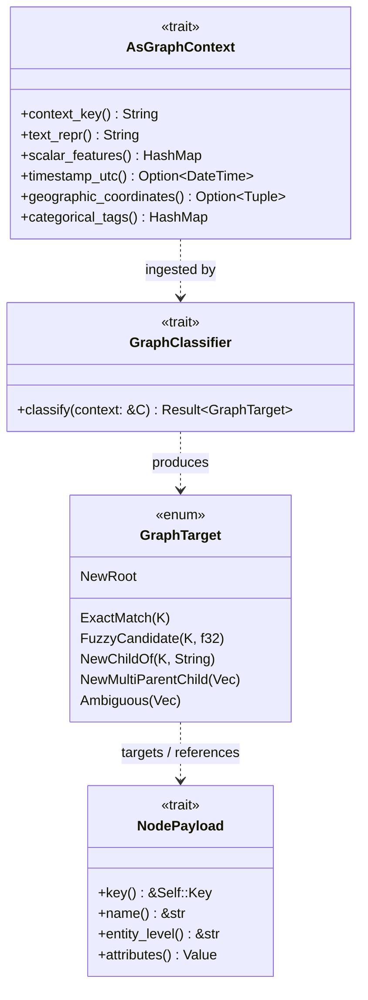

# Core Domain & Entity Contracts

| Metadata | Details |
| :--- | :--- |
| **Document ID** | `04_Core_Domain_and_Entity_Contracts` |
| **Domain** | Core Domain Models & Entity Abstractions |
| **Responsibility** | Public Trait Contracts, Entity Payloads, Dynamic Payloads, and Lazy References |
| **Target Crates** | `embedag-core` |
| **Status** | Definitive Architectural Specification |

---

## 1. Executive Summary & Architectural Role

The `embedag-core` crate encapsulates the core data contracts of the `embedag` ecosystem. It defines how raw application data is presented to the graph engine, how entities are identified, and how classifications and relationships are structured.

By maintaining strict object safety and zero external database dependencies, these contracts can be implemented by any business struct, whether embedded in a web server, CLI tool, or batch data ingestion pipeline.

---

## 2. Core Domain Traits & Contracts



---

### 2.1 The Ingestion Contract: `AsGraphContext`
Any application record seeking graph classification or entity resolution implements `AsGraphContext`. It provides text for linguistic embedding, continuous scalars, cyclical temporal dimensions, spatial coordinates, and categorical tags.

```rust
use std::collections::HashMap;

/// Contract for turning domain data structures into multi-modal graph context.
pub trait AsGraphContext: Send + Sync {
    /// Unique business key identifying this record within its source system.
    fn context_key(&self) -> String;

    /// Primary text representation for dense linguistic embeddings.
    fn text_repr(&self) -> String;

    /// Optional token weights for lexical/BM25 sparse retrieval.
    fn sparse_lexical_tokens(&self) -> Vec<(u32, f32)> {
        Vec::new()
    }

    /// Continuous numeric scalar dimensions (e.g. weight, volume, price).
    fn scalar_features(&self) -> HashMap<String, f64> {
        HashMap::new()
    }

    /// UTC timestamp for temporal analysis.
    fn timestamp_utc(&self) -> Option<chrono::DateTime<chrono::Utc>> {
        None
    }

    /// Optional geographic coordinates (longitude, latitude) in WGS84.
    fn geographic_coordinates(&self) -> Option<(f64, f64)> {
        None
    }

    /// Categorical tags or taxonomy breadcrumbs.
    fn categorical_tags(&self) -> HashMap<String, String> {
        HashMap::new()
    }
}
```

### 2.2 The Node Payload Contract: `NodePayload`
`NodePayload` defines the payload stored within each graph node.

```rust
use std::hash::Hash;
use serde::{Serialize, de::DeserializeOwned};

/// Payload contract for nodes stored within the directed acyclic graph.
pub trait NodePayload: Clone + Send + Sync + 'static {
    /// The unique primary key type for node lookup (e.g., Uuid, String, i64).
    type Key: Eq + Hash + Clone + Send + Sync + std::fmt::Display;

    /// Returns the unique primary business key of this node.
    fn key(&self) -> &Self::Key;

    /// Returns the human-readable entity name or label.
    fn name(&self) -> &str;

    /// Returns the hierarchical entity level (e.g., "Category", "Product", "Variant").
    fn entity_level(&self) -> &str;

    /// Returns arbitrary structured metadata serialized as JSON.
    fn attributes(&self) -> serde_json::Value {
        serde_json::Value::Null
    }
}
```

### 2.3 The Target Classification Contract: `GraphTarget`
When the resolution engine classifies an input context, it produces a `GraphTarget`:

```rust
#[derive(Debug, Clone, PartialEq)]
pub enum GraphTarget<K> {
    /// Exact match with an existing node key.
    ExactMatch(K),
    /// Fuzzy candidate match with an associated similarity score in [0.0, 1.0].
    FuzzyCandidate { key: K, similarity: f32 },
    /// Placement as a child of an existing parent node with relationship semantics.
    NewChildOf { parent_key: K, relationship: String },
    /// Placement as a multi-parent child of multiple existing parents.
    NewMultiParentChild { parent_keys: Vec<(K, String)> },
    /// Creation of a brand new root node.
    NewRoot,
    /// Ambiguous match requiring human arbitration or LLM fallback.
    Ambiguous(Vec<(K, f32)>),
}
```

### 2.4 The Dynamic Classifier Contract: `GraphClassifier`
`GraphClassifier` defines the asynchronous interface for determining graph placement:

```rust
#[async_trait::async_trait]
pub trait GraphClassifier<T: NodePayload>: Send + Sync {
    type Error: std::error::Error + Send + Sync + 'static;

    /// Evaluates an incoming context against the graph and predicts its placement.
    async fn classify<C: AsGraphContext>(
        &self,
        context: &C,
    ) -> Result<GraphTarget<T::Key>, Self::Error>;
}
```

---

## 3. Lazy Node Evaluation: `LazyNodeRef<T>`

In high-throughput environments, loading thousands of full node payloads during graph traversal causes severe memory bloat. `embedag-core` provides `LazyNodeRef<T>` to defer payload hydration until explicitly accessed:

```rust
use std::sync::Arc;
use tokio::sync::OnceCell;

pub struct LazyNodeRef<T: NodePayload> {
    pub id: uuid::Uuid,
    pub key: T::Key,
    pub entity_level: String,
    loader: Arc<dyn Fn(uuid::Uuid) -> futures::future::BoxFuture<'static, Result<T, String>> + Send + Sync>,
    cached_payload: OnceCell<T>,
}

impl<T: NodePayload> LazyNodeRef<T> {
    pub async fn get_payload(&self) -> Result<&T, String> {
        self.cached_payload
            .get_or_try_init(|| (self.loader)(self.id))
            .await
    }
}
```

---

## 4. Invariants & Guarantees

1. **Object Safety**: `AsGraphContext` and `NodePayload` are object-safe or provide object-safe dispatch wrappers.
2. **Deterministic Hash Identity**: `NodePayload::Key` must implement `Eq + Hash` with deterministic behavior across program executions.
3. **No Unbounded Memory Leaks**: `LazyNodeRef<T>` caches payloads using thread-safe, non-blocking cells without holding write locks across await points.
