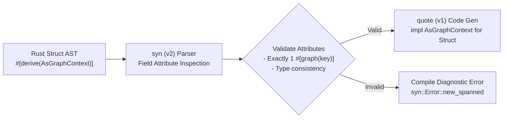

# Procedural Derive Macros (`embedag-derive`)

| Metadata | Details |
| :--- | :--- |
| **Document ID** | `06_Procedural_Derive_Macros` |
| **Domain** | Metaprogramming & Compile-Time AST Generation |
| **Responsibility** | Procedural Macro Implementation for Zero-Boilerplate Ingestion (`#[derive(AsGraphContext)]`) |
| **Target Crates** | `embedag-derive` |
| **Status** | Definitive Architectural Specification |

---

## 1. Executive Summary & Architectural Role

Integrating domain structures with `embedag` should not require hundreds of lines of manual serialization and feature extraction boilerplate. The `embedag-derive` crate provides procedural derive macros that inspect user structs at compile-time and automatically generate implementations of the `AsGraphContext` trait.

Using declarative field attributes (`#[graph(key)]`, `#[graph(scalar)]`, `#[graph(temporal)]`, `#[graph(geo)]`), developers annotate their domain entities with zero runtime overhead.

---

## 2. Macro API & Usage Example



---

```rust
use embedag::prelude::*;
use chrono::{DateTime, Utc};

#[derive(Debug, Clone, AsGraphContext)]
pub struct ProductInvoiceItem {
    #[graph(key)]
    pub sku: String,

    #[graph(text)]
    pub description: String,

    #[graph(scalar(min = 0.0, max = 1000.0))]
    pub weight_grams: f64,

    #[graph(scalar)]
    pub price_usd: f64,

    #[graph(temporal)]
    pub invoice_date: DateTime<Utc>,

    #[graph(geo)]
    pub warehouse_location: (f64, f64), // (lon, lat)

    #[graph(tag)]
    pub supplier_category: String,
}
```

---

## 3. Generated Code Architecture

When `#[derive(AsGraphContext)]` is invoked on the struct above, `embedag-derive` emits:

```rust
impl ::embedag::traits::AsGraphContext for ProductInvoiceItem {
    fn context_key(&self) -> String {
        self.sku.to_string()
    }

    fn text_repr(&self) -> String {
        self.description.clone()
    }

    fn scalar_features(&self) -> ::std::collections::HashMap<String, f64> {
        let mut map = ::std::collections::HashMap::new();
        map.insert("weight_grams".to_string(), self.weight_grams as f64);
        map.insert("price_usd".to_string(), self.price_usd as f64);
        map
    }

    fn timestamp_utc(&self) -> Option<::chrono::DateTime<::chrono::Utc>> {
        Some(self.invoice_date)
    }

    fn geographic_coordinates(&self) -> Option<(f64, f64)> {
        Some(self.warehouse_location)
    }

    fn categorical_tags(&self) -> ::std::collections::HashMap<String, String> {
        let mut map = ::std::collections::HashMap::new();
        map.insert("supplier_category".to_string(), self.supplier_category.clone());
        map
    }
}
```

---

## 4. Attribute Grammar & Compile-Time Diagnostics

The macro parser parses struct fields using `syn` and validates annotations:

| Field Attribute | Allowed Types | Validation / Error Generated |
| :--- | :--- | :--- |
| `#[graph(key)]` | `Display` (String, Uuid, integer) | Exactly one `key` attribute is required. Multiple keys trigger a compile error. |
| `#[graph(text)]` | `AsRef<str>` | At least one field should provide text representation. |
| `#[graph(scalar)]`| Numeric types (`f64`, `f32`, integer) | Non-numeric fields annotated with `scalar` emit a clear error message. |
| `#[graph(temporal)]`| `DateTime<Utc>`, `NaiveDateTime` | Non-date fields trigger an invalid type error. |
| `#[graph(geo)]` | `(f64, f64)` | Must be a two-element tuple representing `(longitude, latitude)`. |
| `#[graph(tag)]` | `Display` | Emits string key-value entry. |

### 4.1 Compile-Time Error Reporting
If a developer annotates multiple fields with `#[graph(key)]`, the macro emits a precise compile diagnostic:
```
error: Only one field may be annotated with #[graph(key)]
  --> src/models.rs:14:5
   |
14 |     #[graph(key)]
   |     ^^^^^^^^^^^^^ duplicate key specification
```

---

## 5. Invariants & Hygiene

1. **Full Path Qualification**: All generated code references types via `::embedag::traits::*` or `::core::*` to avoid scope collisions with user imports.
2. **Zero Runtime Reflection**: All property offsets, dictionary insertions, and formatting are resolved during `cargo build`.
