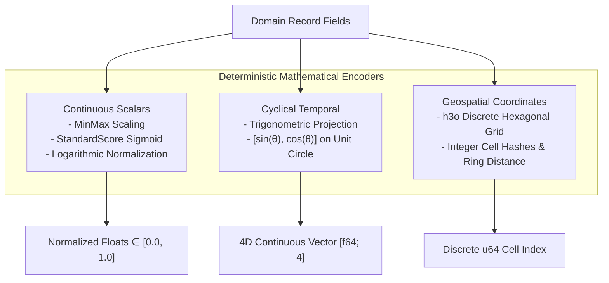

# Deterministic Feature Encoding

| Metadata | Details |
| :--- | :--- |
| **Document ID** | `07_Deterministic_Feature_Encoding` |
| **Domain** | Deterministic Feature Engineering & Mathematical Transformation |
| **Responsibility** | Exact Mathematical Transformations of Continuous Scalars, Cyclical Time, and Geospatial Hexagonal Cells |
| **Target Crates** | `embedag-core` |
| **Status** | Definitive Architectural Specification |

---

## 1. Architectural Motivation: Separation of Determinism vs. Probability

A fundamental flaw in naive Vector RAG and LLM systems is treating numerical, temporal, and spatial quantities as natural language text.
- **Numbers**: If an invoice says `50g` vs `500g`, an LLM or dense vector model yields a cosine similarity $\approx 0.96$ because both strings share identical product and token contexts. The critical $10\times$ difference in physical weight is lost in the vector projection.
- **Time**: Midnight boundary intervals (e.g., $23:58$ and $00:03$) are mathematically $5$ minutes apart, but lexicographically and numerically appear disjoint ($23$ vs $00$).
- **Geography**: Longitude and latitude coordinates formatted as strings lack Euclidean or geodesic geometry awareness when tokenized.

`embedag` enforces **strict separation of concerns**: continuous numbers, time intervals, and geographic positions are processed through **deterministic mathematical encoders**, guaranteeing exact, reproducible results with zero hallucination.

---

## 2. Deterministic Feature Encoders



---

### 2.1 Continuous Scalar Normalization
Continuous scalar fields (e.g. price, weight, volume, dimensions) are scaled into bounded intervals $[0.0, 1.0]$:

```rust
pub enum ScalarScaling {
    /// Bounded interval normalization: (x - min) / (max - min)
    MinMax { min: f64, max: f64 },
    /// Standard score normalization with sigmoid squashing: 1 / (1 + exp(-(x - mean)/std))
    StandardScoreSigmoid { mean: f64, std_dev: f64 },
    /// Scale-free logarithmic scaling: log(1 + x) / log(1 + max)
    Logarithmic { max: f64 },
}

impl ScalarScaling {
    pub fn transform(&self, value: f64) -> f64 {
        match self {
            ScalarScaling::MinMax { min, max } => {
                if (max - min).abs() < f64::EPSILON {
                    0.0
                } else {
                    ((value - min) / (max - min)).clamp(0.0, 1.0)
                }
            }
            ScalarScaling::StandardScoreSigmoid { mean, std_dev } => {
                let z = (value - mean) / std_dev.max(f64::EPSILON);
                1.0 / (1.0 + (-z).exp())
            }
            ScalarScaling::Logarithmic { max } => {
                let v = value.max(0.0);
                (1.0 + v).ln() / (1.0 + max).ln()
            }
        }
    }
}
```

### 2.2 Cyclical Temporal Encoding
Time is periodic. Hours repeat every 24 hours, days of the week repeat every 7 days, and days of the year repeat every 365 days. `embedag` projects temporal values onto the trigonometric unit circle:

$$\sin\left(\frac{2\pi \cdot t}{T}\right), \quad \cos\left(\frac{2\pi \cdot t}{T}\right)$$

```rust
use chrono::{DateTime, Utc, Timelike, Datelike};

pub struct CyclicalTimeEncoder;

impl CyclicalTimeEncoder {
    /// Returns 4-dimensional continuous vector: [sin_hour, cos_hour, sin_day, cos_day]
    pub fn encode(dt: &DateTime<Utc>) -> [f64; 4] {
        let hour = dt.hour() as f64 + (dt.minute() as f64 / 60.0);
        let tau = 2.0 * std::f64::consts::PI;

        let hour_angle = (hour / 24.0) * tau;
        let day_angle = ((dt.ordinal0() as f64) / 365.25) * tau;

        [
            hour_angle.sin(),
            hour_angle.cos(),
            day_angle.sin(),
            day_angle.cos(),
        ]
    }
}
```

This ensures that $23:59$ and $00:01$ have near-zero Euclidean distance on the unit circle.

### 2.3 Geospatial Hierarchical Hexagonal Indexing (`h3o`)
Instead of floating-point Haversine distance computations across every candidate node, `embedag` maps coordinates into **discrete hexagonal spatial cells** using the pure-Rust `h3o` crate:

```rust
use h3o::{CellIndex, LatLng, Resolution};

pub struct GeospatialEncoder;

impl GeospatialEncoder {
    /// Encodes (longitude, latitude) into an H3 Cell Index at target resolution.
    /// Resolution 8 represents ~460m edge length; Resolution 9 represents ~170m edge length.
    pub fn encode(lon: f64, lat: f64, resolution: u8) -> Result<u64, String> {
        let res = Resolution::try_from(resolution).map_err(|e| e.to_string())?;
        let coord = LatLng::new(lat, lon).map_err(|e| e.to_string())?;
        let cell = coord.to_cell(res);
        Ok(u64::from(cell))
    }

    /// Computes discrete topological grid ring distance between two H3 cells.
    pub fn grid_distance(cell_a: u64, cell_b: u64) -> Result<u32, String> {
        let c_a = CellIndex::try_from(cell_a).map_err(|e| e.to_string())?;
        let c_b = CellIndex::try_from(cell_b).map_err(|e| e.to_string())?;
        c_a.grid_distance(c_b).map_err(|e| e.to_string())
    }
}
```

---

## 3. Invariants & Performance Guarantees

1. **Sub-Microsecond Execution**: Feature encoding executes in $< 1\,\mu\text{s}$ per record, running entirely in CPU registers and L1 cache.
2. **Deterministic Reproducibility**: Given the same inputs, the encoders produce bit-for-bit identical floats and integer cell hashes.
3. **Zero Dynamic Allocation**: Cyclical temporal and H3 encoders use stack-allocated arrays `[f64; 4]` and `u64` integers with zero heap allocations.
