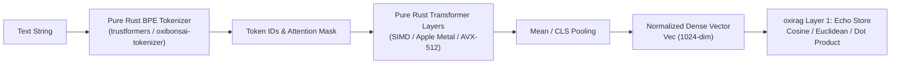
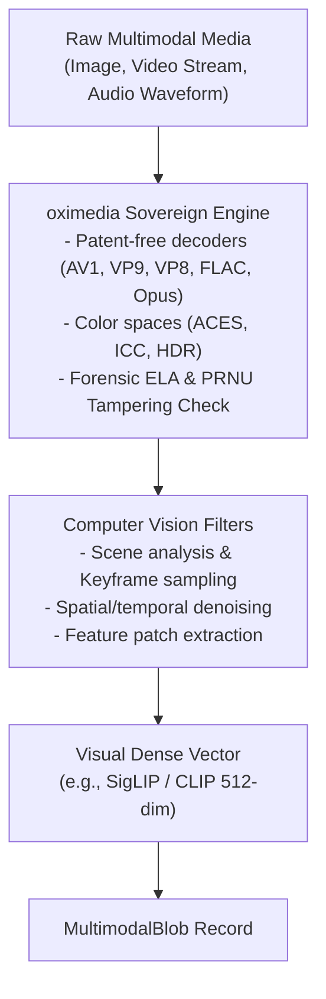

# Neural & Multimodal Embeddings

| Metadata | Details |
| :--- | :--- |
| **Document ID** | `08_Neural_and_Multimodal_Embeddings` |
| **Domain** | Neural Linguistic & Multimodal Vector Pipelines |
| **Responsibility** | Local Dense Neural Text Embeddings, BPE Tokenization, Pure-Rust Multimedia Ingestion via `oximedia`, and Vector Management via `oxirag` |
| **Target Crates** | `embedag-llm`, `embedag-core`, `embedag-rag` |
| **Status** | Definitive Architectural Specification |

---

## 1. Executive Summary & Architectural Role

While continuous numbers and coordinates are encoded deterministically, natural language text requires **dense semantic vector embeddings** to capture synonymy, intent, and semantic proximity. Furthermore, multimodal entities (scanned invoices, product catalog photographs, video keyframes, audio telemetry) require patent-free, memory-safe media processing.

To satisfy `embedag`'s core tenet of **100% Pure Rust with Zero C/C++ FFI**, neural embeddings and multimodal pipelines are powered strictly by the **KitaSan open-source foundation (`cool-japan` / COOLJAPAN OÜ)**:
- **`cool-japan/trustformers` & `cool-japan/oxirag` (Priority 1)** for pure-Rust transformer embeddings and in-memory vector storage (Layer 1: Echo).
- **`cool-japan/oximedia` (Priority 1)** for pure-Rust multimedia codec processing and computer vision without FFmpeg/OpenCV C shared libraries.

Secondary backends (such as ONNX Runtime via `fastembed-rs`) are available only behind optional feature gates.

---

## 2. In-Process Neural Embedding Engine: `trustformers` & `oxirag` (Priority 1)

### 2.1 The KitaSan Foundation
- **Crates**: `trustformers` and `oxirag` (Layer 1: Echo vector store).
- **Zero FFI**: 100% written in Rust. No Python, no LibTorch, no C++ compilation required.
- **Embedded Inference**: Runs in-process with the Rust application binary, eliminating network round-trip overhead.
- **Supported Models**: BGE-M3 (1024-dimension multilingual), MiniLM-L6-v2 (384-dimension lightweight).



### 2.2 The Embedding Engine Interface
```rust
#[async_trait::async_trait]
pub trait TextEmbedder: Send + Sync {
    type Error: std::error::Error + Send + Sync + 'static;

    /// Embeds a single text string into a normalized dense vector.
    async fn embed_text(&self, text: &str) -> Result<Vec<f32>, Self::Error>;

    /// Batched embedding generation.
    async fn embed_batch(&self, texts: &[String]) -> Result<Vec<Vec<f32>>, Self::Error>;

    /// Dimensionality of the produced vectors (e.g. 384 or 1024).
    fn dimensions(&self) -> usize;
}
```

---

## 3. Multimodal Asset Pipeline via `cool-japan/oximedia` (Priority 1)

Enterprise document processing frequently requires analyzing visual images (scanned receipts, PDF invoices, product photos), video keyframes, or audio sensor signals. Traditional solutions rely on C-heavy FFmpeg and OpenCV binaries that introduce security vulnerabilities and cross-compilation friction.

`embedag` integrates **`cool-japan/oximedia`**—the sovereign pure-Rust reconstruction of FFmpeg (multimedia) and OpenCV (computer vision):



### 3.1 Forensic Tampering Verification & Computer Vision
Before extracting textual entities from invoice scans, `oximedia` provides forensic analysis:
- **Error Level Analysis (ELA)**: Detects digital image manipulation or fraudulent price edits in scanned invoices.
- **Photo-Response Non-Uniformity (PRNU)**: Verifies camera sensor signature integrity.
- **Patent Freedom**: Relies strictly on royalty-free codecs (AV1, VP9, Opus, FLAC).

### 3.2 Multimodal Blob Representation
```rust
/// Represents an audited, preprocessed multimodal asset payload.
#[derive(Debug, Clone, serde::Serialize, serde::Deserialize, PartialEq)]
pub struct MultimodalBlob {
    /// MIME type (e.g., "image/png", "video/webm", "audio/flac")
    pub mime_type: String,
    /// Persistent storage URI or SHA-256 content address
    pub storage_uri: String,
    /// Extracted visual or acoustic embedding vector
    pub precomputed_vector: Vec<f32>,
    /// Forensic tampering confidence score (0.0 = tampered, 1.0 = verified original)
    pub integrity_confidence: f32,
}
```

---

## 4. Secondary & Fallback Backends

For environments where specific ONNX model weights or external APIs are mandated by legacy systems, `embedag` provides an abstraction layer:

```rust
pub enum EmbeddingBackend {
    /// Priority 1: Pure Rust trustformers & oxirag in-process engine
    Trustformers,
    /// Priority 2: ONNX Runtime via fastembed-rs (optional feature)
    FastEmbedOnnx,
    /// Priority 3: Remote Cloud API (optional feature for cloud-only setups)
    RemoteCloud { endpoint: String, api_key: String },
}
```

---

## 5. Invariants & Performance Guarantees

1. **L2 Normalization**: All vectors emitted by `TextEmbedder` are normalized to unit length ($\|v\|_2 = 1.0$), ensuring that dot product equals cosine similarity:
   $$\cos(u, v) = u \cdot v$$
2. **Zero FFI Leakage in Default Build**: With default Cargo features enabled, `cargo build` links zero dynamic C libraries (no `libavcodec`, no `libopencv`, no `libtorch`).
3. **Batch Throughput**: In-process SIMD vector generation achieves $> 1,000$ sentences/sec per core on modern x86_64 / Apple Silicon.
4. **Forensic Integrity**: Multimodal blobs with forensic integrity score $< 0.80$ automatically route to Tier 4 human verification.
