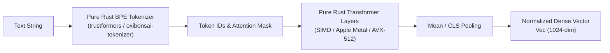

# Neural & Multimodal Embeddings

| Metadata | Details |
| :--- | :--- |
| **Document ID** | `08_Neural_and_Multimodal_Embeddings` |
| **Domain** | Neural Linguistic & Multimodal Vector Pipelines |
| **Responsibility** | Local Dense Neural Text Embeddings, BPE Tokenization, and Multimodal Feature Vector Ingestion |
| **Target Crates** | `embedag-llm`, `embedag-core` |
| **Status** | Definitive Architectural Specification |

---

## 1. Executive Summary & Architectural Role

While continuous numbers and coordinates are encoded deterministically, natural language text requires **dense semantic vector embeddings** to capture synonymy, intent, and semantic proximity.

To satisfy `embedag`'s core tenet of **100% Pure Rust with Zero C/C++ FFI**, neural embeddings are powered primarily by **`cool-japan/trustformers` (Priority 1)**. Secondary backends (such as ONNX Runtime via `fastembed-rs`) are available behind optional feature gates.

---

## 2. In-Process Neural Embedding Engine: `trustformers` (Priority 1)

### 2.1 The KitaSan Foundation
- **Crate**: `trustformers` (part of the KitaSan ecosystem by COOLJAPAN OÜ).
- **Zero FFI**: 100% written in Rust. No Python, no LibTorch, no C++ compilation required.
- **Embedded Inference**: Runs in-process with the Rust application binary, eliminating network round-trip overhead.
- **Supported Models**: BGE-M3 (1024-dimension multilingual), MiniLM-L6-v2 (384-dimension lightweight).



### 2.2 The Embedding Engine Interface
```rust
#[async_trait::async_trait]
pub trait TextEmbedder: Send + Sync {
    type Error: std::error::Error + Send + Sync + 'static;

    /// Embeds a single text string into a normalized dense vector.
    async fn embed_text(&self, text: &str) -> Result<Vec<f32>, Self::Error>;

    /// Batched embedding generation.
    async fn embed_batch(&self, texts: &[String]) -> Result<Vec<Vec<f32>>, Self::Error>;

    /// Dimensionality of the produced vectors (e.g. 384 or 1024).
    fn dimensions(&self) -> usize;
}
```

---

## 3. Secondary & Fallback Backends

For environments where specific ONNX model weights or external APIs are mandated by legacy systems, `embedag` provides an abstraction layer:

```rust
pub enum EmbeddingBackend {
    /// Priority 1: Pure Rust trustformers in-process engine
    Trustformers,
    /// Priority 2: ONNX Runtime via fastembed-rs (optional feature)
    FastEmbedOnnx,
    /// Priority 3: Remote Cloud API (optional feature for cloud-only setups)
    RemoteCloud { endpoint: String, api_key: String },
}
```

---

## 4. Multimodal Asset Pipeline (Images, Audio, Telemetry)

When records include images (e.g. product photos, scanned receipt images) or audio telemetry:
1. **Visual Feature Vectors**: Pre-extracted visual embeddings (e.g., CLIP / SigLIP 512-dim vectors) are ingested directly into the record payload.
2. **Multimodal Blob Reference**:
   ```rust
   pub struct MultimodalBlob {
       pub mime_type: String,               // e.g. "image/jpeg", "audio/wav"
       pub storage_uri: String,             // S3 / filesystem URI
       pub precomputed_vector: Vec<f32>,    // Normalized dense visual embedding
   }
   ```
3. **Cross-Modal Fusion**: Text and image vectors can be projected into a joint multimodal embedding space or evaluated as separate dimensions within the Composite Hybrid Distance Engine.

---

## 5. Invariants & Performance Guarantees

1. **L2 Normalization**: All vectors emitted by `TextEmbedder` are normalized to unit length ($\|v\|_2 = 1.0$), ensuring that dot product equals cosine similarity:
   $$\cos(u, v) = u \cdot v$$
2. **Zero FFI Leakage in Default Build**: With default Cargo features enabled, `cargo build` links zero dynamic C libraries.
3. **Batch Throughput**: In-process SIMD vector generation achieves $> 1,000$ sentences/sec per core on modern x86_64 / Apple Silicon.
