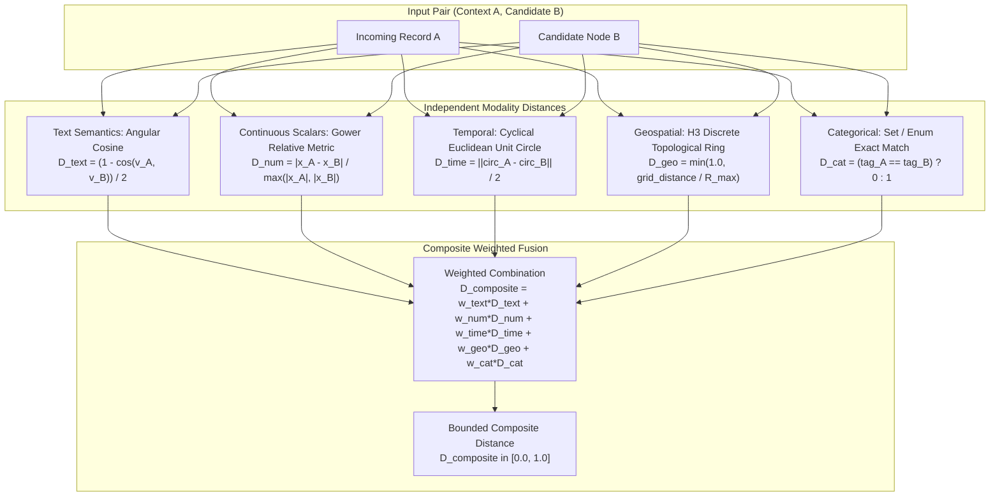

# Mixed-Modality Representation & Similarity Engine

| Metadata | Details |
| :--- | :--- |
| **Document ID** | `09_Mixed_Modality_Representation_and_Similarity` |
| **Domain** | Multi-Modal Entity Representation & Hybrid Distance Metrics |
| **Responsibility** | Specification of `UnifiedNode<T>`, Composite Hybrid Distance Metric, and LLM Comparison Delta Synthesis |
| **Target Crates** | `embedag-core`, `embedag-llm` |
| **Status** | Definitive Architectural Specification |

---

## 1. Executive Summary & Problem Formulation

Real-world business entities are rarely pure text. Consider resolving:
> *"Carlos V Dark Chocolate 50g bar, $1.25 USD, scanned at Mexico City Distribution Center (-99.1332, 19.4326)"*

- Comparing raw text vectors ignores that `50g` and `500g` are $10\times$ different in physical product weight.
- Comparing raw coordinates in SQL fails to recognize linguistic synonyms (*"Dark Choc"* vs *"Dark Chocolate"*).

`embedag` solves this with a **Unified Typed Entity Model** and a **Composite Hybrid Distance Engine**, mathematically combining dense semantics, scalar intervals, cyclic time, and discrete spatial grids into a single bounded metric $D_{\text{composite}} \in [0.0, 1.0]$.

---

## 2. The Unified Typed Entity Model: `UnifiedNode<T>`

```rust
use std::collections::HashMap;
use uuid::Uuid;
use chrono::{DateTime, Utc};
use crate::traits::NodePayload;

pub struct UnifiedNode<T: NodePayload> {
    pub id: Uuid,
    pub key: T::Key,
    pub payload: T,

    // 1. Semantic Linguistic Modality
    pub dense_embedding: Vec<f32>,              // 1024-dim BGE-M3 text vector via trustformers
    pub sparse_lexical_tokens: Vec<(u32, f32)>, // BM25 lexical weights for exact SKU/name tokens

    // 2. Continuous & Numeric Modality (SI Standardized)
    pub scalar_features: HashMap<String, f64>,  // e.g. "weight_grams": 50.0, "price_usd": 1.25

    // 3. Temporal Modality (Continuous & Cyclical)
    pub timestamp_utc: DateTime<Utc>,
    pub cyclical_time: [f64; 4],                // [sin(hour), cos(hour), sin(day), cos(day)]

    // 4. Geospatial Modality (Discrete Topology)
    pub spatial_h3_cell: Option<u64>,           // Uber H3 resolution 9 discrete index

    // 5. Categorical Modality
    pub categorical_tags: HashMap<String, String>, // e.g. "packaging": "bar", "currency": "USD"
}
```

---

## 3. The Composite Hybrid Distance Engine

The composite distance between an incoming context $A$ and a candidate node $B$ is a weighted combination:

$$D_{\text{composite}}(A, B) = w_{\text{text}} D_{\text{text}} + w_{\text{num}} D_{\text{num}} + w_{\text{time}} D_{\text{time}} + w_{\text{geo}} D_{\text{geo}} + w_{\text{cat}} D_{\text{cat}}$$

Where $\sum w_i = 1.0$ and $D \in [0.0, 1.0]$.



| Modality | Metric Applied | Mathematical Formula |
| :--- | :--- | :--- |
| **Text (Semantic)** | Angular Cosine | $D_{\text{text}} = (1 - \cos(v_A, v_B))/2$ |
| **Text (Lexical BM25)** | Token Overlap | $D_{\text{lex}} = 1 - \text{Jaccard}(\text{tokens})$ |
| **Numeric (Scalars)** | Gower Relative | $D_{\text{num}} = |x_A - x_B| / \max(|x_A|, |x_B|)$ |
| **Temporal (Cyclic)** | Euclidean Circle | $D_{\text{time}} = \|\text{circ}_A - \text{circ}_B\|/2$ |
| **Geospatial (H3)** | Integer Grid Ring | $D_{\text{geo}} = \min(1.0, \text{rings}/R_{\text{max}})$ |
| **Categorical (Enums)**| Exact Match | $D_{\text{cat}} = (\text{tag}_A == \text{tag}_B)? 0:1$ |

### 3.1 Mathematical Distance Formulations

1. **Angular Cosine Distance ($D_{\text{text}}$)**:
   For unit-normalized vectors $v_A, v_B$:
   $$D_{\text{text}} = \frac{1 - (v_A \cdot v_B)}{2}$$

2. **Gower Relative Scalar Distance ($D_{\text{num}}$)**:
   For each scalar dimension $k$:
   $$D_{\text{num}, k} = \frac{|x_{A,k} - x_{B,k}|}{\max(|x_{A,k}|, |x_{B,k}|, \epsilon)}$$
   For a $50\text{g}$ item vs a $500\text{g}$ item, $D_{\text{num}} = \frac{450}{500} = 0.90$. This reliably blocks false positive mergers of different product package sizes.

3. **Cyclical Temporal Distance ($D_{\text{time}}$)**:
   $$D_{\text{time}} = \frac{1}{2} \sqrt{(\sin\theta_A - \sin\theta_B)^2 + (\cos\theta_A - \cos\theta_B)^2}$$
   Timestamps at $23:58$ and $00:03$ evaluate to $D_{\text{time}} \approx 0.003$.

4. **Geospatial H3 Grid Distance ($D_{\text{geo}}$)**:
   Using `h3o` discrete hexagonal rings:
   $$D_{\text{geo}} = \min\left(1.0, \frac{\text{grid\_distance}(\text{cell}_A, \text{cell}_B)}{R_{\text{max}}}\right)$$

---

## 4. Structured LLM Comparison Delta Synthesis

When $D_{\text{composite}}$ falls into the ambiguous range ($0.15 \le D_{\text{composite}} < 0.40$), the system calls `oxibonsai` for structured classification.

Rather than sending raw unformatted floating point numbers to the LLM (which often triggers arithmetic hallucination), `embedag` automatically synthesizes a **normalized semantic comparison card**:

```markdown
Candidate Anchor Node:
- Name: Carlos V Chocolate Bar (SKU-100)
- Hierarchy: Food -> Confectionery -> Chocolate
- Standard Weight: 50.0 grams
- Packaging: Single Unit

Incoming Item to Classify:
- Text: "Carlos V 12 pack 50g"
- Detected Numerical Deltas:
  * Unit Weight Match: 50.0g (100% match with SKU-100)
  * Multiplier Detected: 12 units (Total weight: 600.0g, 12x scale)
- Spatial Proximity: Co-located in same distribution center (H3 ring distance: 0)

Classification Task:
Determine if this is:
1. An attribute update to SKU-100
2. A new Variant/Package node attached under SKU-100 (packaged_as)
3. A distinct product branch
```

By providing the model with **pre-computed mathematical deltas**, the LLM reliably selects the correct structural directive (`InsertNode` under `SKU-100` with relationship `packaged_as`).
