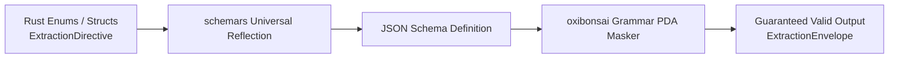

# Structured Extraction & Schema Derivation

| Metadata | Details |
| :--- | :--- |
| **Document ID** | `10_Structured_Extraction_and_Schema_Derivation` |
| **Domain** | Information Extraction Contracts & Schema Synthesis |
| **Responsibility** | Universal Schema Derivation via `schemars`, Extraction Directive Taxonomy, and Draft-Then-Decode Scratchpad Contracts |
| **Target Crates** | `embedag-llm`, `embedag-core` |
| **Status** | Definitive Architectural Specification |

---

## 1. Executive Summary & Architectural Role

Extracting graph relationships and classification directives from unstructured inputs requires strict structural guarantees. Free-form text generation from LLMs frequently produces invalid JSON, missing keys, or hallucinated relationship labels.

`embedag` enforces **compile-time derived extraction schemas** using `schemars`. The extracted directive taxonomy explicitly defines every permitted graph mutation, and the **Draft-Then-Decode** pattern eliminates the *alignment tax* that degrades LLM reasoning when forced into rigid formats without scratchpad space.

---

## 2. The Extraction Directives Taxonomy



---

Graph mutations emitted by the extraction layer are typed enums implementing `JsonSchema`, `Serialize`, and `Deserialize`:

```rust
use schemars::JsonSchema;
use serde::{Deserialize, Serialize};

#[derive(Debug, Clone, Serialize, Deserialize, JsonSchema, PartialEq)]
#[serde(tag = "action", rename_all = "snake_case")]
pub enum ExtractionDirective {
    /// Connect record as a child of an existing parent node
    InsertNode {
        parent_key: String,
        entity_name: String,
        entity_level: String,
        relationship: String,
        confidence: f32,
    },
    /// Connect record to multiple parents simultaneously
    InsertMultiParentNode {
        parent_keys: Vec<String>,
        entity_name: String,
        entity_level: String,
        relationship: String,
        confidence: f32,
    },
    /// Record refers to an existing node; update its attributes
    UpdateAttributes {
        target_key: String,
        updated_fields: std::collections::HashMap<String, serde_json::Value>,
        confidence: f32,
    },
    /// Move or retarget an existing relationship edge
    RetargetEdge {
        child_key: String,
        old_parent_key: String,
        new_parent_key: String,
        relationship: String,
        confidence: f32,
    },
    /// Establish a brand new root node
    CreateRootNode {
        entity_name: String,
        entity_level: String,
        confidence: f32,
    },
    /// Ambiguous match requiring human resolution
    MarkAmbiguous {
        candidate_keys: Vec<String>,
        reason: String,
    },
}
```

---

## 3. The Draft-Then-Decode Cognitive Scratchpad Pattern

Forcing an autoregressive language model to emit structured tokens (e.g. `{"action": ...}`) from the very first token restricts the model's internal attention states, significantly reducing its reasoning performance.

`embedag` structures the extraction contract as a **Draft-Then-Decode envelope**:

```rust
#[derive(Debug, Clone, Serialize, Deserialize, JsonSchema)]
pub struct ExtractionEnvelope {
    /// Unconstrained chain-of-thought scratchpad where the model reasons freely
    pub reasoning_scratchpad: String,

    /// Final deterministic extraction directive
    pub directive: ExtractionDirective,
}
```

### 3.1 Provenance and Telemetry Isolation
When the envelope is processed:
1. `directive` is extracted and executed against the graph mutation pipeline.
2. `reasoning_scratchpad` is stored in the audit telemetry database alongside token counts, execution latency, and model version, preserving full explainability.

---

## 4. Universal Schema Generation via `schemars`

The JSON Schema passed to the grammar-guided inference engine is generated dynamically from the Rust type system:

```rust
pub fn generate_extraction_schema() -> serde_json::Value {
    let schema = schemars::schema_for!(ExtractionEnvelope);
    serde_json::to_value(&schema).expect("Failed to serialize schema")
}
```

This guarantees 100% synchronization between Rust deserialization structs and LLM logit masking grammars.
