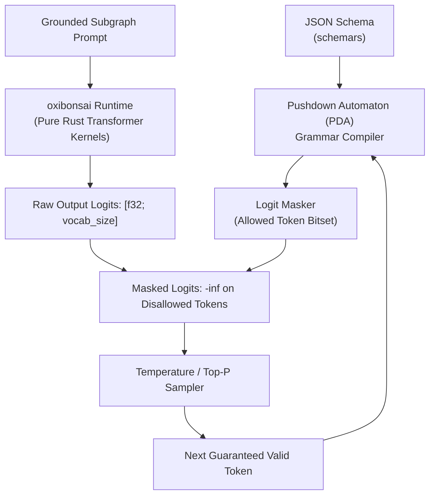

# Pure-Rust LLM Inference & Constrained Decoding

| Metadata | Details |
| :--- | :--- |
| **Document ID** | `11_Pure_Rust_LLM_Inference_and_Constrained_Decoding` |
| **Domain** | Zero-FFI LLM Execution & Grammar-Guided Sampling |
| **Responsibility** | `oxibonsai` Execution Engine, Pushdown Automaton Logit Masking, Async Thread Isolation, and the `LlmProvider` Port |
| **Target Crates** | `embedag-llm` |
| **Status** | Definitive Architectural Specification |

---

## 1. Executive Summary & Architectural Role

To fulfill `embedag`'s core promise of **Zero C/C++ FFI and 100% Pure Rust**, LLM execution is powered by **`cool-japan/oxibonsai` (Priority 1)**. Unlike `llama.cpp` or PyTorch, `oxibonsai` compiles directly with `cargo build` and runs natively in-process.

This specification details how `oxibonsai` executes token-level constrained logit masking via pushdown automata (PDA), how async runtimes isolate heavy CPU/GPU matrix computations, and how the `LlmProvider` port decouples the system from specific model weights.

---

## 2. In-Depth Architecture: `oxibonsai` Execution Engine



### 2.1 Zero-FFI Pushdown Automaton (PDA) Logit Masking
At each generation step $t$:
1. The Pushdown Automaton inspects its current state and grammar stack.
2. It generates a bitmask of valid next tokens from the vocabulary ($\approx 32,000$ to $128,000$ tokens).
3. Tokens violating the schema syntax receive $-\infty$ logit bias before Softmax:
   $$\text{Logit}'(w) = \begin{cases} \text{Logit}(w) & \text{if } w \in \text{ValidTokens} \\ -\infty & \text{otherwise} \end{cases}$$
4. **Result**: Zero JSON syntax errors, zero missing required fields, and zero trailing commas.

---

## 3. Async Isolation & Threadpool Management

Transformer matrix multiplications are CPU/GPU-bound and must never block Tokio worker threads handling network I/O or database transactions.

`embedag-llm` isolates `oxibonsai` on dedicated Rayon/blocking worker pools:

```rust
use tokio::task;

pub async fn run_constrained_inference(
    engine: std::sync::Arc<oxibonsai::Runtime>,
    prompt: String,
    schema: serde_json::Value,
) -> Result<String, LlmError> {
    task::spawn_blocking(move || {
        engine.generate_constrained(&prompt, &schema)
    })
    .await
    .map_err(|e| LlmError::ExecutionPanicked(e.to_string()))?
}
```

---

## 4. The Model-Agnostic Inference Port: `LlmProvider`

```rust
#[async_trait::async_trait]
pub trait LlmProvider: Send + Sync {
    type Error: std::error::Error + Send + Sync + 'static;

    /// Generates structured output conforming strictly to the provided JSON Schema.
    async fn generate_structured(
        &self,
        prompt: &str,
        schema: &serde_json::Value,
    ) -> Result<serde_json::Value, Self::Error>;

    /// Model identifier and quantization metadata.
    fn model_info(&self) -> ModelMetadata;
}
```

---

## 5. Invariants & Reliability

1. **Zero FFI Linkage**: `oxibonsai` uses pure Rust SIMD kernels (AVX-512, Apple Metal, NEON) without external shared libraries.
2. **Deterministic Fallback**: If an edge-device memory budget is exceeded, the runtime gracefully returns `LlmError::OutOfMemory` to trigger Tier 4 human-in-the-loop fallback without crashing the process.
