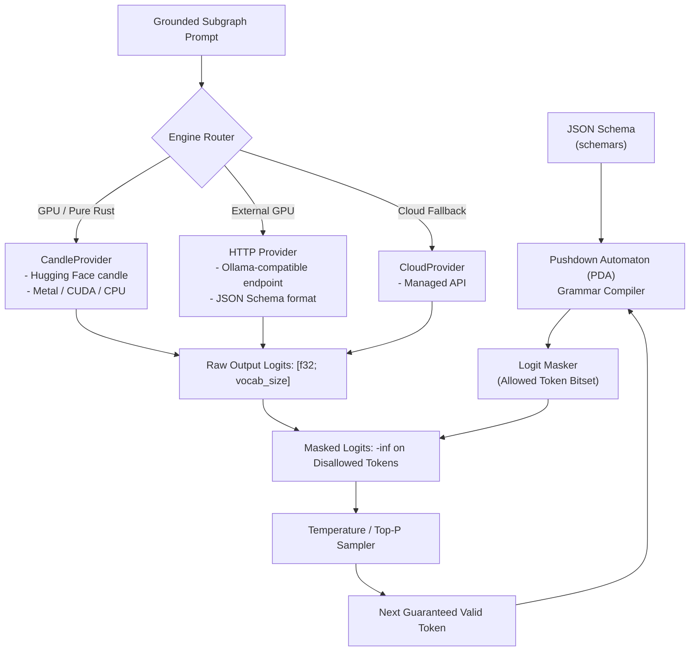

# Pure-Rust LLM Inference & Constrained Decoding

| Metadata | Details |
| :--- | :--- |
| **Document ID** | `11_Pure_Rust_LLM_Inference_and_Constrained_Decoding` |
| **Domain** | Zero-FFI LLM Execution & Grammar-Guided Sampling |
| **Responsibility** | `CandleProvider` (Hugging Face candle, GPU first) & HTTP Provider Execution Engines, Pushdown Automaton Logit Masking, Async Thread Isolation, and the `LlmProvider` Port |
| **Target Crates** | `embedag-llm` |
| **Status** | Definitive Architectural Specification |

---

## 1. Executive Summary & Architectural Role

To fulfill `embedag`'s core promise of **Zero C/C++ FFI and 100% Pure Rust**, LLM execution is powered by:
1. **`huggingface/candle` (`CandleProvider`)**: Pure-Rust tensor inference engine running whole forward passes (prefill and decode) on Metal, CUDA, or CPU.
2. **Ollama-Compatible HTTP Provider**: For external GPU inference outside the process.
3. **`CloudProvider`**: Managed API fallback.

*(Note on removed components)*: The former KitaSan LLM engines (`cool-japan/oxibonsai` sub-2-bit engine and `cool-japan/oxillama` GGUF multi-quant engine) are **not implemented**; they were removed due to upstream relicensing to BUSL-1.1 in 2026-11.

Unlike `llama.cpp` or PyTorch, the active engines compile directly with `cargo build` and execute with zero foreign system dependencies.

---

## 2. In-Depth Architecture: Dual Pure-Rust Inference Engines



### 2.1 Zero-FFI Pushdown Automaton (PDA) Logit Masking
At each generation step $t$:
1. The Pushdown Automaton inspects its current state and grammar stack derived from `schemars` JSON schemas.
2. It generates a bitmask of valid next tokens from the vocabulary ($\approx 32,000$ to $128,000$ tokens).
3. Tokens violating the schema syntax receive $-\infty$ logit bias before Softmax:
   $$\text{Logit}'(w) = \begin{cases} \text{Logit}(w) & \text{if } w \in \text{ValidTokens} \\ -\infty & \text{otherwise} \end{cases}$$
4. **Result**: Zero JSON syntax errors, zero missing required fields, and zero trailing commas.

### 2.2 GGUF Multi-Architecture Support (Not Implemented)
The sovereign pure-Rust GGUF runtime (`oxillama`) is **not implemented**; it was removed due to upstream relicensing to BUSL-1.1 (2026-11).

### 2.3 Sub-2-Bit PDA Engine (Not Implemented)
The sub-2-bit ternary/1-bit inference engine (`oxibonsai`) with pushdown automaton logit masking is **not implemented**; it was removed due to upstream relicensing to BUSL-1.1 (2026-11).

### 2.4 Provider priority: GPU first

Local and external providers are ranked:

1. `candle` (`CandleProvider`) on Metal or CUDA: whole forward passes, prefill included, run on the GPU.
2. An Ollama-compatible HTTP provider (ticket 10.3.1): GPU inference outside the process.
3. `candle` on the CPU: CPU-only or memory-constrained deployments, and short structured outputs where decode dominates.
4. `CloudProvider`: Managed cloud API fallback.

---

## 3. Async Isolation & Threadpool Management

Transformer matrix multiplications are CPU/GPU-bound and must never block Tokio worker threads handling network I/O or database transactions.

`embedag-llm` isolates compute-bound inference on dedicated Rayon/blocking worker pools:

```rust
use tokio::task;

pub async fn run_constrained_inference(
    engine: std::sync::Arc<dyn LlmProvider>,
    prompt: String,
    schema: serde_json::Value,
) -> Result<serde_json::Value, LlmError> {
    task::spawn_blocking(move || {
        engine.generate_structured_blocking(&prompt, &schema)
    })
    .await
    .map_err(|e| LlmError::ExecutionPanicked(e.to_string()))?
}
```

---

## 4. The Model-Agnostic Inference Port: `LlmProvider`

```rust
#[derive(Debug, Clone, PartialEq)]
pub struct ModelMetadata {
    pub provider_name: String,
    pub model_id: String,
    pub quantization: String,
    pub pure_rust: bool,
}

#[async_trait::async_trait]
pub trait LlmProvider: Send + Sync {
    type Error: std::error::Error + Send + Sync + 'static;

    /// Generates structured output conforming strictly to the provided JSON Schema.
    async fn generate_structured(
        &self,
        prompt: &str,
        schema: &serde_json::Value,
    ) -> Result<serde_json::Value, Self::Error>;

    /// Blocking variant for execution on spawn_blocking / Rayon threadpools.
    fn generate_structured_blocking(
        &self,
        prompt: &str,
        schema: &serde_json::Value,
    ) -> Result<serde_json::Value, Self::Error>;

    /// Model identifier and quantization metadata.
    fn model_info(&self) -> ModelMetadata;
}
```

---

## 5. Invariants & Reliability

1. **Zero FFI Linkage**: `CandleProvider` compiles cleanly with standard Cargo and zero system C libraries (`llama.cpp`, CMake, LibTorch). (Note: `oxibonsai` and `oxillama` are not implemented due to upstream BUSL-1.1 licence change, 2026-11).
2. **Deterministic Fallback**: If an edge-device memory budget is exceeded, the runtime gracefully returns `LlmError::OutOfMemory` to trigger Tier 4 human-in-the-loop fallback without crashing the process.
3. **Grammar Pushdown Guarantee**: All generated payloads parse cleanly as valid JSON conforming strictly to `ExtractionEnvelope<ExtractionDirective>`.
