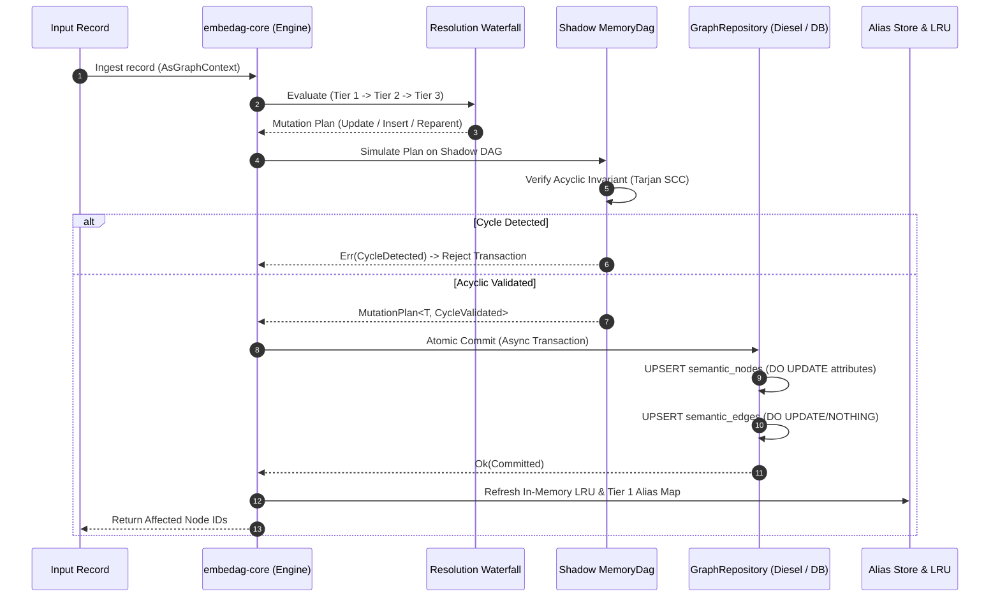

# Dynamic Graph Updates & Mixed-Modality Similarity Resolution

## 1. Executive Summary
This document provides the definitive specification for two critical systems in `embedag`:
1. **Dynamic Graph Updates & Mutation Lifecycle**: How the system processes incoming records that modify, update, re-parent, or expand an already persisted graph without violating topological constraints.
2. **Mixed-Modality Representation & Similarity Matching**: How the system performs inference and similarity evaluation when both input records and stored nodes contain a blend of textual descriptions and non-textual data (continuous scalars, cyclic temporal intervals, discrete spatial cells, and categorical attributes).

---

## 2. Dynamic Graph Updates: The Mutation Lifecycle

In real-world enterprise environments, graphs are not static. New inventory items, updated product weights, reclassified taxonomies, and new supplier connections continuously arrive. When incoming data alters the graph, `embedag` executes an atomic, cycle-safe 7-stage mutation workflow:



### 2.1 The Mutation Directives Taxonomy
Rather than regenerating the entire graph from scratch, the system models updates as atomic directives:

```rust
#[derive(Debug, Clone, Serialize, Deserialize)]
pub enum MutationDirective<T: NodePayload> {
    /// Update attributes, weights, or timestamps of an existing node
    UpdateNodePayload {
        key: T::Key,
        updated_payload: T,
        attribute_patch: serde_json::Value,
    },
    /// Insert a brand new node and link to existing parents
    InsertNode {
        payload: T,
        parents: Vec<(T::Key, String)>, // (parent_key, relationship)
        confidence: f32,
    },
    /// Add an additional parent edge to an existing node (DAG convergence)
    AttachParent {
        child_key: T::Key,
        parent_key: T::Key,
        relationship: String,
        confidence: f32,
    },
    /// Reparent or deprecate an existing relationship
    RetargetEdge {
        child_key: T::Key,
        old_parent_key: T::Key,
        new_parent_key: T::Key,
        relationship: String,
    },
}
```

### 2.2 Shadow Graph Simulation & Double Cycle Guards
To guarantee that a concurrent or sequential update cannot introduce a circular loop ($A \to B \to C \to A$):
1. **In-Memory Shadow Simulation**: The active subgraph is cloned into a temporary shadow `petgraph::graph::DiGraph`.
2. **Cycle Validation**: `petgraph::algo::is_cyclic_directed` is evaluated. If any proposed edge creates a cycle, the operation is immediately rejected before touching the database.
3. **Typestate Guard**: Rust's type system enforces that only a `MutationPlan<T, CycleValidated>` can invoke `.commit(&repo)`.
4. **SQL-Level Cycle Guard**: During the recursive CTE queries, the database tracks path arrays (`WHERE NOT (child_id = ANY(visited_path))`), providing defense-in-depth against external manual database edits.

### 2.3 Atomic Transaction Persistence (`INSERT ... ON CONFLICT`)
Database commits are executed in an `AsyncPgConnection::transaction` (PostgreSQL) or thread-isolated SQLite transaction:
- **Nodes Upsert**:
  ```sql
  INSERT INTO semantic_nodes (id, entity_level, name, attributes, embedding, updated_at)
  VALUES ($1, $2, $3, $4, $5, NOW())
  ON CONFLICT (id) DO UPDATE SET
      attributes = semantic_nodes.attributes || EXCLUDED.attributes,
      embedding = EXCLUDED.embedding,
      updated_at = NOW();
  ```
- **Edges Upsert**:
  ```sql
  INSERT INTO semantic_edges (parent_id, child_id, relationship_type, confidence, provenance)
  VALUES ($1, $2, $3, $4, $5)
  ON CONFLICT (parent_id, child_id, relationship_type) DO UPDATE SET
      confidence = EXCLUDED.confidence,
      provenance = EXCLUDED.provenance;
  ```

---

## 3. Mixed-Modality Representation & Similarity Matching

### 3.1 The Challenge of Mixed-Modality Data
Enterprise entities are rarely pure text. Consider parsing:
> *"Carlos V Dark Chocolate 50g bar, $1.25 USD, scanned 2026-10-11 at Mexico City Distribution Center (-99.1332, 19.4326)"*

- **Pure text embeddings fail on numbers**: Transforming `50g` and `500g` into dense text vectors yields near-identical cosine similarities ($\approx 0.96$), ignoring a $10\times$ difference in physical product weight.
- **Pure text embeddings fail on coordinates**: Lat/Lon coordinates formatted as strings are split into arbitrary sub-word tokens with zero spatial geometry awareness.
- **Pure SQL fails on linguistic nuance**: Exact SQL filters fail on synonyms or misspellings (*"Dark Choc"* vs *"Dark Chocolate"*).

### 3.2 The Unified Typed Entity Model
`embedag` decouples unstructured linguistic data from continuous physical and spatial variables:

```rust
pub struct UnifiedNode<T: NodePayload> {
    pub id: uuid::Uuid,
    pub key: T::Key,
    pub payload: T,

    // 1. Semantic Linguistic Modality
    pub dense_embedding: Vec<f32>,       // 1024-dim BGE-M3 text vector via trustformers
    pub sparse_lexical_tokens: Vec<(u32, f32)>, // Lexical weights for exact SKU/name tokens

    // 2. Continuous & Numeric Modality (SI Standardized)
    pub scalar_features: HashMap<String, f64>,  // e.g. "weight_grams": 50.0, "price_usd": 1.25

    // 3. Temporal Modality (Continuous & Cyclical)
    pub timestamp_utc: chrono::DateTime<chrono::Utc>,
    pub cyclical_time: [f64; 4],         // [sin(hour), cos(hour), sin(day), cos(day)]

    // 4. Geospatial Modality (Discrete Topology)
    pub spatial_h3_cell: Option<u64>,    // Uber H3 resolution 9 discrete index

    // 5. Categorical Modality
    pub categorical_tags: HashMap<String, String>, // e.g. "packaging": "bar", "currency": "USD"
}
```

---

## 4. The Composite Hybrid Similarity Engine

When comparing an incoming record $A$ against a candidate graph node $B$, `embedag` computes a composite bounded distance $D_{\text{composite}} \in [0.0, 1.0]$:

$$D_{\text{composite}}(A, B) = w_{\text{text}} D_{\text{text}} + w_{\text{num}} D_{\text{num}} + w_{\text{time}} D_{\text{time}} + w_{\text{geo}} D_{\text{geo}} + w_{\text{cat}} D_{\text{cat}}$$

Where $\sum w_i = 1.0$.

```
┌────────────────────────────────────────────────────────────────────────┐
│                        Composite Distance Breakdown                    │
├─────────────────────┬──────────────────┬───────────────────────────────┤
│ Modality            │ Metric Applied   │ Mathematical Formula          │
├─────────────────────┼──────────────────┼───────────────────────────────┤
│ Text (Semantic)     │ Angular Cosine   │ D_text = (1 - cos(v_A, v_B))/2│
│ Text (Lexical BM25) │ Token Overlap    │ D_lex  = 1 - Jaccard(tokens)  │
│ Numeric (Scalars)   │ Gower Relative   │ D_num  = |x_A - x_B| / range  │
│ Temporal (Cyclic)   │ Euclidean Circle │ D_time = ||circ_A - circ_B||/2│
│ Geospatial (H3)     │ Integer Grid Ring│ D_geo  = min(1.0, rings/max_r)│
│ Categorical (Enums) │ Exact Match      │ D_cat  = (tag_A == tag_B)? 0:1│
└─────────────────────┴──────────────────┴───────────────────────────────┘
```

### 4.1 Detailed Distance Calculations

1. **Continuous Scalar Distance (Gower Metric)**:
   For each scalar field $k$ (e.g. weight, volume, price):
   $$D_{\text{scalar}, k}(x_A, x_B) = \frac{|x_{A,k} - x_{B,k}|}{\max(x_k) - \min(x_k)}$$
   For scale-free relative differences:
   $$D_{\text{rel}}(x_A, x_B) = \frac{|x_A - x_B|}{\max(|x_A|, |x_B|, \epsilon)}$$
   This guarantees that a $50g$ item vs a $500g$ item yields a large distance ($0.90$), preventing incorrect product collisions.

2. **Cyclical Temporal Distance**:
   $$D_{\text{time}} = \frac{1}{2} \sqrt{(\sin\theta_A - \sin\theta_B)^2 + (\cos\theta_A - \cos\theta_B)^2}$$
   Timestamps at $23:58$ and $00:03$ evaluate to $D_{\text{time}} \approx 0.003$ (nearly identical), correctly handling midnight boundary transitions.

3. **Geospatial H3 Grid Distance**:
   Using `h3o::grid_distance(cell_A, cell_B)`:
   $$D_{\text{geo}} = \min\left(1.0, \frac{\text{grid\_distance}(cell_A, cell_B)}{R_{\text{max}}}\right)$$
   Distance is computed via integer bitwise graph lookups in nanoseconds, completely bypassing floating-point Haversine trigonometry.

---

## 5. How Mixed Data Informs LLM Inference (`oxibonsai`)

When similarity falls into the ambiguous range ($0.60 \le S_{\text{composite}} < 0.85$), the system calls `oxibonsai` for structured classification.

Instead of dumping raw floats into the model, `embedag` synthesizes a **normalized semantic comparison card**:

```markdown
Candidate Anchor Node:
- Name: Carlos V Chocolate Bar (SKU-100)
- Hierarchy: Food -> Confectionery -> Chocolate
- Standard Weight: 50.0 grams
- Packaging: Single Unit

Incoming Item to Classify:
- Text: "Carlos V 12 pack 50g"
- Detected Numerical Deltas:
  * Unit Weight Match: 50.0g (100% match with SKU-100)
  * Multiplier Detected: 12 units (Total weight: 600.0g, 12x scale)
- Spatial Proximity: Co-located in same distribution region (H3 distance: 0)

Classification Task:
Determine if this is:
1. An update to SKU-100
2. A new Variant/Package node attached under SKU-100
3. A distinct product branch
```

By presenting the LLM with **pre-computed mathematical deltas** rather than raw floats, the model is protected from arithmetic reasoning failures and reliably emits `ExtractionDirective::InsertNode` with relationship `"packaged_as"`.
