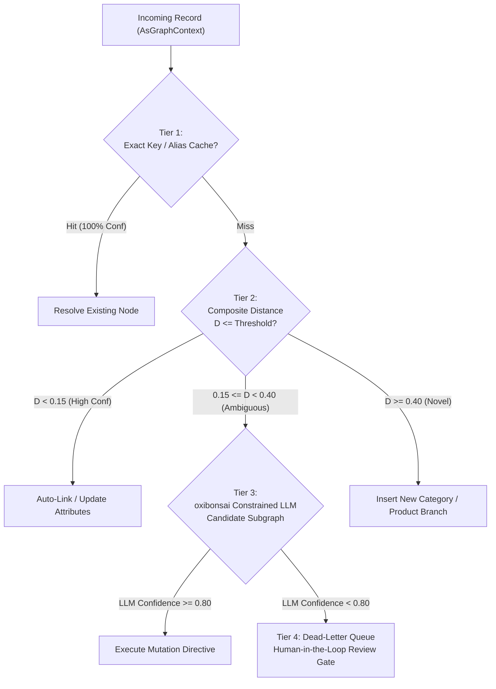

# Multi-Tiered Waterfall Resolution Pipeline

| Metadata | Details |
| :--- | :--- |
| **Document ID** | `12_Multi_Tiered_Waterfall_Resolution` |
| **Domain** | Entity Resolution & Record Linkage |
| **Responsibility** | Specification of the 4-Tier Waterfall Execution Pipeline from Exact Match to Human-in-the-Loop |
| **Target Crates** | `embedag-core`, `embedag-rag`, `embedag-llm` |
| **Status** | Definitive Architectural Specification |

---

## 1. Executive Summary & Architectural Motivation

Entity resolution across thousands of incoming records cannot afford invoking expensive neural LLMs for every item. In production enterprise pipelines:
- $\approx 70\%$ of incoming items have exact SKU, barcode, or known alias matches.
- $\approx 20\%$ are slight linguistic, packaging, or price variations solvable via Composite Hybrid Distance.
- $\approx 8\%$ are complex semantic ambiguities requiring constrained LLM reasoning.
- $\approx 2\%$ are irreconcilable anomalies requiring human review.

`embedag` organizes resolution as a **Multi-Tiered Waterfall**, filtering records through increasingly powerful, computationally calibrated evaluation tiers.

---

## 2. Waterfall Pipeline Architecture



---

## 3. Tier Specifications

### 3.1 Tier 1: Deterministic Exact Match & In-Memory LRU Alias Store
- **Latency**: $< 0.1\,\mu\text{s}$.
- **Mechanism**: O(1) hash map lookup against business keys (`SKU`, `UPC`, `GTIN`) and an in-memory LRU alias cache of historically verified entity resolutions.
- **Outcome**: Immediate resolution with $1.0$ confidence and `ProvenanceKind::DeterministicRule`.

### 3.2 Tier 2: Composite Hybrid Distance Thresholding
- **Latency**: $\approx 5\,\mu\text{s}$.
- **Mechanism**: Evaluates candidate nodes retrieved from the vector index using the Composite Hybrid Distance Metric:
  $$D_{\text{composite}} = w_{\text{text}} D_{\text{text}} + w_{\text{num}} D_{\text{num}} + w_{\text{time}} D_{\text{time}} + w_{\text{geo}} D_{\text{geo}}$$
- **Thresholds**:
  - $D_{\text{composite}} < 0.15$: Candidate is accepted as an exact variant or attribute update.
  - $0.15 \le D_{\text{composite}} < 0.40$: Ambiguous candidate; routed to Tier 3.
  - $D_{\text{composite}} \ge 0.40$: Record represents an entirely novel entity; classified as `NewRoot` or `NewChildOf`.

### 3.3 Tier 3: Constrained Pure-Rust LLM Inference (`oxibonsai`)
- **Latency**: $\approx 10\,\text{ms} - 50\,\text{ms}$.
- **Mechanism**: The top-3 candidate nodes and their immediate ancestral subgraphs are assembled into a structured prompt with pre-computed numerical and spatial deltas. `oxibonsai` emits an `ExtractionEnvelope` via PDA logit masking.
- **Outcome**: Directives with confidence $\ge 0.80$ proceed to the Mutation Lifecycle.

### 3.4 Tier 4: Dead-Letter Queue & Human-in-the-Loop Review Gate
- **Mechanism**: Records where Tier 3 confidence $< 0.80$ or where contradictory relationships are detected are stored in a dead-letter review table:
  ```rust
  pub struct ReviewItem<C: AsGraphContext> {
      pub review_id: uuid::Uuid,
      pub incoming_context: C,
      pub candidate_keys: Vec<String>,
      pub llm_scratchpad: Option<String>,
      pub created_at: chrono::DateTime<chrono::Utc>,
  }
  ```
- **Outcome**: Human operator resolves the ambiguity via CLI or web UI; the resolution is saved to the Tier 1 Alias Cache to prevent future escalations.
