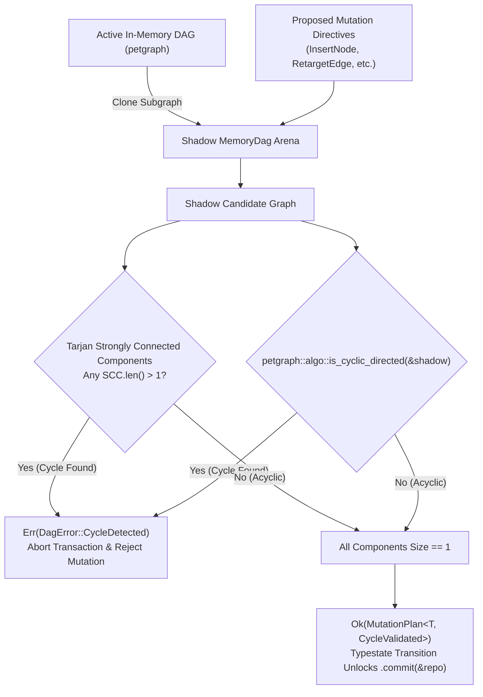

# Topological Cycle Detection & Acyclic Guardrails

| Metadata | Details |
| :--- | :--- |
| **Document ID** | `13_Topological_Cycle_Detection_and_Guards` |
| **Domain** | Graph Topological Validation & Acyclic Invariants |
| **Responsibility** | Strict Cycle Prevention, Tarjan Strongly Connected Components (SCC), Typestate Validation, and SQL Array Path Guards |
| **Target Crates** | `embedag-core`, `embedag-diesel` |
| **Status** | Definitive Architectural Specification |

---

## 1. Executive Summary & The Threat of Graph Cycles

A Directed Acyclic Graph (DAG) guarantees that traversal algorithms (such as hierarchical aggregation, recursive CTEs, and RAG context expansions) terminate in finite steps without infinite loops.

In real-world dynamic systems, incoming data can inadvertently introduce circular references ($A \to B \to C \to A$) through concurrent updates, conflicting extraction directives, or retargeted edges. If a cycle enters the database, standard recursive SQL queries run indefinitely until crashing with out-of-memory errors or stack overflows.

`embedag` enforces **Defense-in-Depth Cycle Guards** across three independent layers:
1. **Algorithmic Shadow Validation**: Pre-flight evaluation using Tarjan's SCC and `petgraph::algo::is_cyclic_directed`.
2. **Compile-Time Typestate Barrier**: Rust's type system prevents unverified mutations from calling `.commit()`.
3. **Database-Level Path Guards**: SQL recursive CTEs maintain visited array paths (`WHERE NOT child_id = ANY(visited_path)`).

---

## 2. Cycle Detection Algorithms



### 2.1 Pre-Flight Check: `would_create_cycle`
Before adding an edge $U \to V$ into `MemoryDag<T>`:
```rust
use petgraph::algo::has_path_connecting;

impl<T: NodePayload> MemoryDag<T> {
    /// Returns true if adding a directed edge from `from_key` to `to_key` would create a cycle.
    pub fn would_create_cycle(&self, from_key: &T::Key, to_key: &T::Key) -> bool {
        let (Some(&from_idx), Some(&to_idx)) = (
            self.key_to_index.get(from_key),
            self.key_to_index.get(to_key)
        ) else {
            return false;
        };

        // If there already exists a path from `to` to `from`, adding `from -> to` closes a cycle!
        has_path_connecting(&self.graph, to_idx, from_idx, None)
    }
}
```

### 2.2 Global Invariant Verification: Tarjan SCC
For batched mutations containing multiple node insertions and edge retargetings, `embedag` tests the entire shadow graph:
```rust
use petgraph::algo::tarjan_scc;

impl<T: NodePayload> MemoryDag<T> {
    pub fn validate_acyclic(&self) -> Result<(), DagError> {
        let sccs = tarjan_scc(&self.graph);
        for scc in sccs {
            if scc.len() > 1 {
                return Err(DagError::CycleDetected {
                    node_indices: scc.iter().map(|n| n.index()).collect(),
                });
            }
        }
        Ok(())
    }
}
```

---

## 3. The Typestate Compile-Time Barrier

To guarantee that developers cannot bypass cycle checks:

```rust
pub struct Unverified;
pub struct CycleValidated;

pub struct MutationPlan<T: NodePayload, State> {
    directives: Vec<MutationDirective<T>>,
    _state: std::marker::PhantomData<State>,
}

impl<T: NodePayload> MutationPlan<T, Unverified> {
    pub fn validate_cycles(self, dag: &MemoryDag<T>) -> Result<MutationPlan<T, CycleValidated>, DagError> {
        if dag.simulate_has_cycle(&self.directives) {
            return Err(DagError::CycleDetected { node_indices: vec![] });
        }
        Ok(MutationPlan {
            directives: self.directives,
            _state: std::marker::PhantomData,
        })
    }
}

// Notice: commit() is ONLY implemented for State = CycleValidated!
impl<T: NodePayload> MutationPlan<T, CycleValidated> {
    pub async fn commit<R: GraphRepository<T>>(self, repo: &R) -> Result<(), RepoError> {
        repo.apply_mutation_batch(&self.directives).await
    }
}
```

---

## 4. SQL-Level Defensive Cycle Guards

Even if an external system manually inserts a circular row directly into PostgreSQL or SQLite, `embedag`'s SQL recursive CTEs maintain an array of visited IDs to prevent runaway queries:

```sql
WITH RECURSIVE ancestral_tree AS (
    SELECT
        child_id,
        parent_id,
        1 AS depth,
        ARRAY[child_id] AS visited_path
    FROM semantic_edges
    WHERE child_id = $1

    UNION ALL

    SELECT
        e.child_id,
        e.parent_id,
        t.depth + 1,
        t.visited_path || e.child_id
    FROM semantic_edges e
    JOIN ancestral_tree t ON e.child_id = t.parent_id
    WHERE NOT (e.child_id = ANY(t.visited_path)) -- CYCLE DEFENSE!
      AND t.depth < 20                          -- DEPTH LIMIT!
)
SELECT * FROM ancestral_tree;
```
