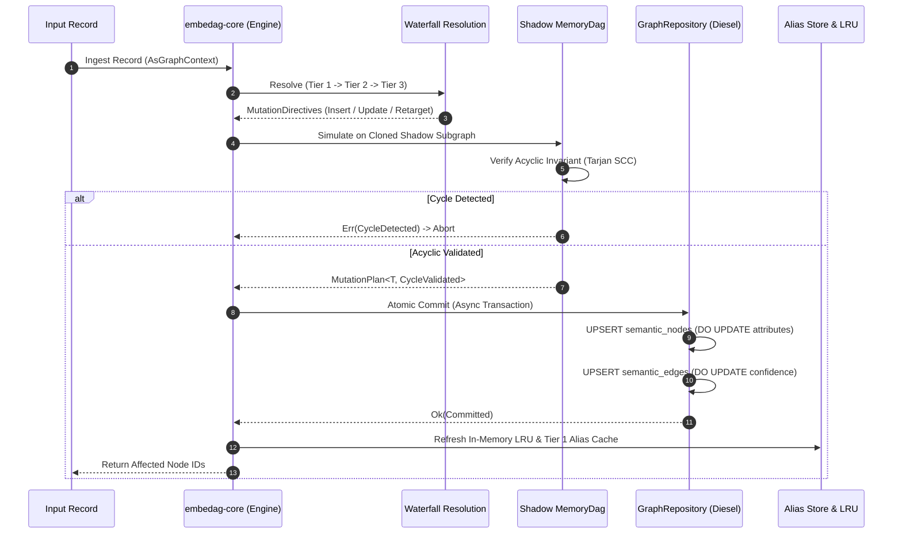

# Dynamic Graph Mutations & In-Memory Diffing

| Metadata | Details |
| :--- | :--- |
| **Document ID** | `14_Dynamic_Graph_Mutations_and_Diffing` |
| **Domain** | Graph Mutation Lifecycle & Change Management |
| **Responsibility** | In-Memory Graph Diffing, Mutation Directives Lifecycle, Shadow Simulation, and Atomic Upsert Execution |
| **Target Crates** | `embedag-core`, `embedag-diesel` |
| **Status** | Definitive Architectural Specification |

---

## 1. Executive Summary & Architectural Role

Real-world graphs are dynamic. Incoming records continuously add new products, update supplier weights, reparent subcategories, or retire obsolete relationships.

`embedag` models all graph changes as explicit, atomic **Mutation Directives**. Before mutating active in-memory arenas or persistent database tables, an **In-Memory Graph Diffing Engine** computes minimal deltas, simulates the changes against a shadow graph, and commits them in an atomic database transaction.

---

## 2. The 7-Stage Mutation Lifecycle



---

## 3. The In-Memory Graph Diffing Engine (`GraphDiff`)

To avoid blind full-graph rewrites, `embedag` computes structured diffs:

```rust
use std::collections::HashSet;
use crate::traits::{NodePayload, EdgePayload};

pub struct GraphDiff<T: NodePayload> {
    pub added_nodes: Vec<T>,
    pub updated_nodes: Vec<(T::Key, serde_json::Value)>,
    pub removed_nodes: HashSet<T::Key>,
    pub added_edges: Vec<(T::Key, T::Key, EdgePayload)>,
    pub removed_edges: Vec<(T::Key, T::Key)>,
}

impl<T: NodePayload> GraphDiff<T> {
    pub fn is_empty(&self) -> bool {
        self.added_nodes.is_empty()
            && self.updated_nodes.is_empty()
            && self.removed_nodes.is_empty()
            && self.added_edges.is_empty()
            && self.removed_edges.is_empty()
    }
}
```

---

## 4. Atomic Transaction Persistence (`INSERT ... ON CONFLICT`)

Database commits are executed in an `AsyncPgConnection::transaction` (PostgreSQL) or thread-isolated SQLite transaction:

### 4.1 Nodes Upsert (PostgreSQL)
```sql
INSERT INTO semantic_nodes (id, entity_level, name, attributes, embedding, updated_at)
VALUES ($1, $2, $3, $4, $5, NOW())
ON CONFLICT (id) DO UPDATE SET
    attributes = semantic_nodes.attributes || EXCLUDED.attributes,
    embedding = EXCLUDED.embedding,
    updated_at = NOW();
```

### 4.2 Edges Upsert (PostgreSQL)
```sql
INSERT INTO semantic_edges (parent_id, child_id, relationship_type, confidence, provenance)
VALUES ($1, $2, $3, $4, $5)
ON CONFLICT (parent_id, child_id, relationship_type) DO UPDATE SET
    confidence = EXCLUDED.confidence,
    provenance = EXCLUDED.provenance;
```

---

## 5. Invariants & Guarantees

1. **Transactional Atomicity**: Node upserts and edge additions occur in the same database transaction. A cycle detection failure or network disconnect leaves the database in its previous valid state.
2. **Zero In-Memory Drift**: The active `MemoryDag<T>` is only updated after the database transaction successfully commits.
