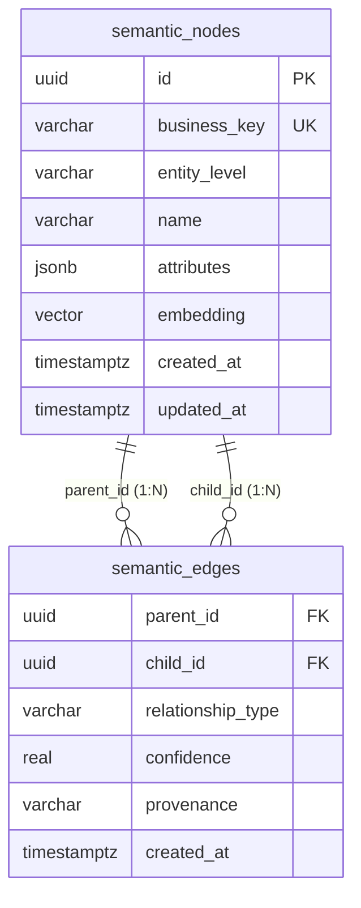

# Relational Persistence & Schema Engine

| Metadata | Details |
| :--- | :--- |
| **Document ID** | `15_Relational_Persistence_and_Schema_Engine` |
| **Domain** | Relational Database Storage & Persistence |
| **Responsibility** | `GraphRepository` Port, Relational Schema Architecture, PostgreSQL `diesel-async` with `pgvector`, and SQLite Storage |
| **Target Crates** | `embedag-diesel`, `embedag-core` |
| **Status** | Definitive Architectural Specification |

---

## 1. Executive Summary & Architectural Role

`embedag` persists DAGs and vector embeddings within standard relational database engines: **PostgreSQL** (via `diesel-async` and `pgvector`) and **SQLite** (via `diesel`).

By leveraging standard relational engines, enterprises avoid maintaining specialized proprietary graph databases, keeping their transactional data, tabular metadata, and vector indices in a single ACID-compliant store.

---

## 2. The Storage Port: `GraphRepository` Trait

`embedag-core` defines the storage contract, abstracting concrete database drivers:

```rust
use uuid::Uuid;
use crate::traits::{NodePayload, EdgePayload, MutationDirective};

#[async_trait::async_trait]
pub trait GraphRepository<T: NodePayload>: Send + Sync {
    type Error: std::error::Error + Send + Sync + 'static;

    /// Fetches a node by its business key.
    async fn get_node(&self, key: &T::Key) -> Result<Option<T>, Self::Error>;

    /// Fetches immediate parents of a node.
    async fn get_parents(&self, key: &T::Key) -> Result<Vec<T>, Self::Error>;

    /// Fetches immediate children of a node.
    async fn get_children(&self, key: &T::Key) -> Result<Vec<T>, Self::Error>;

    /// Performs approximate nearest neighbor vector search.
    async fn find_nearest_neighbors(
        &self,
        embedding: &[f32],
        limit: usize,
    ) -> Result<Vec<(T, f32)>, Self::Error>;

    /// Atomically applies a batch of validated mutation directives.
    async fn apply_mutation_batch(
        &self,
        directives: &[MutationDirective<T>],
    ) -> Result<(), Self::Error>;
}
```

---

## 3. PostgreSQL Relational Schema Architecture



---

```sql
-- Enable vector extension
CREATE EXTENSION IF NOT EXISTS vector;

-- Nodes table
CREATE TABLE semantic_nodes (
    id UUID PRIMARY KEY DEFAULT gen_random_uuid(),
    business_key VARCHAR(255) NOT NULL UNIQUE,
    entity_level VARCHAR(64) NOT NULL,
    name VARCHAR(255) NOT NULL,
    attributes JSONB NOT NULL DEFAULT '{}',
    embedding vector(1024),
    created_at TIMESTAMPTZ NOT NULL DEFAULT NOW(),
    updated_at TIMESTAMPTZ NOT NULL DEFAULT NOW()
);

-- Edges table (Multi-parent DAG topology)
CREATE TABLE semantic_edges (
    parent_id UUID NOT NULL REFERENCES semantic_nodes(id) ON DELETE CASCADE,
    child_id UUID NOT NULL REFERENCES semantic_nodes(id) ON DELETE CASCADE,
    relationship_type VARCHAR(64) NOT NULL,
    confidence REAL NOT NULL CHECK (confidence >= 0.0 AND confidence <= 1.0),
    provenance VARCHAR(64) NOT NULL,
    created_at TIMESTAMPTZ NOT NULL DEFAULT NOW(),
    PRIMARY KEY (parent_id, child_id, relationship_type)
);

-- HNSW Vector Index for sub-millisecond similarity retrieval
CREATE INDEX idx_semantic_nodes_embedding_hnsw
ON semantic_nodes
USING hnsw (embedding vector_cosine_ops)
WITH (m = 16, ef_construction = 64);

-- Traversal Indices
CREATE INDEX idx_semantic_edges_child ON semantic_edges(child_id);
CREATE INDEX idx_semantic_edges_parent ON semantic_edges(parent_id);
```

---

## 4. SQLite Embedded Schema Architecture

For embedded devices, edge deployments, and CLI applications, `embedag` provides an equivalent SQLite schema:

```sql
CREATE TABLE semantic_nodes (
    id TEXT PRIMARY KEY,
    business_key TEXT NOT NULL UNIQUE,
    entity_level TEXT NOT NULL,
    name TEXT NOT NULL,
    attributes TEXT NOT NULL DEFAULT '{}',
    embedding BLOB,
    created_at TEXT NOT NULL DEFAULT CURRENT_TIMESTAMP,
    updated_at TEXT NOT NULL DEFAULT CURRENT_TIMESTAMP
);

CREATE TABLE semantic_edges (
    parent_id TEXT NOT NULL REFERENCES semantic_nodes(id) ON DELETE CASCADE,
    child_id TEXT NOT NULL REFERENCES semantic_nodes(id) ON DELETE CASCADE,
    relationship_type TEXT NOT NULL,
    confidence REAL NOT NULL,
    provenance TEXT NOT NULL,
    created_at TEXT NOT NULL DEFAULT CURRENT_TIMESTAMP,
    PRIMARY KEY (parent_id, child_id, relationship_type)
);

CREATE INDEX idx_sqlite_edges_child ON semantic_edges(child_id);
CREATE INDEX idx_sqlite_edges_parent ON semantic_edges(parent_id);
```

---

## 5. Invariants & Transaction Management

1. **Async Connection Pooling**: PostgreSQL connections use `bb8-diesel` or `deadpool-diesel` with `diesel-async`.
2. **Subtransactions with SAVEPOINT**: When resolving complex batch directives, inner operations execute within SQL `SAVEPOINT` blocks to enable fine-grained rollbacks without aborting the outer transaction.
