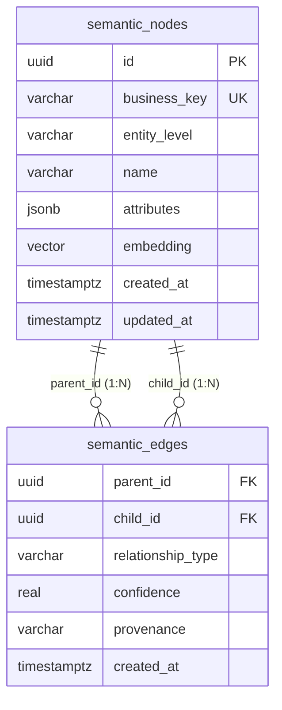
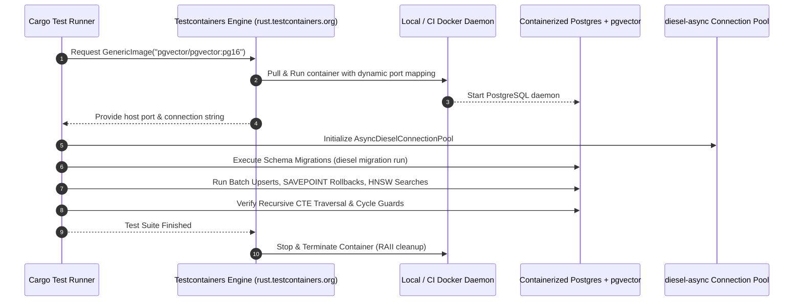
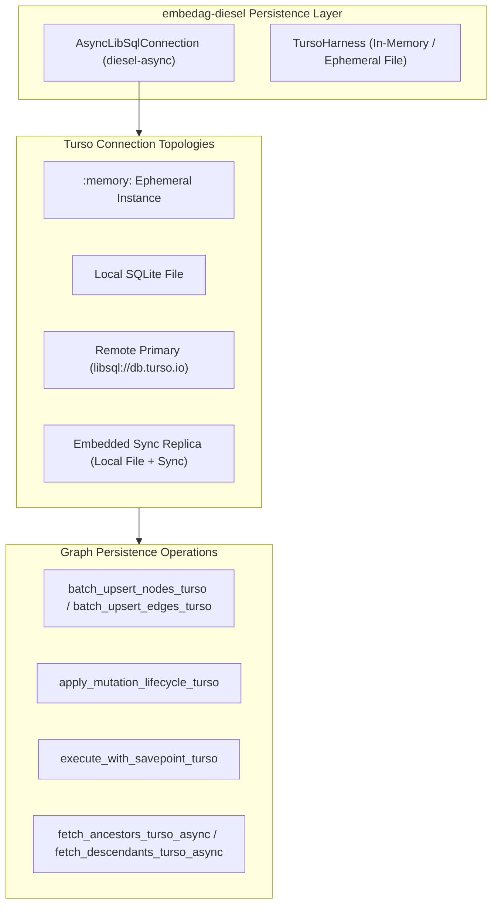

# Relational Persistence & Schema Engine

| Metadata | Details |
| :--- | :--- |
| **Document ID** | `15_Relational_Persistence_and_Schema_Engine` |
| **Domain** | Relational Database Storage & Persistence |
| **Responsibility** | `GraphRepository` Port, Relational Schema Architecture, PostgreSQL `diesel-async` with `pgvector`, SQLite Storage, and Mandatory Containerized Testing Harness |
| **Target Crates** | `embedag-diesel`, `embedag-core` |
| **Status** | Definitive Architectural Specification |

---

## 1. Executive Summary & Architectural Role

`embedag` persists DAGs and vector embeddings within standard relational database engines: **PostgreSQL** (via `diesel-async` and `pgvector`) and **SQLite** (via `diesel`).

By leveraging standard relational engines, enterprises avoid maintaining specialized proprietary graph databases, keeping their transactional data, tabular metadata, and vector indices in a single ACID-compliant store.

---

## 2. The Storage Port: `GraphRepository` Trait

`embedag-core` defines the storage contract, abstracting concrete database drivers:

```rust
use uuid::Uuid;
use crate::traits::{NodePayload, EdgePayload, MutationDirective};

#[async_trait::async_trait]
pub trait GraphRepository<T: NodePayload>: Send + Sync {
    type Error: std::error::Error + Send + Sync + 'static;

    /// Fetches a node by its business key.
    async fn get_node(&self, key: &T::Key) -> Result<Option<T>, Self::Error>;

    /// Fetches immediate parents of a node.
    async fn get_parents(&self, key: &T::Key) -> Result<Vec<T>, Self::Error>;

    /// Fetches immediate children of a node.
    async fn get_children(&self, key: &T::Key) -> Result<Vec<T>, Self::Error>;

    /// Performs approximate nearest neighbor vector search.
    async fn find_nearest_neighbors(
        &self,
        embedding: &[f32],
        limit: usize,
    ) -> Result<Vec<(T, f32)>, Self::Error>;

    /// Atomically applies a batch of validated mutation directives.
    async fn apply_mutation_batch(
        &self,
        directives: &[MutationDirective<T>],
    ) -> Result<(), Self::Error>;
}
```

---

## 3. PostgreSQL Relational Schema Architecture



---

```sql
-- Enable vector extension
CREATE EXTENSION IF NOT EXISTS vector;

-- Nodes table
CREATE TABLE semantic_nodes (\
    id UUID PRIMARY KEY DEFAULT gen_random_uuid(),
    business_key VARCHAR(255) NOT NULL UNIQUE,
    entity_level VARCHAR(64) NOT NULL,
    name VARCHAR(255) NOT NULL,
    attributes JSONB NOT NULL DEFAULT '{}',
    embedding vector(1024),
    created_at TIMESTAMPTZ NOT NULL DEFAULT NOW(),
    updated_at TIMESTAMPTZ NOT NULL DEFAULT NOW()
);

-- Edges table (Multi-parent DAG topology)
CREATE TABLE semantic_edges (
    parent_id UUID NOT NULL REFERENCES semantic_nodes(id) ON DELETE CASCADE,
    child_id UUID NOT NULL REFERENCES semantic_nodes(id) ON DELETE CASCADE,
    relationship_type VARCHAR(64) NOT NULL,
    confidence REAL NOT NULL CHECK (confidence >= 0.0 AND confidence <= 1.0),
    provenance VARCHAR(64) NOT NULL,
    created_at TIMESTAMPTZ NOT NULL DEFAULT NOW(),
    PRIMARY KEY (parent_id, child_id, relationship_type)
);

-- HNSW Vector Index for sub-millisecond similarity retrieval
CREATE INDEX idx_semantic_nodes_embedding_hnsw
ON semantic_nodes
USING hnsw (embedding vector_cosine_ops)
WITH (m = 16, ef_construction = 64);

-- Traversal Indices
CREATE INDEX idx_semantic_edges_child ON semantic_edges(child_id);
CREATE INDEX idx_semantic_edges_parent ON semantic_edges(parent_id);
```

---

## 4. SQLite Embedded Schema Architecture

For embedded devices, edge deployments, and CLI applications, `embedag` provides an equivalent SQLite schema:

```sql
CREATE TABLE semantic_nodes (
    id TEXT PRIMARY KEY,
    business_key TEXT NOT NULL UNIQUE,
    entity_level TEXT NOT NULL,
    name TEXT NOT NULL,
    attributes TEXT NOT NULL DEFAULT '{}',
    embedding BLOB,
    created_at TEXT NOT NULL DEFAULT CURRENT_TIMESTAMP,
    updated_at TEXT NOT NULL DEFAULT CURRENT_TIMESTAMP
);

CREATE TABLE semantic_edges (
    parent_id TEXT NOT NULL REFERENCES semantic_nodes(id) ON DELETE CASCADE,
    child_id TEXT NOT NULL REFERENCES semantic_nodes(id) ON DELETE CASCADE,
    relationship_type TEXT NOT NULL,
    confidence REAL NOT NULL,
    provenance TEXT NOT NULL,
    created_at TEXT NOT NULL DEFAULT CURRENT_TIMESTAMP,
    PRIMARY KEY (parent_id, child_id, relationship_type)
);

CREATE INDEX idx_sqlite_edges_child ON semantic_edges(child_id);
CREATE INDEX idx_sqlite_edges_parent ON semantic_edges(parent_id);
```

---

## 5. Invariants & Transaction Management

1. **Async Connection Pooling**: PostgreSQL connections use `bb8-diesel` or `deadpool-diesel` with `diesel-async`.
2. **Subtransactions with SAVEPOINT**: When resolving complex batch directives, inner operations execute within SQL `SAVEPOINT` blocks to enable fine-grained rollbacks without aborting the outer transaction.

---

## 6. Mandatory Integration Testing Harness via Testcontainers (`rust.testcontainers.org`)

Testing the persistence layer against SQLite or mock structures is insufficient for enterprise validation because SQLite lacks native `pgvector` indexing, specific PostgreSQL transaction isolation levels, and native array-based cycle guards.

Therefore, **[Testcontainers for Rust](https://rust.testcontainers.org) is mandated as an indispensable, non-negotiable testing tool for `embedag`'s persistence layer**.

### 6.1 Testing Mandate & Scope
- **Zero Mock Policy for PostgreSQL Adapters**: All schema migrations, batch upserts, vector cosine similarity queries, and recursive CTE traversals implemented in `embedag-diesel` must be tested against real PostgreSQL instances with `pgvector` pre-installed.
- **Ephemeral Containerized Isolation**: Tests dynamically spin up throwaway Docker containers running `pgvector/pgvector:pg16` via `testcontainers`. Each test suite runs in an isolated ephemeral database with random high port mappings, preventing cross-test pollution and host-environment dependency leaks.
- **Mandatory Quality Gate**: No pull request or persistence feature will be accepted or merged without passing the Testcontainers integration test suite. This requirement is enforced continuously in CI via the dedicated `persistence-testcontainers` workflow.

### 6.2 Testcontainers Architecture for `embedag-diesel`



### 6.3 Standard Test Fixture Implementation

Integration tests in `embedag-diesel/tests/` utilize the standard container fixture:

```rust
use testcontainers::{runners::AsyncRunner, ContainerAsync, GenericImage, ImageExt};
use diesel_async::{AsyncPgConnection, RunQueryDsl};

pub struct PostgresTestHarness {
    pub container: ContainerAsync<GenericImage>,
    pub database_url: String,
}

impl PostgresTestHarness {
    /// Spins up a throwaway PostgreSQL container with pgvector enabled.
    pub async fn start() -> Result<Self, Box<dyn std::error::Error + Send + Sync>> {
        let image = GenericImage::new("pgvector/pgvector", "pg16")
            .with_env_var("POSTGRES_DB", "embedag_test")
            .with_env_var("POSTGRES_USER", "postgres")
            .with_env_var("POSTGRES_PASSWORD", "postgres");

        let container = image.start().await?;
        let host = container.get_host().await?;
        let port = container.get_host_port_ipv4(5432).await?;

        let database_url = format!("postgres://postgres:postgres@{}:{}/embedag_test", host, port);

        // Run migrations on the fresh container
        Self::run_migrations(&database_url).await?;

        Ok(Self {
            container,
            database_url,
        })
    }

    async fn run_migrations(url: &str) -> Result<(), Box<dyn std::error::Error + Send + Sync>> {
        // Execute pending diesel migrations to create semantic_nodes, semantic_edges, HNSW indices
        Ok(())
    }
}
```

### 6.4 Non-Negotiable Invariants Enforced by Testcontainers
1. **Extension Verification**: Ensures `CREATE EXTENSION IF NOT EXISTS vector;` succeeds on a pristine database.
2. **Dimension Consistency**: Guarantees that vectors of dimension 1024 index correctly with HNSW and throw runtime errors on dimension mismatch.
3. **Savepoint Integrity**: Simulates constraint violations (e.g., duplicate edges or invalid foreign keys) and verifies that rollback to `SAVEPOINT` preserves valid preceding directives.
4. **Recursive CTE Performance & Cycle Termination**: Validates arbitrary-depth recursive CTE queries on PostgreSQL under heavy topological loads.


---

## 7. Turso & libSQL Distributed Persistence via Diesel & Diesel-Async

### 7.1 Distributed Edge Architecture & Vision

In addition to centralized PostgreSQL and local file-based SQLite, `embedag` persists DAGs on **Turso (powered by libSQL)** via `diesel` and `diesel-async`.

Turso enables distributed edge replication, low-latency regional reads, and zero-infrastructure serverless graph persistence:



### 7.2 Connection Topologies & Modes

`embedag-diesel` models connection topologies via `TursoConnectionMode`:

```rust
pub enum TursoConnectionMode {
    InMemory,
    LocalFile(PathBuf),
    Remote { url: String, auth_token: String },
    Replica { local_path: PathBuf, remote_url: String, auth_token: String },
}
```

- **`establish_turso_sync(mode)`**: Instantiates a synchronous `diesel_libsql::LibSqlConnection`.
- **`establish_turso_async(mode)`**: Instantiates an asynchronous `diesel_libsql::AsyncLibSqlConnection` implementing `diesel_async::AsyncConnection`.

### 7.3 Recursive CTE Cycle Guardrails on Turso

Unlike PostgreSQL which provides native `ARRAY` and `= ANY(visited)` expressions, Turso / libSQL implements cycle protection using deterministic string delimiter path concatenation:

```sql
WITH RECURSIVE ancestor_tree(node_id, depth, visited_path) AS (
    SELECT
        parent_id,
        1 AS depth,
        "," || "$target_id" || "," || parent_id || "," AS visited_path
    FROM semantic_edges
    WHERE child_id = "$target_id"

    UNION ALL

    SELECT
        e.parent_id,
        t.depth + 1,
        t.visited_path || e.parent_id || ","
    FROM semantic_edges e
    JOIN ancestor_tree t ON e.child_id = t.node_id
    WHERE t.depth < $max_depth
      AND INSTR(t.visited_path, "," || e.parent_id || ",") = 0
)
SELECT t.node_id, t.depth, n.business_key, n.name, n.entity_level
FROM ancestor_tree t
JOIN semantic_nodes n ON n.id = t.node_id
ORDER BY t.depth ASC;
```

This guarantees that cyclic graphs terminate in bounded time without recursion overflow or hanging transactions.
