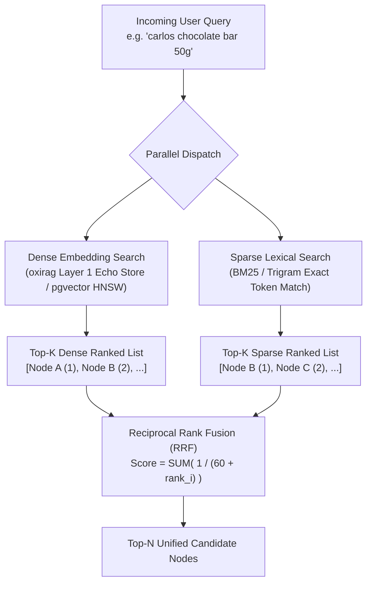

# Hybrid Vector & Lexical Retrieval (RRF)

| Metadata | Details |
| :--- | :--- |
| **Document ID** | `17_Hybrid_Vector_and_Lexical_Retrieval` |
| **Domain** | Information Retrieval & Search Fusion |
| **Responsibility** | Stage 1 Retrieval Engine: Dense Vector Search (`oxirag` Layer 1: Echo & pgvector), Sparse Lexical Matching, and Reciprocal Rank Fusion |
| **Target Crates** | `embedag-rag`, `embedag-diesel` |
| **Status** | Definitive Architectural Specification |

---

## 1. Executive Summary & Architectural Role

Retrieving relevant context from an enterprise graph cannot rely solely on dense vector search or solely on keyword search:
- **Dense Vector Search (HNSW)** excels at semantic understanding and broad intent, but fails on exact SKUs, codes, and numerical identifiers (e.g., searching for `"SKU-90210"` often matches unrelated product codes).
- **Sparse Lexical Search (BM25 / Trigram)** excels at exact keywords and alphanumeric codes, but fails on paraphrasing and vocabulary mismatches.

`embedag-rag` implements **Stage 1 Hybrid Retrieval**, integrating **`cool-japan/oxirag` (Layer 1: Echo Vector Store)** and database vector indexes with sparse token matches, merging candidates via **Reciprocal Rank Fusion (RRF)**.

---

## 2. Stage 1 Retrieval Architecture with `oxirag` (Layer 1: Echo)



### 2.1 The `oxirag` Echo Vector Store & Prefix Caching
- **Echo Layer**: Pure-Rust in-memory vector storage supporting Cosine, Euclidean, and Dot Product similarity functions with configurable capacity.
- **Context-Aware Prefix Caching**: Caches key-value states and document prefixes for frequent domain taxonomies (e.g. standard category headers, organizational trees), bypassing redundant transformer token passes.

---

## 3. Reciprocal Rank Fusion (RRF) Formulation

Given candidate node $d$ appearing across rankings $\mathcal{R}$, its fused score is:

$$\text{RRF}(d) = \sum_{r \in \mathcal{R}} \frac{1}{k + \text{rank}_r(d)}$$

Where $k = 60$ (the standard smoothing constant).

```rust
use std::collections::HashMap;
use uuid::Uuid;

pub struct RrfRanker {
    smoothing_k: f32,
}

impl RrfRanker {
    pub fn new(smoothing_k: f32) -> Self {
        Self { smoothing_k }
    }

    /// Merges dense and sparse ranked lists into a single sorted candidate list.
    pub fn fuse(
        &self,
        dense_results: &[Uuid],
        sparse_results: &[Uuid],
    ) -> Vec<(Uuid, f32)> {
        let mut scores: HashMap<Uuid, f32> = HashMap::new();

        // Accumulate dense ranks (1-indexed)
        for (rank, &id) in dense_results.iter().enumerate() {
            let score = 1.0 / (self.smoothing_k + (rank as f32 + 1.0));
            *scores.entry(id).or_insert(0.0) += score;
        }

        // Accumulate sparse ranks (1-indexed)
        for (rank, &id) in sparse_results.iter().enumerate() {
            let score = 1.0 / (self.smoothing_k + (rank as f32 + 1.0));
            *scores.entry(id).or_insert(0.0) += score;
        }

        let mut sorted: Vec<(Uuid, f32)> = scores.into_iter().collect();
        sorted.sort_by(|a, b| b.1.partial_cmp(&a.1).unwrap_or(std::cmp::Ordering::Equal));
        sorted
    }
}
```

---

## 4. Typo Resilience & Alphanumeric Accuracy

- **Typo Immunity**: If a user enters `"carls v chcolate"`, dense vector similarity from `oxirag` Echo recovers the semantic target (`Carlos V Chocolate`) despite lexical spelling errors.
- **Exact SKU Preservation**: If a user enters `"SKU-8820"`, BM25 scores this exact match rank #1, ensuring it survives into the fused candidate pool even if its generic vector similarity is modest.

---

## 5. Invariants & Performance Characteristics

1. **Sub-10ms Stage 1 Latency**: Vector HNSW index scans and PostgreSQL trigram/BM25 lookups run concurrently via `tokio::join!`.
2. **Deterministic Tie-Breaking**: When two items have identical RRF scores, tie-breaking falls back to business key lexicographical order.
3. **Pure-Rust In-Memory Fast Path**: When operating in-memory or on edge nodes, `oxirag` Echo store executes local vector retrieval in $< 1\,\text{ms}$ with zero SQLite/Postgres overhead.
