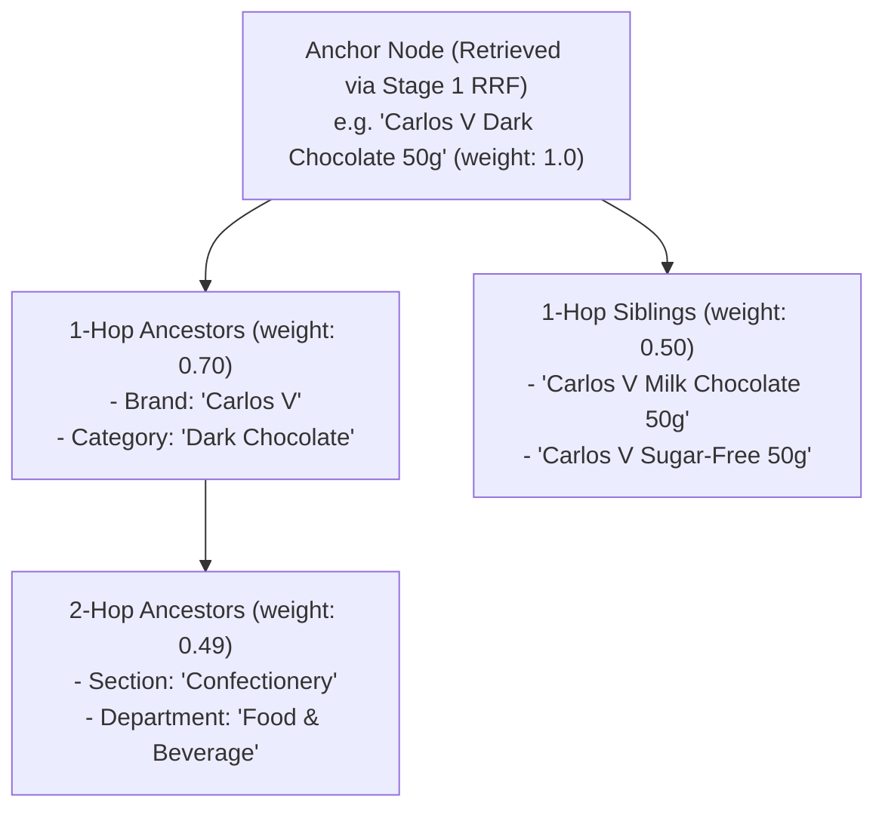
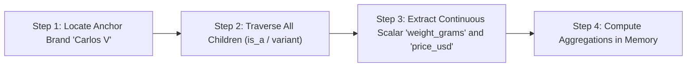

# Topological Subgraph Expansion & GraphRAG Synthesis

| Metadata | Details |
| :--- | :--- |
| **Document ID** | `18_Topological_Subgraph_Expansion_and_GraphRAG` |
| **Domain** | Topological Context Expansion & Grounded Evidence Synthesis |
| **Responsibility** | Stage 2 Subgraph Expansion, Grounded Verification via `VerifiedRagEngine`, Distance Decay, and Citation Packaging |
| **Target Crates** | `embedag-rag`, `embedag-core` |
| **Status** | Definitive Architectural Specification |

---

## 1. Executive Summary & Architectural Role

Traditional vector RAG returns isolated text chunks without contextual awareness of taxonomy, categorization, or parent relationships. A query about a specific product variant often misses critical facts defined at the category or brand level.

`embedag-rag` implements **Stage 2 Topological Subgraph Expansion & Grounded Verification**:
- **Graph Expansion**: Expands outward from candidate anchor nodes retrieved in Stage 1 along graph edges, traversing ancestor hierarchies and sibling clusters while applying **topological distance decay** via `SubgraphExpander`.
- **Verified Retrieval**: `VerifiedRagEngine` composes answers strictly from retrieved chunks, citing each as `[n]`. Queries not supported by any chunk fail with `RagError::VerificationFailure`.
- **Semantic Interoperability**: Formats subgraphs into structured evidence blocks and W3C RDF-Star / JSON-LD graphs via **`cool-japan/oxirs`**.
- *(Not Implemented Capabilities)*: The former 4-layer `oxirag` pipeline (Layer 2 Speculator, Layer 3 Judge SMT logic verification via `OxiZ` solver, and Layer 4 Graph) is **not implemented**; it was removed due to upstream licence change to BUSL-1.1 (2026-11).

---

## 2. Topological Expansion with Distance Decay



### 2.1 The Exponential Decay Function
Nodes further from the anchor have attenuated influence:

$$W(\text{node}) = W_{\text{anchor}} \cdot \gamma^{\text{hop\_distance}}$$

Where $\gamma = 0.70$ by default.

```rust
pub struct SubgraphExpander {
    decay_gamma: f32,
    max_hops: usize,
}

impl SubgraphExpander {
    pub fn new(decay_gamma: f32, max_hops: usize) -> Self {
        Self { decay_gamma, max_hops }
    }

    pub fn compute_weight(&self, hop_distance: usize) -> f32 {
        if hop_distance > self.max_hops {
            0.0
        } else {
            self.decay_gamma.powi(hop_distance as i32)
        }
    }
}
```

---

## 3. Grounded Verification Pipeline (`VerifiedRagEngine`)

To prevent hallucinations without complex neural solvers, `embedag-rag` provides `VerifiedRagEngine`:
- Queries are answered strictly from the top retrieved chunks (via `SparseLexicalIndex` and `RrfRanker`).
- Each supporting chunk is explicitly cited as `[n]`.
- If no indexed chunk supports the query, execution returns `RagError::VerificationFailure` instead of generating an unsupported guess.

### 3.1 SMT Logic Judge & Speculator (Not Implemented)
The formal SMT logic verification (Layer 3 Judge with `OxiZ` solver) and draft verification (Layer 2 Speculator) from `oxirag` are **not implemented** (removed due to upstream licence change to BUSL-1.1, 2026-11). Formal logic proofs via SMT-LIB and automated SAT/UNSAT solvers are not provided.

---

## 4. Structured Query Planner DAG & Grounded Packaging

For complex analytical queries (e.g., *"Compare the price per gram of all Carlos V confectionery items against the brand average"*), `embedag-rag` generates an internal query plan DAG:



### 4.1 Grounded Evidence Packaging with Citations
The verified subgraph is formatted into a markdown evidence block with explicit node IDs, guaranteeing verifiable citations:

```markdown
### Grounded Evidence Context (Verified by VerifiedRagEngine)
[Node: SKU-100] (Hop: 0, Confidence: 1.0)
- Name: Carlos V Chocolate Bar 50g
- Attributes: { "weight_grams": 50.0, "price_usd": 1.25 }
- Ancestors:
  * [Node: BRAND-01] Brand: Carlos V (Hop: 1)
  * [Node: CAT-04] Confectionery -> Chocolate (Hop: 2)
- Siblings:
  * [Node: SKU-101] Carlos V Milk Chocolate 50g (Hop: 1)

Citation Requirement:
When answering the user prompt, every factual assertion MUST cite its node ID (e.g. [SKU-100]).
```

---

## 5. Invariants & Traceability

1. **Hallucination Prevention**: Answers are strictly constrained by the verified subgraph. Missing attributes are explicitly identified as absent.
2. **Audit Telemetry**: Every generated answer is paired with cited chunk numbers `[n]` and node IDs, enabling compliance provenance. (Note: `oxirag` and `OxiZ` SMT verification solver are not implemented due to BUSL-1.1 licence change, 2026-11).
3. **Pure-Rust Guarantees**: Graph expansion, BFS queries, and verified retrieval run entirely in-process in pure Rust without external solver binaries or database roundtrips.
