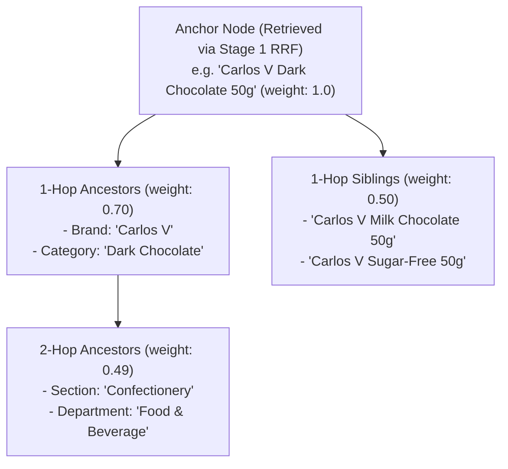
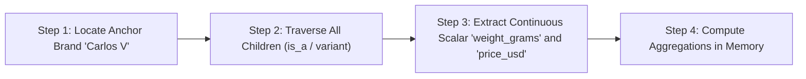

# Topological Subgraph Expansion & GraphRAG Synthesis

| Metadata | Details |
| :--- | :--- |
| **Document ID** | `18_Topological_Subgraph_Expansion_and_GraphRAG` |
| **Domain** | Topological Context Expansion & Grounded Evidence Synthesis |
| **Responsibility** | Stage 2 Topological Subgraph Expansion, Distance Decay Weighting, Query Planner DAG, and Citation Packaging |
| **Target Crates** | `embedag-rag` |
| **Status** | Definitive Architectural Specification |

---

## 1. Executive Summary & Architectural Role

Traditional vector RAG returns isolated text chunks without contextual awareness of taxonomy, categorization, or parent relationships. A query about a specific product variant often misses critical facts defined at the category or brand level.

`embedag-rag` implements **Stage 2 Topological Subgraph Expansion**: starting from candidate anchor nodes retrieved in Stage 1, it expands outward along graph edges, traversing ancestor hierarchies and sibling clusters while applying **topological distance decay**. The resulting structured subgraph is compiled into a grounded prompt with explicit citation attributes.

---

## 2. Topological Expansion with Distance Decay



### 2.1 The Exponential Decay Function
Nodes further from the anchor have attenuated influence:

$$W(\text{node}) = W_{\text{anchor}} \cdot \gamma^{\text{hop\_distance}}$$

Where $\gamma = 0.70$ by default.

```rust
pub struct SubgraphExpander {
    decay_gamma: f32,
    max_hops: usize,
}

impl SubgraphExpander {
    pub fn compute_weight(&self, hop_distance: usize) -> f32 {
        if hop_distance > self.max_hops {
            0.0
        } else {
            self.decay_gamma.powi(hop_distance as i32)
        }
    }
}
```

---

## 3. Structured Query Planner DAG

For complex analytical queries (e.g., *"Compare the price per gram of all Carlos V confectionery items against the brand average"*), `embedag-rag` generates an internal query plan DAG:



---

## 4. Grounded Evidence Packaging & Citation Attribution

The expanded subgraph is formatted into a markdown evidence block with explicit node IDs, guaranteeing verifiable citations in the LLM response:

```markdown
### Grounded Evidence Context
[Node: SKU-100] (Hop: 0, Confidence: 1.0)
- Name: Carlos V Chocolate Bar 50g
- Attributes: { "weight_grams": 50.0, "price_usd": 1.25 }
- Ancestors:
  * [Node: BRAND-01] Brand: Carlos V (Hop: 1)
  * [Node: CAT-04] Confectionery -> Chocolate (Hop: 2)
- Siblings:
  * [Node: SKU-101] Carlos V Milk Chocolate 50g (Hop: 1)

Citation Requirement:
When answering the user prompt, every factual assertion MUST cite its node ID (e.g. [SKU-100]).
```

---

## 5. Invariants & Traceability

1. **Hallucination Prevention**: The LLM is instructed to answer strictly using the provided grounded subgraph. If an attribute is missing, it explicitly reports that the node lacks that attribute.
2. **Audit Telemetry**: Every generated answer is paired with the list of cited node IDs, enabling compliance teams to verify provenance.
