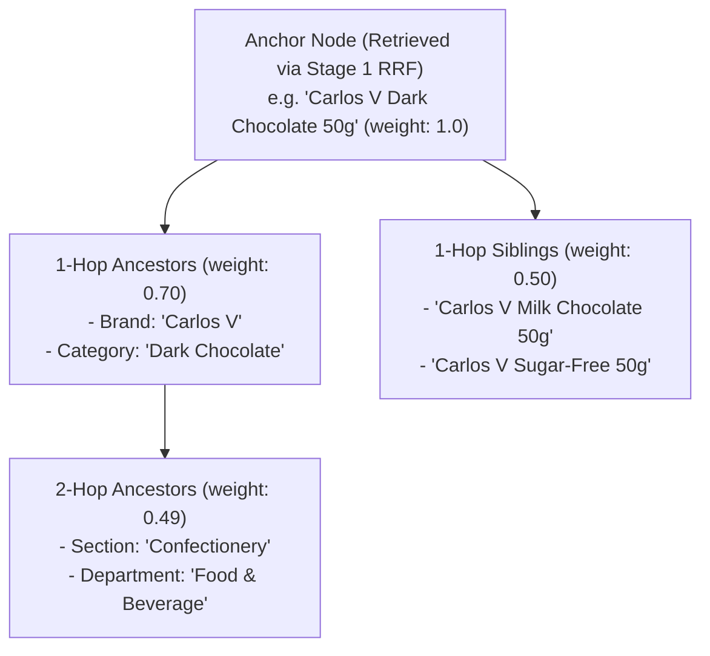
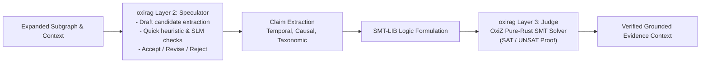
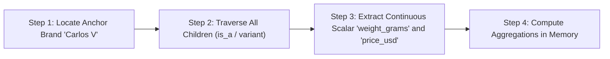

# Topological Subgraph Expansion & GraphRAG Synthesis

| Metadata | Details |
| :--- | :--- |
| **Document ID** | `18_Topological_Subgraph_Expansion_and_GraphRAG` |
| **Domain** | Topological Context Expansion & Grounded Evidence Synthesis |
| **Responsibility** | Stage 2 Subgraph Expansion (`oxirag` Layer 4), SMT-Based Logic Verification (`oxirag` Layer 3 via OxiZ), Distance Decay, and Citation Packaging |
| **Target Crates** | `embedag-rag`, `embedag-core` |
| **Status** | Definitive Architectural Specification |

---

## 1. Executive Summary & Architectural Role

Traditional vector RAG returns isolated text chunks without contextual awareness of taxonomy, categorization, or parent relationships. A query about a specific product variant often misses critical facts defined at the category or brand level.

`embedag-rag` implements **Stage 2 Topological Subgraph Expansion & Formal Verification** powered by **`cool-japan/oxirag`**:
- **Layer 4 (Graph)**: Expands outward from candidate anchor nodes retrieved in Stage 1 along graph edges, traversing ancestor hierarchies and sibling clusters while applying **topological distance decay**.
- **Layer 2 (Speculator)**: Fast draft verification evaluating candidate claims.
- **Layer 3 (Judge)**: Formal logic verification encoding extracted claims into **SMT-LIB** formulas solved by the pure-Rust **`OxiZ` SMT solver** to prove non-contradiction and factual soundness.
- **Semantic Interoperability**: Formats subgraphs into structured evidence blocks and W3C RDF-Star / JSON-LD graphs via **`cool-japan/oxirs`**.

---

## 2. Topological Expansion with Distance Decay (`oxirag` Layer 4: Graph)



### 2.1 The Exponential Decay Function
Nodes further from the anchor have attenuated influence:

$$W(\text{node}) = W_{\text{anchor}} \cdot \gamma^{\text{hop\_distance}}$$

Where $\gamma = 0.70$ by default.

```rust
pub struct SubgraphExpander {
    decay_gamma: f32,
    max_hops: usize,
}

impl SubgraphExpander {
    pub fn new(decay_gamma: f32, max_hops: usize) -> Self {
        Self { decay_gamma, max_hops }
    }

    pub fn compute_weight(&self, hop_distance: usize) -> f32 {
        if hop_distance > self.max_hops {
            0.0
        } else {
            self.decay_gamma.powi(hop_distance as i32)
        }
    }
}
```

---

## 3. Four-Layer Verification Pipeline (`oxirag` Layers 2 & 3)

To eradicate hallucinations and circular logic in complex RAG workflows, `embedag-rag` executes `oxirag`'s Speculator and Judge pipeline:



### 3.1 Formal SMT Verification with `OxiZ`
When an LLM synthesizes statements involving constraints (e.g. *"Product A is gluten-free, yet classified under Wheat Confectionery"* or temporal validity intervals), claims are translated into first-order logic formulas:
- **Consistent Context**: Solved as `SAT` by `OxiZ`; assertion accepted into response evidence.
- **Contradictory Context**: Flagged as `UNSAT`; contradictory edge or node discarded with automated warning telemetry.

---

## 4. Structured Query Planner DAG & Grounded Packaging

For complex analytical queries (e.g., *"Compare the price per gram of all Carlos V confectionery items against the brand average"*), `embedag-rag` generates an internal query plan DAG:



### 4.1 Grounded Evidence Packaging with Citations
The verified subgraph is formatted into a markdown evidence block with explicit node IDs, guaranteeing verifiable citations:

```markdown
### Grounded Evidence Context (Verified by oxirag & OxiZ)
[Node: SKU-100] (Hop: 0, Confidence: 1.0)
- Name: Carlos V Chocolate Bar 50g
- Attributes: { "weight_grams": 50.0, "price_usd": 1.25 }
- Ancestors:
  * [Node: BRAND-01] Brand: Carlos V (Hop: 1)
  * [Node: CAT-04] Confectionery -> Chocolate (Hop: 2)
- Siblings:
  * [Node: SKU-101] Carlos V Milk Chocolate 50g (Hop: 1)

Citation Requirement:
When answering the user prompt, every factual assertion MUST cite its node ID (e.g. [SKU-100]).
```

---

## 5. Invariants & Traceability

1. **Hallucination Prevention**: Answers are strictly constrained by the verified subgraph. Missing attributes are explicitly identified as absent.
2. **Audit Telemetry**: Every generated answer is paired with cited node IDs and SMT verification solver status, enabling full compliance provenance.
3. **Pure-Rust Guarantees**: Graph expansion, BFS queries, and SMT solving run entirely in-process in pure Rust without external solver binaries (e.g. Z3 C libraries) or database roundtrips.
