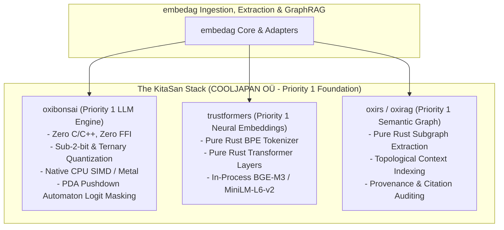

# External Ecosystem & The KitaSan Stack (Priority 1)

| Metadata | Details |
| :--- | :--- |
| **Document ID** | `19_External_Ecosystem_and_KitaSan_Stack` |
| **Domain** | Priority 1 Vendor Ecosystem & External Stack Audit |
| **Responsibility** | Technical Audit of External Repositories: `cool-japan/oxibonsai`, `trustformers`, `oxirs`, and `leynos/diesel-cte-ext` |
| **Target Crates** | `embedag-llm`, `embedag-diesel`, `embedag-core` |
| **Status** | Definitive Architectural Specification |

---

## 1. Executive Summary & Strategic Ranking

To satisfy the ironclad requirement that `embedag` must be **100% written in Rust** with zero runtime C/C++ dynamic libraries or Python runtimes, the **KitaSan ecosystem (`cool-japan` / COOLJAPAN OÜ)** is adopted as the **Priority 1 (Default) Machine Learning, Inference, and GraphRAG Foundation**.

Other frameworks (such as Hugging Face Candle, FastEmbed ONNX Runtime, or remote Cloud APIs) are secondary or optional fallbacks, but the **KitaSan stack represents the primary first-class architectural core**.

---

## 2. In-Depth Analysis of the KitaSan Ecosystem (`cool-japan`)

### 2.1 `oxibonsai`: Zero-FFI Pure Rust LLM Inference Engine (Priority 1)
- **Repository**: [`cool-japan/oxibonsai`](https://github.com/cool-japan/oxibonsai)
- **Crates.io**: `oxibonsai`, `oxibonsai-core`, `oxibonsai-runtime`, `oxibonsai-tokenizer`, `oxibonsai-kernels`
- **Why It Is Top 1**:
  - **Zero C/C++ / Zero-FFI**: Compiles cleanly with standard `cargo build` on macOS, Linux, and Windows.
  - **Sub-2-Bit & Ternary Quantization**: Natively runs 1-bit (`Q1_0_g128`) and ternary (`TQ2_0_g128`) models with minimal memory footprint on edge devices, CPU SIMD (AVX-512, NEON), and Apple Metal.
  - **Standalone Pure Rust Tokenizer (`oxibonsai-tokenizer`)**: Ingests Hugging Face `tokenizer.json` files without external C dynamic libraries.
  - **In-Process Integration**: Embedded directly into the `embedag-llm` binary with zero network latency.

### 2.2 `trustformers`: Pure Rust Neural Embeddings & Transformers (Priority 1)
- **Repository**: [`cool-japan/trustformers`](https://github.com/cool-japan/trustformers)
- **Why It Is Top 1 for Embeddings**:
  - Pure Rust implementation of transformer attention and pooling layers.
  - Pre-trained weights for BGE-M3 and MiniLM loaded via pure-Rust Safetensors.

### 2.3 `oxirs` & `oxirag`: Pure Rust Semantic Web & GraphRAG (Priority 1)
- **Repository**: [`cool-japan/oxirs`](https://github.com/cool-japan/oxirs)
- **Why It Is Top 1 for Graph Utilities**:
  - Subgraph extraction and topological context aggregation without external SPARQL server daemons.

---

## 3. Analysis of `leynos/diesel-cte-ext` (Priority 1 Relational CTE Extension)

- **Repository**: [`leynos/diesel-cte-ext`](https://github.com/leynos/diesel-cte-ext)
- **Architectural Value**:
  - Brings first-class recursive CTE capabilities to Diesel's query builder.
  - Enables type-safe arbitrary-depth graph queries without raw SQL strings.
  - Seamlessly handles PostgreSQL and SQLite recursive CTE syntax.

---

## 4. Priority Ranking Matrix

| Technology | Category | Priority Tier | Rationale |
| :--- | :--- | :--- | :--- |
| `cool-japan/oxibonsai` | LLM Inference | **Priority 1 (Default)** | Pure Rust, Zero-FFI, Ternary Quantization, Grammar PDA Masking. |
| `cool-japan/trustformers`| Neural Embeddings | **Priority 1 (Default)** | Pure Rust Transformer layers, native BGE-M3 & MiniLM support. |
| `leynos/diesel-cte-ext` | SQL CTE Builder | **Priority 1 (Default)** | First-class recursive CTE support in Diesel for Postgres and SQLite. |
| `cool-japan/oxirs` | Graph Utilities | **Priority 1 (Default)** | Pure Rust semantic graph extraction. |
| `fastembed-rs` | Neural Embeddings | **Priority 2 (Fallback)** | Requires ONNX Runtime C library; useful for legacy environments. |
| Cloud APIs (OpenAI/Anthropic)| LLM Inference | **Priority 3 (Optional)** | Cloud-only fallback; introduces network latency and privacy concerns. |
