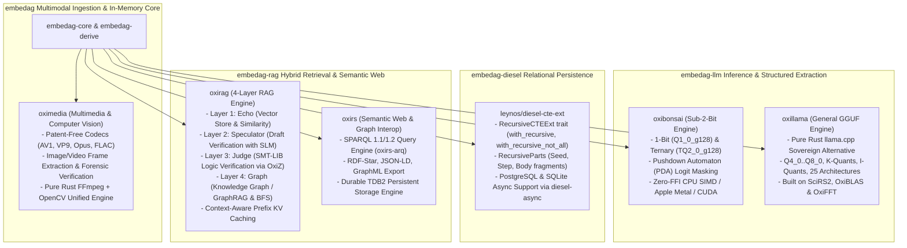

# External Ecosystem & The KitaSan Stack (Priority 1)

| Metadata | Details |
| :--- | :--- |
| **Document ID** | `19_External_Ecosystem_and_KitaSan_Stack` |
| **Domain** | Priority 1 Vendor Ecosystem & External Stack Audit |
| **Responsibility** | Technical Audit of External Open Source Repositories: `cool-japan/oxibonsai`, `cool-japan/oxirag`, `cool-japan/oxirs`, `cool-japan/oxillama`, `cool-japan/oximedia`, and `leynos/diesel-cte-ext` |
| **Target Crates** | `embedag-llm`, `embedag-diesel`, `embedag-core`, `embedag-rag`, `embedag` |
| **Status** | Definitive Architectural Specification |

---

## 1. Executive Summary & Strategic Open-Source Mandate

To satisfy the ironclad requirement that `embedag` must be **100% written in Rust** with zero runtime C/C++ dynamic libraries, zero CMake/libtorch bindings, and zero Python runtimes, the **KitaSan open-source ecosystem (`cool-japan` / COOLJAPAN OÜ)** is adopted as the **Priority 1 (Default) Machine Learning, Inference, Semantic Web, Multimedia, and GraphRAG Foundation**.

### 1.1 Strict Open-Source Sovereignty & License Boundary
- **Source of Truth**: [`cool-japan/cool-japan`](https://github.com/cool-japan/cool-japan).
- **Mandate**: **Strictly Open-Source (Apache-2.0 / MIT)**.
- **Explicit Exclusion of Commercial Verticals**: The COOLJAPAN ecosystem provides both open-source foundations and commercial licensed vertical workspaces (e.g., `autors`, `med`, `cad`, `aero`, `eda`, `3d`, `car`). `embedag` **strictly utilizes only the free open-source Apache-2.0 core projects**, never introducing proprietary licensed vertical dependencies or closed codebases.
- **Zero FFI / fail0 + Clippy0**: Every adopted crate in the KitaSan foundation enforces 100% pure Rust, zero C/C++/Fortran FFI, and zero Clippy warnings (`fail0 + Clippy0`).
- **Relational Persistence Partner**: In relational persistence and hierarchical graph queries, [`leynos/diesel-cte-ext`](https://github.com/leynos/diesel-cte-ext) provides first-class recursive CTE support directly atop Diesel and `diesel-async`.

---

## 2. In-Depth Technical Audit: The KitaSan Open-Source Stack

---

### 2.1 `oxibonsai`: Zero-FFI Sub-2-Bit LLM Inference Engine (Priority 1)
- **Repository**: [`cool-japan/oxibonsai`](https://github.com/cool-japan/oxibonsai)
- **License**: Apache-2.0 (Open Source)
- **Crates**: `oxibonsai`, `oxibonsai-core`, `oxibonsai-runtime`, `oxibonsai-tokenizer`, `oxibonsai-kernels`
- **Architectural Strengths**:
  - **Zero C/C++ / Zero-FFI**: Compiles cleanly with standard `cargo build` on macOS, Linux, and Windows without CMake or LibTorch.
  - **Sub-2-Bit & Ternary Quantization**: Natively runs 1-bit (`Q1_0_g128`) and ternary (`TQ2_0_g128`) models with minimal memory footprint on edge devices, CPU SIMD (AVX-512, NEON), and Apple Metal.
  - **Pushdown Automaton (PDA) Token Masking**: Integrates directly with `embedag-llm` grammar compiler to apply $-\infty$ logit masks on invalid tokens before Softmax, guaranteeing 100% schema compliance.
  - **In-Process Integration**: Embedded directly into the `embedag-llm` binary with zero network latency.

### 2.2 `oxillama`: Pure-Rust GGUF LLM Inference Engine (Priority 1 Sovereign Alternative to llama.cpp)
- **Repository**: [`cool-japan/oxillama`](https://github.com/cool-japan/oxillama)
- **License**: Apache-2.0 (Open Source)
- **Crates**: `oxillama`, `oxillama-gguf`, `oxillama-quant`, `oxillama-arch`, `oxillama-runtime`, `oxillama-server`, `oxillama-gpu`
- **Architectural Strengths**:
  - **Full GGUF Model Loading**: Complete native parser for GGUF model formats without external C libraries.
  - **Multi-Format Quantization**: Supports standard integer quants (`Q4_0` through `Q8_0`), K-quants (`Q2_K`..`Q6_K`), I-quants (`IQ1_S`..`IQ4_NL`), and `Q1_0_G128`.
  - **25 Architectures Supported**: Broad coverage including LLaMA, Qwen3, Mistral, Gemma, Phi, Command-R, StarCoder, Falcon, DeepSeek-V2/V3, DBRX, Grok-1, Mamba-2, OLMo2, Yi, Granite, LLaVA, BLOOM.
  - **COOLJAPAN Foundation Layer**: Directly built upon pure Rust scientific computing building blocks: `SciRS2` (Tensor), `OxiBLAS` (GEMM), and `OxiFFT` (RoPE).
  - **Role in `embedag`**: Works alongside `oxibonsai` in `embedag-llm` to provide general GGUF model execution when general-purpose weights (e.g. Mistral-7B, Qwen-2.5-3B) are deployed.

### 2.3 `oxirag`: Four-Layer RAG Engine with SMT Logic Verification (Priority 1 GraphRAG)
- **Repository**: [`cool-japan/oxirag`](https://github.com/cool-japan/oxirag)
- **License**: Apache-2.0 (Open Source)
- **Architectural Strengths**:
  - **Layer 1 (Echo)**: Pure Rust in-memory vector store with configurable capacity and Cosine, Euclidean, and Dot Product similarity metrics.
  - **Layer 2 (Speculator)**: Speculative RAG verification using SLM or rule-based draft checkers (Accept / Revise / Reject decision pipeline).
  - **Layer 3 (Judge)**: SMT-based logic verification using SMT-LIB encoding and the pure-Rust `OxiZ` SMT solver. Verifies causal, temporal, and modal consistency of extracted graph claims to prevent hallucinated assertions.
  - **Layer 4 (Graph)**: Native GraphRAG knowledge graph retrieval with BFS traversal, shortest-path calculation, N-hop bounded queries, and hybrid vector+graph search.
  - **Context-Aware Prefix Caching**: Efficient KV cache management for recurring premise knowledge.
  - **Role in `embedag`**: Directly integrates into `embedag-rag` for candidate vector retrieval, draft verification, formal logic checking, and topological subgraph expansion.

### 2.4 `oxirs`: Modular Semantic Web, SPARQL 1.2 & RDF-Star Platform (Priority 1)
- **Repository**: [`cool-japan/oxirs`](https://github.com/cool-japan/oxirs)
- **License**: Apache-2.0 (Open Source)
- **Crates**: `oxirs-core`, `oxirs-arq`, `oxirs-tdb`, `oxirs-fuseki`
- **Architectural Strengths**:
  - **Complete SPARQL 1.1/1.2 Query Engine**: Powered by `oxirs-arq` with query optimization, CONSTRUCT/DESCRIBE template instantiation, and federated queries.
  - **Durable TDB2 Storage Engine**: Pure Rust on-disk storage backend (`oxirs-tdb`) with superblock, fsync-backed writes, free-page allocator, and GSPO/GPOS/GOSP indexes.
  - **RDF-Star & W3C Standards**: First-class support for RDF-Star statements, Turtle, TriG, N-Quads, JSON-LD, and GraphQL schema autogeneration (`graphql_autoschema`).
  - **Role in `embedag`**: Provides semantic graph export (JSON-LD, RDF-Star) in `embedag-core`, ontology mapping, and SPARQL 1.2 querying over the topological graph in `embedag-rag`.

### 2.5 `oximedia`: Patent-Free Multimedia & Computer Vision Framework (Priority 1 Multimodal)
- **Repository**: [`cool-japan/oximedia`](https://github.com/cool-japan/oximedia)
- **License**: Apache-2.0 (Open Source)
- **Crates**: `oximedia`, `oximedia-cli`, `oximedia-wasm`
- **Architectural Strengths**:
  - **Clean-Room Pure Rust FFmpeg + OpenCV Reconstruction**: Unifies multimedia processing and computer vision in a single memory-safe Rust framework with zero C/C++ dependencies.
  - **Patent-Free Codecs**: Bit-exact pure Rust implementations of AV1, VP9, VP8, Opus, Vorbis, FLAC.
  - **Computer Vision & Video Inspection**: Scene analysis, frame extraction, shot detection, spatial/temporal denoising, camera calibration, color management, and forensic image analysis (ELA, PRNU, copy-move detection).
  - **Async-First Architecture**: Built on Tokio for non-blocking stream processing and media decoding.
  - **Role in `embedag`**: Decodes and preprocesses multimodal inputs (invoices, scanned receipts, product images, video frames, audio telemetry) directly in pure Rust before passing visual/audio features to embedding encoders.

---

## 3. Analysis of `leynos/diesel-cte-ext` (Priority 1 Relational CTE Extension)

- **Repository**: [`leynos/diesel-cte-ext`](https://github.com/leynos/diesel-cte-ext)
- **License**: ISC (Open Source)
- **Architectural Strengths**:
  - **Type-Safe Recursive Query Builders**: Provides the `RecursiveCTEExt` trait directly extending Diesel connections:
    - `.with_recursive(...)` for standard recursive queries (`UNION ALL`).
    - `.with_recursive_not_all(...)` for deduplicated recursive queries (`UNION`).
  - **Composable Parts with `RecursiveParts`**: Encapsulates seed query, step query, and primary query fragments (`RecursiveParts::new(seed, step, body)`).
  - **Macro Helpers**: Offers `columns!`, `table_columns!`, `seed_query!`, `step_query!`, and `cte_query!` to bridge runtime column names to compile-time Diesel metadata.
  - **Async Support**: Ships with the `async` feature enabling `RecursiveCTEExt` on `diesel_async` connection pools (`AsyncPgConnection`).
  - **Cross-Backend Compatibility**: Handles both PostgreSQL and SQLite recursive CTE dialect differences seamlessly without raw SQL string concatenation.
  - **Role in `embedag`**: Powers arbitrary-depth multi-parent hierarchy traversals and SQL-level visited path cycle detection in `embedag-diesel`.

---

## 4. Technology Priority Ranking Matrix

| Technology | Category | Priority Tier | License | Primary Architectural Rationale |
| :--- | :--- | :--- | :--- | :--- |
| `cool-japan/oxibonsai` | LLM Inference | **Priority 1 (Default)** | Apache-2.0 (Open Source) | Zero-FFI, sub-2-bit ternary/1-bit quantization, grammar PDA logit masking. |
| `cool-japan/oxillama` | LLM Inference | **Priority 1 (Default)** | Apache-2.0 (Open Source) | Pure Rust sovereign llama.cpp replacement, GGUF parser, 25 architectures, Q4..Q8 quants. |
| `cool-japan/oxirag` | RAG & Logic Verifier | **Priority 1 (Default)** | Apache-2.0 (Open Source) | 4-layer engine (Echo vector store, Speculator, Judge SMT logic checking with OxiZ, GraphRAG). |
| `cool-japan/oxirs` | Semantic Web & Graph | **Priority 1 (Default)** | Apache-2.0 (Open Source) | RDF-Star, SPARQL 1.1/1.2, TDB2 persistent storage, JSON-LD / GraphML export. |
| `cool-japan/oximedia` | Multimodal Processing | **Priority 1 (Default)** | Apache-2.0 (Open Source) | Pure Rust FFmpeg + OpenCV reconstruction, patent-free codecs, image/video frame extraction. |
| `leynos/diesel-cte-ext` | SQL CTE Builder | **Priority 1 (Default)** | ISC (Open Source) | `RecursiveCTEExt` typed recursive queries (`UNION ALL` & `UNION`), async support for Diesel. |
| `cool-japan/trustformers`| Neural Embeddings | **Priority 1 (Default)** | Apache-2.0 (Open Source) | Pure Rust transformer layers, BGE-M3 & MiniLM tokenization and inference. |
| `fastembed-rs` | Neural Embeddings | **Priority 2 (Fallback)** | Apache-2.0 | Requires ONNX Runtime C library; secondary fallback for legacy models. |
| Cloud APIs (OpenAI / Anthropic)| LLM Inference | **Priority 3 (Optional)** | Proprietary / Cloud | Remote fallback; introduces network roundtrip latency and privacy concerns. |
| COOLJAPAN Vertical Workspaces | Vertical Applications | **Excluded (Commercial)** | Commercial | `autors`, `med`, `cad`, `aero`, `eda`, `3d`, `car` are commercial licensed products; NOT used in `embedag`. |
