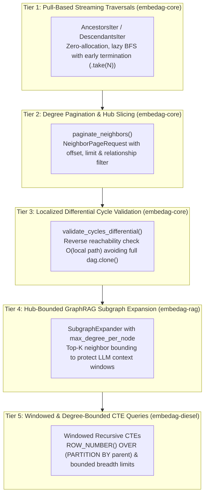

# Heavy Graph Handling & Topological Pagination

| Metadata | Details |
| :--- | :--- |
| **Document ID** | `21_Heavy_Graph_Handling_and_Topological_Pagination` |
| **Domain** | Graph Scalability, Bounded Traversal, and Topological Pagination |
| **Responsibility** | Architectural strategies and concrete implementations for scaling to heavy graphs ($10^5+$ nodes), hub mitigation, lazy streaming iterators, and localized differential cycle validation. |
| **Target Crates** | `embedag-core`, `embedag-rag`, `embedag-diesel` |
| **Status** | Definitive Architectural Specification |

---

## 1. Executive Summary & Problem Formulation

In relational databases, datasets scale along a single dimension: rows. Standard pagination (`LIMIT` / `OFFSET` or cursor-based `WHERE id > cursor LIMIT n`) operates linearly on flat collections.

In Directed Acyclic Graphs (DAGs) and knowledge graphs, however, scale is multidimensional:
1. **Depth ($D$)**: Path distance from leaf to root or vice-versa.
2. **Breadth / Degree ($B$)**: Branching factor (fan-in and fan-out per vertex).
3. **Neighborhood Radius ($K$)**: Number of topological hops in an ego-network ($O(B^K)$ explosion).
4. **Payload Mass ($M$)**: Heavy attribute vectors, embeddings, text chunks, and multimedia blobs stored on each node.

When a graph contains **supernodes (hubs)** with tens of thousands of adjacent edges, or scales to millions of vertices, naive in-memory operations and unpaginated traversals fail:
- Full graph cloning (`dag.clone()`) and global Tarjan SCC in cycle validation cause memory churn.
- BFS traversals collecting into eager `Vec<&T>` allocate massive heap buffers and prevent early exit.
- Unbounded neighbor expansion in GraphRAG overflows LLM context windows.
- Recursive CTEs without breadth partitioning retrieve tens of thousands of rows at intermediate depths.

To address these challenges, `embedag` adopts a **5-Tier Heavy Graph Architecture**:



---

## 2. Solution 1: Pull-Based Streaming Traversal Iterators

### 2.1 The Architectural Anti-Pattern: Eager `Vec<&T>` Allocation
Previously, `transitive_ancestors` and `transitive_descendants` in `MemoryDag<T>` executed Breadth-First Search (BFS) to completion and allocated a flat `Vec<&T>`. If a node sits below an ancestor tree of 50,000 nodes, but the caller only needs the first 10 matching categories, the entire subtree is traversed and allocated on the heap.

### 2.2 Streaming Iterators Design
`embedag-core` introduces zero-allocation pull-based traversal iterators implementing standard Rust `Iterator`:
- `AncestorsIter<'a, T>`: Traverses incoming edges lazily using an inverted index visitor.
- `DescendantsIter<'a, T>`: Traverses outgoing edges lazily using forward BFS.

Caller advantages:
1. **Zero Eager Heap Allocation**: Only the active BFS queue and visited set are maintained.
2. **Short-Circuit Evaluation**: Calls like `dag.ancestors_iter(&key).take(10).collect()` stop immediately after finding 10 ancestors, executing in $O(10)$ rather than $O(|V| + |E|)$.
3. **Depth-Aware Streaming**: Supports `ancestors_with_depth_iter` returning `(&'a T, usize)` (node reference and relative hop distance).

---

## 3. Solution 2: Degree Pagination & Hub Slicing

### 3.1 The Supernode / Hub Problem
In real-world graphs (e.g. product taxonomies or citation networks), certain nodes exhibit power-law degree distributions. A root category like *"Electronics"* may have $100,000$ direct child SKUs. Calling `dag.children_of(&key)` materializes a 100,000-element vector.

### 3.2 Degree Pagination Contracts
`embedag-core` implements deterministic degree slicing via `paginate_neighbors`:

```rust
pub struct NeighborPageRequest<'a, K> {
    pub key: &'a K,
    pub direction: Direction,
    pub offset: usize,
    pub limit: usize,
    pub relationship: Option<&'a str>,
}

pub struct NeighborPage<'a, T: NodePayload> {
    pub items: Vec<(&'a T, &'a EdgePayload)>,
    pub total_count: usize,
    pub next_offset: Option<usize>,
    pub has_more: bool,
}
```

This guarantees that consumer APIs can page through high-degree vertices with deterministic offsets, filtering by edge relationship and edge confidence without loading the entire adjacency list.

---

## 4. Solution 3: Localized Differential Cycle Validation

### 4.1 The Full Clone Anti-Pattern
Previously, `MutationPlan::validate_cycles` performed:
```rust
let mut shadow = dag.clone(); // Clones ENTIRE graph arena & HashMap!
...
shadow.validate_acyclic()?;   // Tarjan's SCC over the entire graph O(V + E)
```
When `MemoryDag` holds $10^5$ nodes, cloning the entire graph for a small batch of 3 edge additions produces unacceptable latency spikes and memory duplication.

### 4.2 Differential Reachability Invariant
A directed acyclic graph remains acyclic after adding edge $U \to V$ **if and only if** there is no directed path from $V$ to $U$ ($V \not\rightsquigarrow U$).
- `UpsertNode` directives cannot create cycles.
- `RemoveEdge` directives cannot create cycles.
- `AddEdge { parent: U, child: V }` creates a cycle if and only if $V \rightsquigarrow U$.

`MutationPlan` now uses a **differential reachability validator**:
1. Inspects only proposed `AddEdge` directives.
2. For each proposed edge $U \to V$, executes a localized reverse BFS from $V$ to $U$ over the existing DAG and the newly introduced edges.
3. Bypasses the monolithic `dag.clone()` entirely, reducing time complexity from $O(|V_{\text{total}}| + |E_{\text{total}}|)$ to $O(|V_{\text{local}}| + |E_{\text{local}}|)$ and memory overhead from $O(V + E)$ to $O(1)$.

---

## 5. Solution 4: Hub-Bounded GraphRAG Subgraph Expansion

### 5.1 The LLM Context Window Problem
During Stage 2 Subgraph Expansion (`oxirag` Layer 4), candidate anchor nodes are expanded across $K$ hops. If an anchor connects to a hub with 1,000 children, unbounded expansion pulls all 1,000 nodes into the reasoning context, exhausting token budgets and diluting attention.

### 5.2 Bounded Expansion Configuration
`embedag-rag::expansion::SubgraphExpander` is enhanced with:
- `max_degree_per_node: Option<usize>`: Maximum neighbors explored per vertex per hop (e.g., top 25).
- `min_confidence_cutoff: Option<f32>`: Edge confidence pruning threshold.
- Neighbors are sorted by edge confidence and weight, prioritizing the most statistically grounded paths.

---

## 6. Solution 5: Windowed & Degree-Bounded CTE Traversals

### 6.1 Database-Level Breadth Explosion
In `embedag-diesel`, `WITH RECURSIVE` queries bound traversal depth via `WHERE t.depth < max_depth`. However, if any intermediate level has high degree, the database engine returns thousands of rows in a single result set.

### 6.2 Windowed Recursive CTEs
`embedag-diesel` introduces degree bounds in CTE generation:
- PostgreSQL & SQLite windowed step query:
  ```sql
  SELECT t.id, t.parent_id, a.depth + 1, t.name
  FROM (
      SELECT *, ROW_NUMBER() OVER (PARTITION BY parent_id ORDER BY confidence DESC) as rn
      FROM semantic_edges
  ) e
  JOIN semantic_nodes t ON t.id = e.parent_id
  WHERE rn <= :max_breadth_per_node
  ```
- Exposes `max_breadth_per_node: Option<i32>` in `HierarchicalTableConfig`, `CteHierarchyBuilder`, and `RecursiveTraversalBuilder`.

---

## 7. Performance & Complexity Verification

| Metric | Unpaginated Baseline | Paginated / Bounded Implementation |
| :--- | :--- | :--- |
| **Ancestor Traversal Peak RAM** | $O(|V|)$ eager allocations | $O(\text{queue}) \approx O(\text{depth} \times \text{degree})$ |
| **Early Exit Latency (Take 10)** | $O(|V| + |E|)$ (traverses all) | $O(10)$ (lazy iterator) |
| **Cycle Validation Time** | $O(|V_{\text{total}}| + |E_{\text{total}}|)$ (full Tarjan SCC) | $O(|V_{\text{local}}| + |E_{\text{local}}|)$ (reachability BFS) |
| **Cycle Validation Allocation** | Clones entire `MemoryDag` | $0$ DAG clones ($O(\text{local visited})$ set) |
| **Hub Node Expansion (1k edges)** | 1,000 nodes in prompt context | Bound to `max_degree_per_node` (e.g. 25 items) |
| **CTE Result Set Size** | Unbounded width per depth | Bounded by `max_breadth_per_node` |
