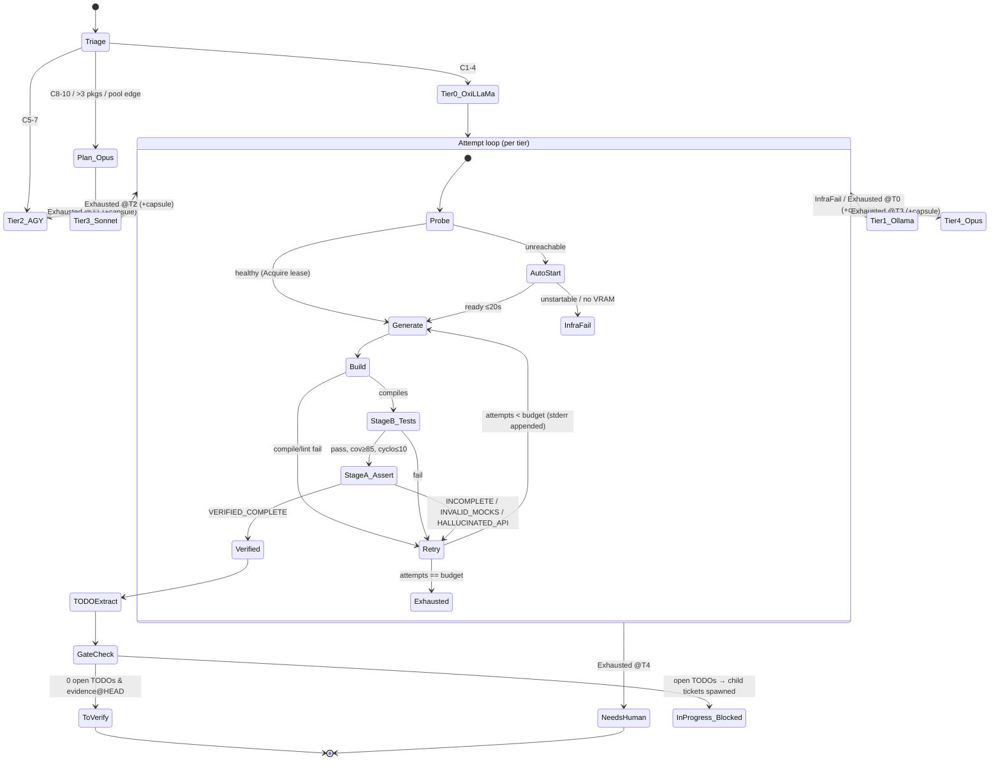

<!-- Imported from Dendrite docs/architecture/2026-10-quality-audit-execution-plan.md @ 69ea048 on 2026-10-18. Source of truth for this repo's scope; keep in sync with the Dendrite copy until the extraction umbrella lands. -->

# Dendrite Quality Audit & Architectural Execution Plan (2026-10)

> **Scope**: 13 engineering pillars. Pillars 1, 2, 8 and 13 come first.
> **Baseline**: branch `develop` @ `d625bfd`. `go build ./...` passes.
> **Ticket IDs**: the `DEN-9xx` numbers below are placeholders. Plane v2 assigns the real sequence IDs when the tickets are created.

---

## 0. Executive Summary — the five findings that drive this plan

| #  | Finding                                                                                                                                                                                                                                                                                                                                           | Evidence                                                                                                     | Impact                                                                                                                                                                                    |
|----|---------------------------------------------------------------------------------------------------------------------------------------------------------------------------------------------------------------------------------------------------------------------------------------------------------------------------------------------------|--------------------------------------------------------------------------------------------------------------|-------------------------------------------------------------------------------------------------------------------------------------------------------------------------------------------|
| F1 | **The semantic feature assertion is a stub that always passes.** `LocalOllamaAnalyzer.AnalyzeFeature` and `AGYFallbackAnalyzer.AnalyzeFeature` return a hard-coded `HasLogicalBugs: false`. `AuditFinishedTicket` calls them with an **empty diff (`""`)**.                                                                                       | `pkg/quality/quality.go:160-192`, `:415`                                                                     | Every ticket passes the "LLM" stage. The only real gates are a `git grep` regex and `go test`. This explains the 37 tickets in `To Verify` that have no DoD (`incompleted_context.md`).   |
| F2 | **The anti-mock gate is a regex over every file, test files included.** `ScanFilesForMocks` greps for `gomock\|testify/mock\|type Mock\|type Fake\|t.Skip(` and does **not** exclude `_test.go`.                                                                                                                                                  | `pkg/quality/quality.go:245-279`                                                                             | It rejects legitimate test-boundary mocks. It misses stubbed production code that doesn't use those names, such as `return nil, nil // TODO`. That is backwards from what Pillar 1 needs. |
| F3 | **LiteLLM key handling is broken or unsafe in every variant.** Committed `compose.control.yaml` mounts the config but uses the static fallback `sk-dendrite-master-key` and sets `LITELLM_DANGEROUSLY_PERMIT_WEAK_OR_UNSET_MASTER_KEY: "true"`. Committed `compose.dev.yaml` passes no key and no config at all. An *uncommitted* working-tree edit (2026-10-17) removed the key, the config mount and `command` from `compose.control.yaml`. That edit is what causes the current `UnsafeMasterKeyError` crash. The static key also sits in a **git-tracked** `stacks/.env`. | `stacks/compose.control.yaml:48-68` (HEAD vs. working tree), `stacks/compose.dev.yaml:53-66`, `git ls-files stacks/.env` | LiteLLM either crashes at boot or runs with a guessable admin key that is committed to the repo. |
| F4 | **Local routing favors Ollama, and nothing tracks model lifecycle.** `DefaultManager` registers Ollama first. The triage tie-break is a strict `>`, so Ollama wins ties. Capability is just a parameter-count regex (`ModelIntelligenceScore`). There's no per-model idle/cooldown state, auto-start, or escalation on build or semantic failure. | `pkg/inference/manager.go:282-305`, `pkg/agent/triage/triage.go:118-131`, `pkg/inference/intelligence.go:19` | Pillar 2 is about 25% done. The cascade only reacts to HTTP errors.                                                                                                                       |
| F5 | **There are two CLIs.** Root `main.go` is a Cobra CLI with 5 commands. `cmd/dendrite/` is a custom `pkg/cli.Registry` with about 28 commands, neural-themed aliases (`soma-diagnose`, `homeostasis`, …), stdlib `flag` parsing, and **exit code 0 on error** (`cmd/dendrite/main.go:47-50`). `go.mod` lists Cobra as `// indirect`.               | `main.go`, `cmd/dendrite/main.go`                                                                            | CI can't detect failing commands. Help, completions and `--json` aren't consistent across commands.                                                                                       |

Other hygiene issues found during the audit:
- Runtime state is written into package directories. Five tracked files sit under `pkg/**/.dendrite/`, for example `pkg/server/.dendrite/zero_cost_models.json` and `pkg/scheduler/governor/.dendrite`. The cause is tests resolving `.dendrite` from the CWD instead of `t.TempDir()`.
- `coverage.out` is at the repo root.
- `pkg/ast` is a **line-based heuristic** (`bufio` + `strings.HasPrefix`), not Tree-sitter.
- `pkg/ai/tokenopt.EstimateTokens` is a character heuristic.
- `AuditFinishedTicket` requires **100%** coverage gap tickets. That conflicts with the 85% gate in Pillar 1, which this plan adopts.
- `tokens.Evaluator` probes the AGY CLI only. It never queries the LiteLLM ledger.

### Pushback / scoping decisions (applied throughout)
1. **"Strip all regex" applies to *completion verdicts*, not to parsing.** Regexes that extract `DEN-\d+` IDs (`pkg/devtool/commit.go:92,205,282,287`) or package paths stay. They're the right tool for that job. Regexes that decide whether a feature is complete or mock-free get removed.
2. **Rust comes after the interfaces, not before.** Pillars 1, 2, 8 and 13 ship first in Go, behind interfaces (`ASTProvider`, `HunkClusterer`, `TokenCounter`, `ChunkHasher`). `dendrite-core-rs` and `dendrite-git-rs` then plug in as **stdio JSON-RPC sidecars**, not cgo. That keeps `go build` pure, keeps cross-compilation working, and lets each Rust crate be benchmarked against the Go baseline before it replaces it.
3. **Exact pre-flight token counts are only possible per tokenizer.** For local GGUF models, use the model's own tokenizer: the OxiLLaMa/Ollama `/tokenize` endpoint, or HF `tokenizers` in Rust. For Claude, use the Messages `count_tokens` endpoint. For anything else, fall back to the heuristic with a 1.15× safety factor. Don't claim "exact" for every model.
4. **External integrations need verification before tickets are finalized.** These weren't verified against live docs during this audit: Penpot's official MCP server deployment shape, Plane AI's env var names, and whether Plane AI needs a commercial edition. Each one has a 1-point spike ticket.

---

## 1. Codebase Audit & Open-Source Integration Matrix

### 1.1 File-by-file gap analysis

| Area | Files | Current state | Gap vs. pillars | Action |
|------|-------|---------------|-----------------|--------|
| CLI root | `main.go` (612 LOC) | Cobra: `version`, `doctor`, `env`, `dev`, `jetbrains` | Duplicates `cmd/dendrite` | **Delete** after migration. `cmd/dendrite` becomes the only binary (P10). |
| CLI | `cmd/dendrite/*.go` (~8.6k LOC, 28 files) | Custom registry, `flag`, neural aliases, exit 0 on error | No noun-verb tree, no `--json` parity, no completions | Port to Cobra: `cmd/dendrite/cmd/<noun>.go` (P10) |
| Assertion | `pkg/quality/quality.go` | Stub analyzers, regex mock scan, 100% coverage gaps | F1, F2 | Replace with `pkg/assert` pipeline (P1) |
| Commit | `pkg/devtool/commit.go` (~800 LOC) | Ticket resolution plus a single-message synthesis via Ollama/OxiLLaMa CLI/LiteLLM. `git add -A` unless already staged. | No hunk clustering, no multiple atomic commits, no `--local-review` | Split into `pkg/commit/{hunks,cluster,plan,review}` (P8) |
| Triage | `pkg/agent/triage/*.go` | Ollama vs. OxiLLaMa by param-count score, Ollama wins ties | F4 | Replace selection with `pkg/inference/router` (P2) |
| Inference | `pkg/inference/*` (6.7k LOC) | 8 engine adapters, FIFO priority queue, cascade on error | No lifecycle/cooldown, no capability catalog, no semantic escalation | Add `catalog.go`, `lifecycle.go`, `ladder.go` (P2) |
| Ollama | `pkg/ollama/client.go` | Ping/health/list | No `keep_alive` control, no `/api/ps` (loaded models) | Add `Loaded()`, `Unload()` via `keep_alive: 0` (P2) |
| Gateway | `pkg/gateway/{renderer,updater,types}.go` | Renders LiteLLM YAML with `master_key: os.environ/LITELLM_MASTER_KEY` and `context_window_fallbacks` | Correct config, but the dev stack never mounts it, and the key is weak or bypassed (F3) | Wire compose and add `enable_pre_call_checks` (P4, P13) |
| Env | `pkg/env/{planner,replicator,detector}.go` | Plan/replicate stacks | No secret provisioning | `env/secrets.go` with `EnsureLiteLLMMasterKey` (P4) |
| Tokens | `pkg/tokens/evaluator.go`, `pkg/scheduler/token/*` | AGY CLI probe. Weekly-reset, sprint-window and quota-floor policy already exist (`scheduler/token/scheduler.go:69`). | No LiteLLM `/spend`, no local telemetry, no per-ticket attribution | 4-source aggregator `pkg/tokens/live` (P11) |
| Token opt | `pkg/ai/tokenopt/{compactor,cache}.go` | `CompactGoSource(source, keepSymbols)` exists, char-heuristic `EstimateTokens` | Go only, no truncation splicing, no checkpointing | Generalize into `pkg/ctxbudget` (P13) |
| AST | `pkg/ast/*` (472 LOC) | Line heuristics | Not syntax-aware | `ASTProvider` interface: Go `go/ast` impl now, Tree-sitter via `dendrite-core-rs` later (P9, P13) |
| Store / RAG | `pkg/store/segmented` (SQLite index + blob store), `pkg/rag` | Local CAS, SQLite index | No remote tier, no WAL, no modes | `pkg/memory/{localonly,edge,push}` (P7) |
| Pool | `pkg/pool/{dag,split,switcher}` | DAG solver, splitter, transactional switcher | No Cargo `[patch]` / `go.work` co-sync proof | Dogfood E2E (P9) |
| Agent runner | `pkg/agent/runner.go`, `sandboxed_runner.go` | Launches `aider`, `agy`, etc. with env | Plain wrapper, no pre/stream/post hooks, no registry | `pkg/toolreg` + `pkg/agent/supervise` (P12) |
| Tracker | `pkg/tracker/plane/client.go` | `UpdateStatus` does no gating | Any caller can move a ticket to Done | `GatedTracker` decorator (P1.4) |
| Stacks | `stacks/compose.*.yaml` | Weak or bypassed LiteLLM key, dev stack has no config. No Penpot MCP. No Plane AI env. | F3, P5 | Compose edits (P4, P5) |
| Repo hygiene | `pkg/**/.dendrite/`, `coverage.out`, `stacks/.env` | Runtime artifacts tracked | Noise in diffs, a committed secret | `git rm --cached`, `.gitignore`, rotate key (DEN-901) |

### 1.2 Open-source integration matrix — build vs. adopt

| Capability | Adopt (OSS) | Custom Dendrite layer | Boundary |
|------------|-------------|------------------------|----------|
| Cloud routing, spend ledger, virtual keys, TPM/RPM, provider fallback | **LiteLLM Proxy** (`:4000`): `fallbacks`, `context_window_fallbacks`, `enable_pre_call_checks: true`, `/spend/logs`, `/key/info`, `/global/spend` | `pkg/gateway` renders config. `pkg/tokens/live` reads the ledger. | Dendrite never re-implements spend accounting. It reads LiteLLM. |
| In-process low-latency routing for local engines | **Bifrost** patterns: provider interface, weighted key pools, per-provider concurrency/buffer config | `pkg/inference/router` and `ladder` | Use Bifrost's Go SDK only if it supports custom providers (OxiLLaMa). Otherwise copy the patterns into `pkg/inference`. **Spike DEN-905.** |
| Session memory, conversation flush, FTS recall | **Engram** (Gentle-AI, SQLite/FTS5, MCP) | `pkg/ctxbudget/checkpoint` writes `<StateCheckpoint>` and flushes history into Engram. | Engram owns the memory. Dendrite owns the checkpoint schema. |
| Syntax-aware parsing | **Tree-sitter** (Rust grammars) | `dendrite-core-rs` exposes `fold_signatures`, `last_complete_node`, `complexity` | Go `go/ast` stays as the in-process fallback for `.go`. |
| Git object access | **gitoxide** (`gix`) | `dendrite-git-rs`: hunk graph and clusterer | Go shells out to `git` until the sidecar lands. |
| Hashing | **BLAKE3** (`blake3` crate, or `lukechampine.com/blake3` in Go) | Chunk addressing in `pkg/ctxbudget/chunks` | Use the Go impl first. The Rust impl must produce byte-identical digests. |

---

## 2. Top-Priority Architecture Specs

### 2.1 Pillar 1 — LLM feature/mock assertion pipeline and TODO extractor

**New package `pkg/assert`.** It replaces the stub analyzers in `pkg/quality`. `pkg/quality` keeps `IssueSpec` and the Plane formatting.

```go
// pkg/assert/types.go
type Verdict string
const (
    VerifiedComplete   Verdict = "VERIFIED_COMPLETE"
    IncompleteLogic    Verdict = "INCOMPLETE_LOGIC"
    InvalidMocks       Verdict = "INVALID_MOCKS"        // mock/stub reachable from a production path
    HallucinatedAPI    Verdict = "HALLUCINATED_API"     // calls symbol not present in AST index
    TestsFailing       Verdict = "TESTS_FAILING"
    CoverageBelowGate  Verdict = "COVERAGE_BELOW_GATE"
    ComplexityExceeded Verdict = "COMPLEXITY_EXCEEDED"
    PendingTODOs       Verdict = "PENDING_TODOS"
)

type AssertionQuery struct {              // Stage A input
    Ticket        TicketSpec              // Plane v2 universal schema (P6)
    Diff          string                  // git diff --merge-base <base> -U3
    SymbolSlices  []SymbolSlice           // changed symbols + 1-hop callers/callees, signature-folded
    ProdMockHits  []MockHit               // AST-derived, NOT regex: see below
}
type ExecutionEvidence struct {           // Stage B input
    Toolchain     string                  // go | cargo | bun | uv | make (from Dynamic Toolchain Adapter)
    ExitCode      int
    StdoutTail    string                  // last 200 lines, failing tests first
    Coverage      float64                 // statement %, changed packages only
    MaxCyclomatic map[string]int          // per changed func
}
type AssertionResult struct {
    Verdict     Verdict
    PerAC       map[string]ACResult       // "AC-1" -> {Met bool, Evidence string, FileLine string}
    Reasons     []string
    NewTODOs    []TODOSpec
    Assessor    string                    // model id that produced it
}
```

**Stage A — semantic diff assertion. Mock detection is AST-based, not regex.**
1. `ChangedSymbols(base)` runs `git diff --merge-base` and maps each hunk to its enclosing `ast.FuncDecl`/`TypeSpec` through `ASTProvider`.
2. **Mock reachability (deterministic, pre-LLM).** Build a call graph with `golang.org/x/tools/go/callgraph/cha` over the non-test packages. A symbol counts as a *mock* if it is (a) a type that implements an interface and is declared in a `_test.go` file or a `*test*`/`mocks` package, or (b) a production function whose body is a trivial stub: it returns only zero values or constants and is marked `// TODO` or `panic("not implemented")`. Flag `InvalidMocks` only when one of these is **reachable from a non-test entry point**. Mocks inside `_test.go` are legitimate and are ignored. This fixes F2.
3. **The LLM assertion query** is sent to the router (§2.2) with `TaskKind=Assertion`. It returns strict JSON (schema above), and each `[AC-n]` must be tied to a file:line in the diff. Use a **different model family from the coder when one is available**, so the model doesn't grade its own work. A response that doesn't parse is a failure (Condition C), not a pass.

**Stage B — execution evidence.**
- The toolchain adapter resolves commands from repo markers (`go.mod`, `Cargo.toml`, `package.json`+`bun.lockb`, `pyproject.toml`+`uv.lock`):
  - Go: `go test -race -coverprofile=.dendrite/cov/<ticket>.out ./<changed-pkgs>/...`, then `go tool cover -func`
  - Rust: `cargo llvm-cov --json` (or `cargo test`, with coverage marked N/A and flagged)
  - Testcontainers suites run only under the `integration` build tag, so the unit loop stays fast.
- Coverage is measured on **changed packages**, gate ≥ 85%. Cyclomatic complexity ≤ 10 per changed function, via `gocyclo`/`go/ast` (later `dendrite-core-rs complexity`).
- The deterministic gates run first. The LLM sees Stage B evidence only to explain failures and to judge AC satisfaction. It **cannot override** a failing deterministic gate.

**TODO Requirement Extractor (`pkg/assert/todo`).**
- Grammar (machine-parseable, one line): `// TODO(DEN-123): [kind=prereq|followup|perf] [blocks=AC-2] <imperative requirement>`
- The scan is AST-based: it walks comments attached to nodes in **changed files only**. Each TODO's identity is `blake3(file_symbol + normalized_text)`, which keeps it stable across line moves. Dedup works against the `.dendrite/todos.db` SQLite store and against open Plane issues, matched by the identity hash stored in the issue's external ID.
- Local OxiLLaMa expands each new TODO into a full P6 ticket body. If the expansion fails schema validation, a deterministic template is used instead, so the extractor never blocks on a model.
- Plane: `CreatePlaneIssueWithDetails` creates a child issue with a `blocked_by` relation to the parent and label `todo-spawned`.

**Ironclad state gate (`pkg/tracker/gate`).**
```go
type GatedTracker struct{ inner tracker.Tracker; evidence EvidenceStore }
func (g *GatedTracker) UpdateStatus(ctx, id, s) error {
    if s.IsTerminalOrVerify() {        // To Verify, Done, Complete
        ev, ok := g.evidence.Latest(id) // must be for current HEAD sha
        if !ok || ev.HeadSHA != git.HEAD() || ev.Verdict != VerifiedComplete ||
           ev.OpenTODOs > 0 || ev.Coverage < 0.85 || !ev.TestsPassed {
            return ErrGateRejected{...}
        }
    }
    return g.inner.UpdateStatus(ctx, id, s)
}
```
- Every tracker constructor (`plane.NewClientFromEnv` and its callers) returns a `GatedTracker`. Gating isn't opt-in.
- Delete the `Done→ToVerify` remap in `AuditFinishedTicket`. A one-off backfill job re-runs the pipeline on the **37 under-specified tickets** and on everything currently in `To Verify`, and demotes the ones that fail.

### 2.2 Pillar 2 — capability router, 30-minute active-inference cooldown, 4-tier ladder

**Capability catalog (`pkg/inference/catalog.go`)**, stored in `.dendrite/models.toml`:
```toml
[[model]]
id = "qwen2.5-coder:14b"; engine = "oxillama"   # also listed under ollama with its own row
reasoning_tier = 3        # 1..5
coding_benchmark = 0.62   # normalized (e.g. HumanEval+/LiveCodeBench pass@1), from bench or registry
context_window = 32768
tokens_per_sec = 0        # 0 = unmeasured; filled by `dendrite bench` (pkg/perf) and EWMA at runtime
min_complexity = 1; max_complexity = 6
```
- Source of truth, in order: the user's TOML, `dendrite bench` measurements, then `ModelIntelligenceScore` as a cold-start prior only.

**Selection.**
```
eligible = models where health==OK|STARTABLE and context_window >= needed*1.33 and max_complexity >= task.C
score    = 0.45*coding_benchmark + 0.25*reasoning_tier/5 + 0.15*log(ctx)/log(1M) + 0.15*min(tps/60,1)
if task.C >= 4: drop models whose reasoning_tier < 3         # small models only allowed at C1-3
tie-break (|Δscore| < 0.02): engine == oxillama wins; then already-loaded wins (avoid swap)
```
This replaces both `triage.go:118-131` and the registration-order cascade in `DefaultManager`.

**Lifecycle and cooldown (`pkg/inference/lifecycle.go`).** One goroutine per loaded `(engine, model)`:
```go
type ModelState string // COLD | STARTING | LOADED_IDLE | IN_USE | DRAINING | UNLOADED
type lease struct{ active atomic.Int32; idleSince atomic.Int64 }
func (l *Lifecycle) Acquire(m) (release func())  // active++ ; state=IN_USE
// release: active-- ; if active==0 { idleSince=now; state=LOADED_IDLE }   // timer resets to 30:00
// ticker(15s): if state==LOADED_IDLE && now-idleSince >= 30m -> DRAINING -> Unload()
```
- The countdown is **derived** (`30m - (now - idleSince)`), never decremented. That makes "freeze while `IN_USE`" true by construction and avoids drift.
- Unload: Ollama gets `POST /api/generate {"model":m,"keep_alive":0}`. OxiLLaMa uses the unload endpoint or a process stop via `oxillama_server.go`.
- Every inference path, including the `pkg/devtool/commit.go` `exec` of `oxillama run`, must go through `Acquire`. Otherwise the cooldown is wrong.
- State is exported through `/metrics` and `dendrite tokens live` (P11).

**Probe and auto-start.** `Health()` has a 1.5s timeout. If unreachable, `pkg/env` starts the service (`ollama serve` or `oxillama serve --port 8080` with launchd/systemd, or the compose service). Poll readiness with backoff for up to 20s. If it still fails, mark the model `UNAVAILABLE(reason)` for 5 minutes and try the next eligible model. VRAM check: if `free_vram < model_size*1.1`, that's Condition A.

**Escalation ladder (`pkg/inference/ladder.go`).**
```go
type Tier int // 0=OxiLLaMa 1=Ollama 2=AGY 3=ClaudeSonnet 4=ClaudeOpus
type Condition string // INFRA_UNAVAILABLE | BUILD_FAILED | SEMANTIC_FAILED | CONTEXT_OVERFLOW | QUOTA
type HandoverCapsule struct {
    TicketID   string
    FromTier   Tier; Attempts int
    Condition  Condition
    PatchDiff  string            // exact attempted diff (not prose)
    Stderr     string            // compiler/test output, tail-truncated to 4k tokens
    Assertion  *assert.AssertionResult
    Checkpoint ctxbudget.StateCheckpoint
}
```
- Retries per tier: `max_local_retries=2` for tiers 0 and 1, then 2 for AGY, then 1 for Sonnet before Opus. Each retry adds the previous attempt's stderr.
- Start tier comes from complexity: C1-4 → 0, C5-7 → 2, C8-10 → 3. The ladder only climbs **within a ticket**. Every new ticket starts again at its complexity tier, so a task is never locked to a tier that failed earlier.
- The capsule is serialized to `.dendrite/handover/<ticket>/<n>.json` and injected as the first user turn for the next tier, with the instruction "repair this patch; do not re-explore".
- Telemetry: each escalation event is logged with ticket, from/to tier, condition and tokens (feeds P11).

### 2.3 Pillar 8 — `dendrite commit` smart commits and `--local-review`

**Pipeline (`pkg/commit`)**
1. **Hunk extraction**: `git diff -U0 --no-color` (staged, or the working tree with `--all`). Each hunk becomes `{file, range, enclosing_symbol (ASTProvider), added/removed ids}`.
2. **Dependency edges**, so each commit builds on its own:
   - Hunk B *uses* a symbol that hunk A *defines or changes* → edge A→B (they must share a commit, or A comes first).
   - Same enclosing symbol → must stay together.
   - A test file and the production file it covers (`foo_test.go`→`foo.go`, `#[cfg(test)] mod`) → affinity, not a hard edge.
3. **Clustering**: strongly connected components over the hard edges, then agglomerative merge by semantic affinity. Affinity combines (a) package/scope, (b) embedding similarity of hunk text plus enclosing symbol docs (local TEI/`nomic`), and (c) the LLM labeling each hunk against the user's `<intent-prompt>` and the ticket ACs.
4. **Plan and reconcile**: the LLM returns `[{type, scope, subject, body, hunks[], ticket}]`. Deterministic validators:
   - Every hunk is assigned exactly once.
   - Topological order respects the edges.
   - **Build check per commit**: apply the cumulative patches in a temp worktree (`git worktree add`) and run `go build ./...`/`cargo check`. A failing cluster is merged with its predecessor.
   - Subject quality gate: the existing `isCannedOrInvalidCommitMessage` (`commit.go:348`) becomes a deny-list (`wip`, `update files`, `third pass`, `update binary`, `chore: update files (…)`), plus a minimum of 3 meaningful words and a subject that names a symbol, scope or behavior. Recent history shows the problem: `d625bfd`, `01bb037` are `chore: update files (main_test.go | 58 ++++…)`.
   - Intent reconciliation: hunks the prompt doesn't explain are listed and the user is asked to confirm (`--yes` accepts them as their own `chore` commit).
5. **Apply**: `git apply --cached` per cluster, then `git commit`. `--dry-run` prints the plan. `--json` emits it.

**`--local-review` branches**
```
review/DEN-123/01-scaffold   (types, interfaces, stubs w/ TODO(DEN-123))
review/DEN-123/02-logic      (stacked on 01)
review/DEN-123/03-tests      (stacked on 02)
```
- Stage classification comes from the cluster plan: interfaces/types → scaffold, bodies → logic, `_test` → tests.
- Each branch tip gets `git notes --ref=dendrite/telemetry add` with `{tier, model, tokens, test_exit, coverage, assertion_verdict}`.
- `dendrite commit review audit DEN-123` hands the stack to Claude, which runs P1 on the cumulative diff. `dendrite commit review land DEN-123` squashes or rebases onto the target branch only when the verdict is `VERIFIED_COMPLETE`.

### 2.4 Pillar 13 — 3-dimensional token-limit recovery

**New package `pkg/ctxbudget`.** It absorbs `pkg/ai/tokenopt`.

| Component | Responsibility |
|-----------|----------------|
| `TokenCounter` iface | `Count(model, text) (n int, exact bool)`. Impls: OxiLLaMa/Ollama `/tokenize`, Claude `count_tokens`, LiteLLM `/utils/token_counter`, heuristic×1.15 |
| `Budget` | `max_input = floor(0.75 * context_window)` (≥25% output reserve). Compaction triggers at 80% of `max_input`. |
| `Compactor` | Step 1 signature folding: `CompactGoSource` generalized through `ASTProvider.FoldSignatures(file, keepSymbols)`. Step 2: Engram flush to `<StateCheckpoint>` (<500 tokens). Step 3: escalate via `CONTEXT_OVERFLOW` → ladder, or LiteLLM `context_window_fallbacks`. |
| `Splicer` | Handles truncated output (Dimension B) |
| `ChunkLedger` | BLAKE3 chunk checkpoints plus WAL (Dimension C) |

**`<StateCheckpoint>` schema (versioned JSON, rendered as XML for prompts):**
```json
{"v":1,"ticket":"DEN-123","goal":"...","acs":{"AC-1":"met","AC-2":"open"},
 "decisions":["use go/ast fallback for .go"],"files_touched":["pkg/x/y.go"],
 "chunks":{"done":["b3:9f…"],"pending":["b3:1a…"]},"cursor":{"state":"GENERATE","chunk":"b3:1a…","attempt":1},
 "engram_refs":["obs:4412","obs:4413"]}
```

**Dimension A — overflow prevention.** Every outbound request goes through `Budget.Fit(req)`: count, then compact, then re-count, then escalate. LiteLLM also has `enable_pre_call_checks: true`, plus `context_window_fallbacks` mapping each local alias to a larger-window model. If the server still returns `ContextWindowExceededError`, it maps to the same `CONTEXT_OVERFLOW` path.

**Dimension B — truncation splicing (`finish_reason == "length"`).**
1. Append the partial output to `.dendrite/staging/<ticket>/<file>.partial`.
2. `ASTProvider.LastCompleteNode(lang, buf)` returns the byte offset of the last complete top-level or block-level node. Bytes after it become the *dangling tail*.
3. The continuation prompt is `<StateCheckpoint>` + target file path + **the last 15 lines up to the cut point** as the anchor + "continue exactly after the anchor, do not repeat it".
4. Splice: strip any overlap where the continuation repeats the anchor (longest suffix/prefix match, max 15 lines), append, and re-parse. Loop up to 6 continuations or until the file parses with no `ERROR` nodes. If it hasn't parsed by then, escalate (`BUILD_FAILED`) with the capsule.
5. Raise `max_tokens` on continuations when the model allows it. Don't rely on assistant prefill: some current Claude models don't support it, so the stateless prompt is the portable mechanism.

**Dimension C — 429 / quota recovery.**
- **Chunking**: the work plan is split into AST chunks of ≤ `chunk_size_tokens = 4000` (`.dendrite/config.toml`). Chunk ID is `blake3(path + symbol + content)`. After each chunk passes Stage B for its package, it's committed: a `--local-review` branch commit when coding, or `dendrite store` when analyzing. Then it's marked `STORED` in the ledger.
- **WAL**: `.dendrite/wal.journal` is append-only JSONL `{seq, ts, ticket, event, cursor}` with an fsync on every state transition. Resume replays the last cursor, and finished chunks are skipped by hash.
- **429**: honor `Retry-After`. Otherwise use exponential backoff with full jitter (base 2s, cap 120s, 5 tries) across LiteLLM key aliases. LiteLLM handles key rotation through its `fallbacks`.
- **Quota floor**: reuse `scheduler/token.Evaluate` (already has the 20% floor, weekly reset and sprint window). When the floor trips:
  - If the remaining chunks' complexity is ≤ 6, **downshift** to OxiLLaMa/AGY on `--local-review` and keep going.
  - Otherwise go to `PAUSED_QUOTA_FLOOR`. The checkpoint goes to the WAL and Engram, and a scheduler wake-up is set for the reset time or a drain-override.

---

## 3. CLI Taxonomy, Live Token Ledger & Toolset Architecture (Pillars 10, 11, 12)

### 3.1 Cobra tree (P10)

Global flags: `--json`, `--ui`, `--tui`, `--repo <dir>`, `-v/--verbose`, `--no-color`. Exit codes: 0 ok, 1 error, 2 usage, 3 gate rejected, 4 paused (quota).

```
dendrite
├── env        plan | replicate | prepare | doctor | secrets ensure
├── pool       add | resolve | switch | split | status        (target dir prompt mandatory unless --dir)
├── store      put | get | status | gc
├── memory     sync --mode local-only|edge|push | status | wal replay
├── tokens     status | live | attribution [--ticket DEN-x] | policy set
├── tool       list | register | show | run <tool> -- <args>
├── agent      run | triage | escalate | handover show
├── commit     [<intent>] [--local-review] [--dry-run] | review audit|land
├── ask        [--man <tool>] <question>
├── query      [--audit-library-reuse] <expr>
├── story      create | fork | list
├── ticket     verify | todo extract | gate check                (new: P1)
├── model      list | bench | load | unload | ps                 (new: P2)
├── node       list | migrate
├── backup     create | restore
├── docs       gen | serve
├── config     get | set | edit --section <sec> [--editor nvim]
└── ui         [--port]
```
- **Migration**: each `cmd/dendrite/<x>.go` becomes `cmd/dendrite/cmd/<noun>.go`, with a `RunE` that returns errors (fixing F5). Neural aliases stay as hidden Cobra `Aliases` for one release with a deprecation notice, then get removed. Delete the root `main.go` and `pkg/cli/router.go` once parity tests pass (a golden test of `--help` for every command).
- **`config edit`**: copies the section to a temp file, opens `$EDITOR`, validates against the schema, writes atomically (`rename`), and keeps a `.bak`. On validation failure it re-opens the editor.
- Completions: `dendrite completion zsh|bash|fish` (built into Cobra).

### 3.2 Live 4-source token aggregator (P11) — `pkg/tokens/live`

| Source | Endpoint / origin | Fields |
|--------|-------------------|--------|
| LiteLLM ledger | `GET /global/spend/report`, `/spend/logs?start_date=`, `/key/info`, Redis TPM/RPM counters | 24h/7d $ spend, key caps, TPM/RPM use, throttle factor R_target |
| Local telemetry | `pkg/inference/lifecycle` + engine `/metrics`; Ollama `/api/ps` | tokens out, TPS (EWMA), VRAM, `IN_USE` vs. TTL `mm:ss`, $ saved = local tokens × reference cloud price |
| Weekly scheduler | `scheduler/token.Evaluate` | quota remaining %, time to reset, sprint/48h status, 20% floor, drain override mode |
| Attribution | WAL + escalation log + `store/status` | tokens per DEN ticket, chunk `STORED`/`ANALYZING_PARTIAL`, escalation events |

- `status` takes one snapshot, with `--json`. `live` is a TUI (bubbletea) refreshing every 2s, or SSE at `/api/tokens/live` for the web UI.
- Each source has its own timeout and reports `stale: true` instead of failing the whole view.
- Attribution needs every LiteLLM call tagged `metadata: {ticket, tier, chunk}`, which LiteLLM stores in spend logs.

### 3.3 Provisioned toolset registry and supervisory middleware (P12)

- **Registry** (`pkg/toolreg`): `.dendrite/tools.toml` is the source of truth, mirrored into the SQLite store for queries. Entry: `{name, kind=agent|analyzer|toolchain, bin, version, install_source, provisioned_by=dendrite|user, capabilities[], man_cache}`. Installers (`pkg/agent/install.go`, `pkg/installer`) **must** call `toolreg.Upsert`, enforced by a test that greps installer code paths for a matching `Upsert`. Exposed via `dendrite tool list`, `/api/tools`, and the `tools/list` MCP tool in `dendrite-mcp-hub`.
- **Supervisor** (`pkg/agent/supervise`): wraps `runner.go` command execution.
  - **Pre**: build the context pack (symbol slices, RAG hits, ticket spec, Engram recall), fit it to the tool's budget, and pass it the way the tool expects (Aider `--read`, AGY `--add-dir` plus a prompt file).
  - **Stream**: `io.TeeReader` on stdout/stderr, with a line classifier. A cheap regex prefilter for `unknown flag|usage:|unrecognized` goes to local OxiLLaMa for diagnosis, plus the `dendrite ask --man <tool>` cache. Self-heal is **bounded to one** corrected re-invocation, and the original args are logged.
  - **Post**: run P1 if the tool changed files, write a token/telemetry row, and add an Engram observation with the outcome.

---

## 4. Infrastructure, Native AI & Distributed Memory (Pillars 3, 4, 5, 6, 7)

### 4.1 Coding matrix (P3)

| Complexity | Primary | Sub-task offload | Escalation (each after its retry budget) |
|-----------|---------|------------------|-------------------------------------------|
| 1-4 | OxiLLaMa → Ollama | none | → AGY → Sonnet → Opus |
| 5-7 | AGY | OxiLLaMa (tests, docs, boilerplate) | → Sonnet (after 2 AGY assertion failures) → Opus |
| 8-10 | Claude Sonnet/Opus (after `/plan`) | AGY (multi-file mechanical), OxiLLaMa (scaffold) | Sonnet → Opus. Opus failure → `NEEDS_HUMAN` |

This is encoded once in `pkg/inference/ladder.go`. The skills (`.agents/skills/ticket-lifecycle-developer/SKILL.md` and its `.gemini` mirror) **reference** `dendrite agent triage` output instead of duplicating the table. Today the two skill copies drift; `dendrite env prepare` should generate them from one template.

### 4.2 LiteLLM master key (P4)
1. `pkg/env/secrets.go`: `EnsureLiteLLMMasterKey(envPath)` reads `.env`. If `LITELLM_MASTER_KEY` is missing **or equals the known-weak default `sk-dendrite-master-key`**, it generates `"sk-" + hex(crypto/rand 32 bytes)` and writes atomically with `0600`. Called from `env plan`, `env replicate` and `env doctor` (doctor reports, `--fix` writes).
2. Compose (both files):
   ```yaml
   litellm:
     env_file: [.env]
     environment:
       LITELLM_MASTER_KEY: ${LITELLM_MASTER_KEY:?run 'dendrite env secrets ensure'}
     volumes: ["./litellm_config.yaml:/app/config.yaml:ro"]
     command: ["--config", "/app/config.yaml", "--port", "4000"]
   ```
   `:?` makes compose fail fast with a useful message instead of LiteLLM crashing.
3. `git rm --cached stacks/.env`, add it to `.gitignore`, keep `.env.example` with a placeholder `sk-CHANGE_ME`, and **rotate** the key. The old one is in git history.
4. Add `enable_pre_call_checks: true` under `router_settings` in `renderer.go` (P13).

### 4.3 Penpot MCP and Plane AI (P5)
- **Penpot**: spike DEN-930 verifies the official MCP server packaging (container vs. plugin + Node server) and its transport (stdio/SSE). Then add a `penpot-mcp` service to `compose.penpot.yaml` on `dendrite-mesh` and register it in `dendrite-mcp-hub` (`.ai/mcp/servers.json`) as an upstream with its tools namespaced `penpot.*`. AC: an agent can list component trees and export design tokens as CSS variables for a test file.
- **Plane AI**: spike DEN-931 confirms the env names and edition requirements from the self-hosting docs. Then set the OpenAI-compatible base URL to `http://litellm:4000/v1`, the API key to a **LiteLLM virtual key** scoped to the `plane-ai` team with a budget (never the master key), and the model to a LiteLLM alias such as `local-coder`, which routes to OxiLLaMa with the governed fallback chain.

### 4.4 Project-agnostic ticket lifecycle (P6)
- `TicketSpec` schema (validated by `IssueSpec.Validate`, extended):
  - `context_intent` (≥ 2 sentences)
  - `targets[]`: `{path, symbol?}`, validated to exist or marked `new`
  - `toolchain`: an adapter id from §2.1 Stage B
  - `complexity` 1-10
  - `acs[]` ≥ 2, each `{id, given, when, then, verify_cmd}`. **Every AC needs a runnable `verify_cmd`.**
- Vagueness linter (deterministic, then LLM): reject ACs without a verify command, with no target, or with only generic verbs ("works", "is correct", "handles errors").
- `/plan` auto-invocation: `complexity ≥ 7`, more than 3 packages, a `pool` edge touched, or any escalation to tier ≥ 3. The plan output is attached to the ticket as a comment.

### 4.5 Distributed memory modes (P7) — `pkg/memory`
- Tier 1: the existing `store/segmented` (SQLite + blob CAS) in `~/.dendrite/store`. Tier 2: PostgreSQL 16 + `pgvector` (already in the control stack's `postgres` service; needs the `vector` extension and `CREATE EXTENSION` in the migration).
- **`local-only`**: resolve the active `pool` DAG (`pkg/pool/dag`), fetch only the AST/CFG graphs, SourceRefs and library RAG slices for those nodes (keyed by commit SHA + chunk hash), then serve queries offline. The network is disabled for the query service.
- **`edge`**: read-through cache. Writes go to the remote store when it's reachable. Otherwise they append to `.dendrite/memory-wal.journal` (shares the `pkg/ctxbudget` WAL format). A reconnect probe every 30s replays the WAL with idempotent upserts keyed by content hash.
- **`push`**: upload local deltas, then compact: delete chunks whose commit isn't reachable from any tracked branch, delete orphaned blobs, and dedupe vectors by content hash (and cosine > 0.995 within the same SourceRef). Runs in batches with `--dry-run` and prints a report.

---

## 5. Five Sub-Project Decomposition & Multi-Directory Sync Proof (Pillar 9)

Sibling directories, synchronized by `dendrite pool`:
```
~/GoLandProjects/
├── dendrite-control/     Go  module dendrite.dev/control   (cmd/dendrite, pkg/env, gateway, tracker, ui, server)
├── dendrite-mcp-hub/     Go  module dendrite.dev/mcphub    (pkg/mcpserver, jetbrains bridge, penpot/plane/engram upstreams)
├── dendrite-core-rs/     Rust crate dendrite-core          (tree-sitter fold/last-node/complexity, blake3, token counting, CFG slice)
├── dendrite-rag-rs/      Rust crate dendrite-rag           (BM25+vector hybrid, CAS, memory sync engine)
└── dendrite-git-rs/      Rust crate dendrite-git           (gix hunk graph + clusterer, review-branch engine)
go.work at ~/GoLandProjects/go.work → use ./dendrite-control ./dendrite-mcp-hub
```
- **Interface contract**: each Rust crate ships a `dendrite-<x>` binary that speaks JSON-RPC 2.0 over stdio, with a schema in `proto/*.json` versioned via semver. The Go side has a `sidecar.Client` with a health handshake and a fallback to the in-process Go implementation when the binary is missing.
- **Extraction order** (lowest risk first): `dendrite-mcp-hub` (`pkg/mcpserver` is already self-contained, 7.5k LOC), then `core-rs` (replacing `pkg/ast` heuristics), then `git-rs` (behind P8's `HunkClusterer`), then `rag-rs` (behind `pkg/rag`). Use `git filter-repo --subdirectory-filter` to keep history.
- **Dogfood E2E proof (`tests/e2e/pool_dogfood_test.go`, build tag `e2e`)**:
  1. `dendrite pool add ../dendrite-control ../dendrite-core-rs …` without `--dir` must prompt for the target directory. A TTY test uses `expect`/`pty`, and a UI test asserts the modal.
  2. `pool resolve` writes `go.work` and adds a `[patch."https://github.com/yasuomaidana/dendrite-core-rs"] dendrite-core = { path = "../dendrite-core-rs" }` override in the consuming crates. It also generates JetBrains `.idea/modules.xml` scopes for GoLand and RustRover.
  3. Changing a `dendrite-core-rs` RPC field and running `pool resolve` gives a Go build failure in `dendrite-control` that names the field. After the Go change, `go build ./... && cargo build --workspace` both pass.
  4. `pool switch` to a release tag and `pool split` back both restore a clean `go.work` and `[patch]` state (the transaction rollback is already in `pkg/pool/switcher/transaction.go`).

---

## 6. Failure & Token-Limit State Machines

### 6a. Code escalation (local → AGY → Claude)


### 6b. Context overflow / truncation / quota recovery

```mermaid
stateDiagram-v2
    [*] --> PreFlight
    PreFlight --> Send: tokens ≤ 80% of max_input
    PreFlight --> FoldSignatures: > 80%
    FoldSignatures --> PreFlight2
    PreFlight2 --> Send: fits
    PreFlight2 --> EngramFlush: still > 80%
    EngramFlush --> PreFlight3: history → <StateCheckpoint> (<500 tok)
    PreFlight3 --> Send: fits
    PreFlight3 --> ContextEscalate: irreducible slice > window
    ContextEscalate --> PreFlight: next larger-window model (ladder / context_window_fallbacks)

    Send --> Done: finish_reason=stop
    Send --> Truncated: finish_reason=length
    Send --> RateLimited: HTTP 429
    Send --> QuotaFloor: weekly quota ≤ 20%
    Send --> PreFlight: ContextWindowExceededError (server-side)

    Truncated --> Splice: persist prefix to last complete AST node
    Splice --> Send: continuation (checkpoint + 15-line anchor), n<6
    Splice --> Done: file parses clean
    Splice --> EscalateBuild: n == 6

    RateLimited --> Backoff: Retry-After or exp+jitter
    Backoff --> Send: retries < 5 (alt key alias)
    Backoff --> QuotaFloor: retries exhausted

    QuotaFloor --> Checkpoint: WAL fsync + Engram
    Checkpoint --> Downshift: remaining chunks C≤6
    Checkpoint --> PausedQuotaFloor: requires Claude (C8-10)
    Downshift --> PreFlight: OxiLLaMa/AGY on --local-review
    PausedQuotaFloor --> PreFlight: weekly reset / drain override (resume from WAL cursor; skip STORED chunks)

    Done --> ChunkCommit: Stage B pass → STORED (BLAKE3)
    ChunkCommit --> [*]
```


---

## 7. Sequenced Plane v2 Execution Roadmap

Legend: **C** = complexity. **Coder** = primary tier, then the escalation chain. Every AC has a `verify` command. "Ladder" means the standard chain from §4.1 starting at the coder.

### Milestone M0 — Safety & Hygiene (unblocks everything) · 1 week

| Ticket | Title | C | Coder | Acceptance criteria |
|--------|-------|---|-------|---------------------|
| DEN-900 | Fix `cmd/dendrite` exit codes | 2 | OxiLLaMa (ladder) | AC-1 `dendrite bogus; echo $?` → `2`. AC-2 a failing subcommand returns `1`. verify: `go test ./cmd/dendrite -run TestExitCodes` |
| DEN-901 | Untrack runtime artifacts and committed secret | 2 | OxiLLaMa | AC-1 `git ls-files \| grep -E '/\.dendrite/\|^coverage.out$\|stacks/\.env$'` is empty. AC-2 tests write `.dendrite` only under `t.TempDir()`: `go test ./... && git status --porcelain` shows no new `.dendrite`. |
| DEN-902 | `EnsureLiteLLMMasterKey` + compose wiring (P4) | 4 | Ollama → AGY | AC-1 a missing or weak key generates a matching `^sk-[0-9a-f]{64}$`, mode `0600`. AC-2 `docker compose -f stacks/compose.control.yaml up litellm` is healthy within 60s (`curl -fs localhost:4000/health/readiness`). AC-3 compose without the key fails with the `:?` message. AC-4 coverage ≥ 85% on `pkg/env`. |

### Milestone M1 — Truthful Assertion (Pillar 1) · 2 weeks

| Ticket | Title | C | Coder | Acceptance criteria |
|--------|-------|---|-------|---------------------|
| DEN-910 | `ASTProvider` iface + Go `go/ast` impl (changed symbols, fold, last-node for Go) | 6 | AGY → Sonnet | AC-1 maps every hunk of a fixture diff to its enclosing symbol. AC-2 `FoldSignatures` reduces `pkg/inference/manager.go` tokens by ≥ 70% and the result still `go/parser`-parses. |
| DEN-911 | AST mock-reachability analyzer (replaces `ScanFilesForMocks`) | 7 | AGY → Sonnet | AC-1 a fixture with `type mockX` in `_test.go` gives no finding. AC-2 a fixture where a production path calls a zero-value stub gives `INVALID_MOCKS` with file:line. AC-3 the regex scanner is deleted (`grep -n 'gomock\|testify/' pkg/quality/quality.go` is empty). |
| DEN-912 | Stage B toolchain adapter (go/cargo/bun/uv) + changed-pkg coverage & cyclomatic | 5 | AGY | AC-1 detects the toolchain for 4 fixture repos. AC-2 coverage is computed on changed packages only. AC-3 a function with cyclomatic > 10 gives `COMPLEXITY_EXCEEDED`. |
| DEN-913 | LLM assertion query + strict JSON verdict (per-AC evidence) | 7 | AGY → Sonnet | AC-1 a stub analyzer never returns `VERIFIED_COMPLETE`, checked with a golden test using a known-incomplete diff. AC-2 malformed model JSON gives a `SEMANTIC_FAILED` verdict. AC-3 the evaluator model family differs from the coder when one is available. |
| DEN-914 | Delete stub analyzers; rewire `AuditFinishedTicket` to `pkg/assert`; 85% gate | 4 | OxiLLaMa → AGY | AC-1 `LocalOllamaAnalyzer` and `AGYFallbackAnalyzer` are removed. AC-2 the Done→ToVerify remap is removed. AC-3 gap tickets are generated only below 85%. |
| DEN-915 | TODO extractor + Plane child-ticket spawner | 6 | AGY | AC-1 the same TODO moved 30 lines doesn't create a duplicate (hash-stable). AC-2 the child issue has `blocked_by` the parent (Plane API assertion against a Testcontainers Plane or recorded fixture). |
| DEN-916 | `GatedTracker` (ironclad state gate) | 5 | AGY | AC-1 `UpdateStatus(ToVerify)` without evidence at HEAD gives `ErrGateRejected`, exit 3. AC-2 there's no constructor path returning an ungated tracker (compile-time: `plane.Client` is unexported behind `tracker.New`). |
| DEN-917 | Backfill: re-audit the 37 under-specified tickets and all `To Verify` | 3 | OxiLLaMa | AC-1 a report in `docs/reports/` lists each ticket as kept or demoted. AC-2 the demoted tickets are in `In Progress` in Plane. |

### Milestone M2 — Router, Cooldown & Ladder (Pillar 2) · 2 weeks

| Ticket | Title | C | Coder | Acceptance criteria |
|--------|-------|---|-------|---------------------|
| DEN-920 | Capability catalog (`models.toml`) + bench ingestion | 4 | OxiLLaMa → AGY | AC-1 `dendrite model list --json` shows the 4 capability fields for each model. AC-2 `dendrite bench` updates `tokens_per_sec`. |
| DEN-921 | Capability scorer + OxiLLaMa tie-break + C1-3 small-model rule | 5 | AGY | AC-1 the same model on both engines picks oxillama. AC-2 a C5 task never picks `reasoning_tier < 3`. AC-3 `triage.go` strict-`>` logic is removed. |
| DEN-922 | Lifecycle manager: leases, derived 30m countdown, unload | 8 | Sonnet → Opus (AGY: tests) | AC-1 with a fake clock, a 45-minute inference followed by 29 minutes idle is still loaded, and unloads at 30m00s. AC-2 `-race` is clean with 64 concurrent `Acquire`. AC-3 Ollama unload sends `keep_alive:0`. |
| DEN-923 | Probe + auto-start + VRAM check | 6 | AGY → Sonnet | AC-1 with the daemon stopped, the first call starts it and succeeds within 20s. AC-2 an unstartable daemon causes the next model to be chosen and `UNAVAILABLE` to be logged. |
| DEN-924 | Escalation ladder + HandoverCapsule + retry budgets | 8 | Sonnet → Opus | AC-1 a scripted engine that fails compile twice moves to the next tier with a capsule containing the exact diff and stderr. AC-2 a new ticket restarts at its complexity tier. AC-3 escalation events reach the telemetry sink. |
| DEN-925 | Route all inference through router/lease (incl. `devtool` `oxillama run` exec) | 5 | AGY | AC-1 `grep -rn 'exec.CommandContext(.*oxillama' pkg/` is empty outside `pkg/inference`. |

### Milestone M3 — Smart Commit (Pillar 8) · 2 weeks

| Ticket | Title | C | Coder | Acceptance criteria |
|--------|-------|---|-------|---------------------|
| DEN-932 | Hunk extractor + symbol-dependency graph | 6 | AGY | AC-1 a fixture with an interface change plus 2 implementers gives one SCC. |
| DEN-933 | Clusterer + LLM plan + validators (exactly-once, topo order, per-commit build) | 8 | Sonnet → Opus | AC-1 every intermediate commit of a 3-concern fixture builds (`git rebase -x 'go build ./...'`). AC-2 a deny-listed subject is rejected. AC-3 unexplained hunks prompt (or `--yes`). |
| DEN-934 | `--local-review` stacked branches + git notes telemetry + `review audit/land` | 7 | AGY → Sonnet | AC-1 creates `review/DEN-x/01..03` stacked. AC-2 `git notes --ref=dendrite/telemetry show` parses as JSON. AC-3 `land` refuses without `VERIFIED_COMPLETE`. |

### Milestone M4 — Token-Limit Recovery (Pillar 13) · 3 weeks

| Ticket | Title | C | Coder | Acceptance criteria |
|--------|-------|---|-------|---------------------|
| DEN-940 | `TokenCounter` impls + `Budget.Fit` (25% reserve, 80% trigger) | 5 | AGY | AC-1 for Claude it uses `count_tokens`, `exact=true`. AC-2 no outbound request exceeds 75% of the window (property test). |
| DEN-941 | `<StateCheckpoint>` schema + Engram flush | 6 | AGY → Sonnet | AC-1 the checkpoint is < 500 tokens for a 40-turn fixture. AC-2 Engram recall by `engram_refs` returns the flushed turns. |
| DEN-942 | Truncation splicer (Go via `go/ast`; other languages after DEN-972) | 8 | Sonnet → Opus | AC-1 a fixture truncated mid-function ends up parsing with ≤ 6 continuations and no duplicated lines. AC-2 there's never a restart from token 0 (asserted via request log). |
| DEN-943 | BLAKE3 chunk ledger + WAL + resume | 8 | Sonnet → Opus | AC-1 `kill -9` mid-task and resume: completed chunks are not re-sent (request count check). AC-2 the WAL survives a torn last line. |
| DEN-944 | 429 backoff + quota-floor downshift / `PAUSED_QUOTA_FLOOR` | 6 | AGY → Sonnet | AC-1 an injected 429 honors `Retry-After`. AC-2 a floor trip with C≤6 remaining continues locally on `--local-review`. AC-3 C≥8 pauses and exits with code 4. |
| DEN-945 | LiteLLM `enable_pre_call_checks` + per-local-alias `context_window_fallbacks` | 3 | OxiLLaMa | AC-1 the rendered YAML has both keys. AC-2 a 40k prompt to a 32k alias is served by the fallback (integration test). |

### Milestone M5 — CLI, Tokens, Tools (Pillars 10, 11, 12) · 3 weeks

| Ticket | Title | C | Coder | Acceptance criteria |
|--------|-------|---|-------|---------------------|
| DEN-950 | Cobra noun-verb tree; port all 28 commands; hidden deprecated aliases | 6 | AGY (OxiLLaMa per-file ports) | AC-1 golden `--help` for every command. AC-2 `--json` is valid JSON for every read command. AC-3 root `main.go` and `pkg/cli/router.go` are deleted. |
| DEN-951 | `config edit` transactional editor flow | 4 | OxiLLaMa → AGY | AC-1 invalid TOML re-opens the editor, and the original is untouched until it validates. |
| DEN-952 | 4-source token aggregator + `tokens live` TUI/SSE | 7 | AGY → Sonnet | AC-1 with LiteLLM down, the other 3 sources still render with `stale` set. AC-2 per-ticket attribution matches the LiteLLM spend logs within 1%. |
| DEN-953 | Tool registry (`tools.toml` + SQLite) + installer enforcement | 4 | OxiLLaMa → AGY | AC-1 installing aider makes it appear in `dendrite tool list`. AC-2 `tool register` round-trips. AC-3 the MCP `tools/list` includes it. |
| DEN-954 | Supervisor pre/stream/post hooks | 7 | AGY → Sonnet | AC-1 an injected bad flag is self-healed once via the `--man` cache. AC-2 post-hook P1 runs when files changed. AC-3 an Engram observation is written. |

### Milestone M6 — Native AI, Lifecycle Schema, Memory (Pillars 3, 5, 6, 7) · 3 weeks

| Ticket | Title | C | Coder | Acceptance criteria |
|--------|-------|---|-------|---------------------|
| DEN-930 | Spike: Penpot official MCP server deployment shape | 1 | OxiLLaMa | AC-1 an ADR in `docs/adr/` with the verified image, transport and auth |
| DEN-931 | Spike: Plane AI env/edition verification | 1 | OxiLLaMa | AC-1 an ADR with the verified variable names and edition requirement |
| DEN-960 | Penpot MCP service + hub registration | 5 | AGY | AC-1 `penpot.*` tools are listed via the hub. AC-2 token export to CSS works on a fixture file. |
| DEN-961 | Plane AI → LiteLLM virtual key + `local-coder` alias | 3 | OxiLLaMa → AGY | AC-1 Plane AI requests appear in LiteLLM spend under team `plane-ai`. AC-2 the master key is absent from the Plane env. |
| DEN-962 | `TicketSpec` schema + vagueness linter + `/plan` auto-trigger | 6 | AGY → Sonnet | AC-1 an AC without `verify_cmd` is rejected. AC-2 C≥7 or >3 pkgs attaches a `/plan` comment. |
| DEN-963 | Single-source skill generation for `.agents`/`.gemini` lifecycle skills | 3 | OxiLLaMa | AC-1 `dendrite env prepare` regenerates both, and `diff` between them, minus the header, is empty. |
| DEN-964 | `memory` modes: local-only / edge (WAL) / push (+compaction) | 9 | Sonnet → Opus (AGY: pgvector migrations) | AC-1 local-only answers a query with the network disabled. AC-2 edge offline writes replay idempotently. AC-3 push `--dry-run` reports orphans, then the real run removes them, and a second run is a no-op. |

### Milestone M7 — Decomposition & Dogfood (Pillar 9) · 4 weeks

| Ticket | Title | C | Coder | Acceptance criteria |
|--------|-------|---|-------|---------------------|
| DEN-970 | Sidecar JSON-RPC contract + Go client with in-process fallback | 7 | Sonnet | AC-1 a missing binary falls back with a warning. AC-2 a schema version mismatch fails the handshake. |
| DEN-971 | Extract `dendrite-mcp-hub` (history-preserving) | 5 | AGY | AC-1 both repos build under `go.work`. AC-2 MCP E2E tests pass. |
| DEN-972 | `dendrite-core-rs`: tree-sitter fold / last-node / complexity / blake3 / tokenize | 9 | Opus (OxiLLaMa: grammar boilerplate) | AC-1 fold parity with the Go impl on the Go corpus (token Δ ≤ 5%). AC-2 BLAKE3 digests are byte-identical to Go. AC-3 ≥ 3× faster than Go on a 10k-file corpus. |
| DEN-973 | `dendrite-git-rs`: gix hunk graph + clusterer | 9 | Opus | AC-1 the same clusters as the Go `HunkClusterer` on the fixture suite. |
| DEN-974 | `dendrite-rag-rs`: BM25+vector hybrid + sync engine | 9 | Opus (AGY: bindings) | AC-1 recall@10 ≥ the current `pkg/rag` on the eval set. |
| DEN-975 | Pool dogfood E2E across 5 sibling dirs (GoLand + RustRover scopes) | 8 | Sonnet → Opus | AC-1 to AC-4 as in §5. Verify: `go test -tags e2e ./tests/e2e -run TestPoolDogfood` |

### Critical path
`DEN-900/901/902 → DEN-910 → DEN-911/913 → DEN-916 → DEN-922/924 → DEN-933 → DEN-943 → DEN-950 → DEN-970 → DEN-972/973 → DEN-975`

Each milestone runs on the ladder it builds. Starting with M2, the new escalation ladder and gate apply to every later ticket, including the tickets that build them: no ticket goes to `To Verify` without `VERIFIED_COMPLETE` evidence at HEAD.
