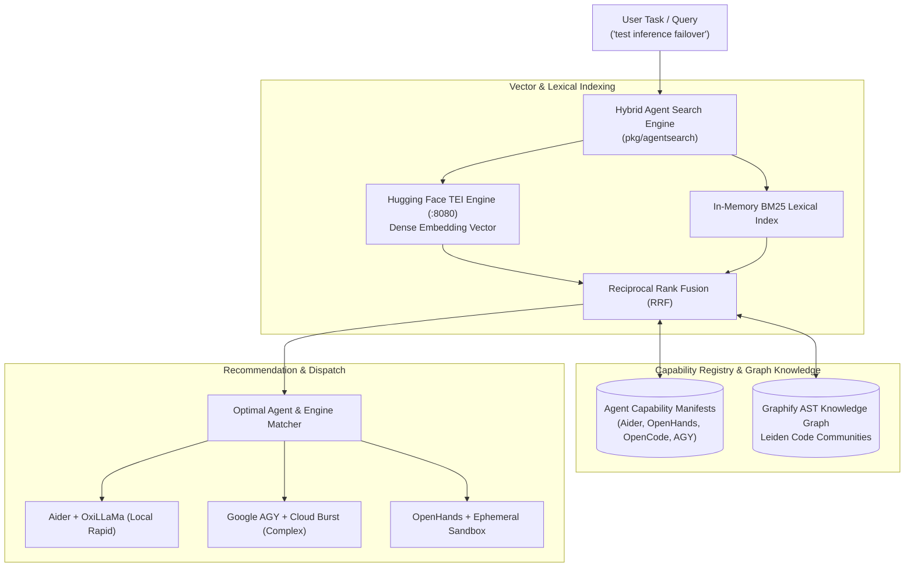

<!-- Imported from Dendrite docs/features/FEAT-022-agent-search-and-capability-discovery.md @ 69ea048 on 2026-10-18. Source of truth for this repo's scope; keep in sync with the Dendrite copy until the extraction umbrella lands. -->

---
id: FEAT-022
title: Agent Search, Capability Discovery & Semantic Routing Engine
status: proposed
plane_epic: PROJ-E-13
dependencies: [FEAT-004, FEAT-013, FEAT-020]
repository: dendrite
tags: [agent-search, capability-discovery, tei, embeddings, semantic-router, graphify, ast]
---

# FEAT-022: Agent Search, Capability Discovery & Semantic Routing Engine

## 1. User Story & Business Objective
As a software engineer and AI systems developer operating in multi-agent environments, I need Dendrite to provide an intelligent **Agent Search and Capability Discovery Engine** (`dendrite agent search` and Web UI Agent Explorer). As the platform supports diverse autonomous agents (**Aider**, **OpenHands**, **OpenCode**, and **Google AGY** from [FEAT-013](file:///Users/yasuomaidana/GoLandProjects/Dendrite/docs/features/FEAT-013-agentic-coding-tools.md)) with distinct strengths, tool schemas, and operational costs, this engine enables querying and matching engineering tasks (e.g., \"refactor Go AST parser\", \"investigate thermal throttling\", \"generate k6 performance scripts\") to the optimal agent tool, prompt strategy, and inference engine tier ([FEAT-020](file:///Users/yasuomaidana/GoLandProjects/Dendrite/docs/features/FEAT-020-pluggable-inference-engines.md)) using hybrid vector embeddings (Hugging Face TEI) and Graphify AST code knowledge.

---

## 2. Technical Boundaries & Specifications

1. **Hybrid Search Architecture (`pkg/agentsearch`)**:
   - **Dense Vector Semantic Search**: Integrates Hugging Face Text Embeddings Inference (TEI, `ghcr.io/huggingface/text-embeddings-inference:1.5` from [FEAT-020](file:///Users/yasuomaidana/GoLandProjects/Dendrite/docs/features/FEAT-020-pluggable-inference-engines.md)) to generate $< 5\text{ms}$ embeddings (`BAAI/bge-small-en-v1.5` or `nomic-embed-text`) over agent manifests, tool capability schemas, and past session trajectories.
   - **Sparse Lexical Search (BM25)**: Matches exact keywords, function signatures, package names, and CLI flags.
   - **Reciprocal Rank Fusion (RRF)**: Merges sparse and dense search scores into a normalized rank score ($0.0 \le S \le 1.0$).
2. **Task-to-Agent Routing & Inference Matching**:
   - Assesses incoming task complexity against historical agent success metrics:
     - *Lightweight file-local refactor / unit test*: Routes to **Aider** backed by local **Ollama** or **OxiLLaMa** (`qwen2.5-coder:14b`).
     - *Complex multi-repo architectural task / root-cause debugging*: Routes to **Google AGY** or **OpenHands** in containerized sandbox backed by **vLLM** or cloud models.
     - *Batch translation / doc reflection*: Routes to **OpenCode** or polyglot synthesizer.
3. **Graphify AST Knowledge Coupling**:
   - Cross-references query targets with the active project's Graphify knowledge graph ([FEAT-004](file:///Users/yasuomaidana/GoLandProjects/Dendrite/docs/features/FEAT-004-repo-intel-ast.md)).
   - Identifies which agent harness has previously interacted with or successfully modified code files within the relevant Leiden community cluster.
4. **CLI & Web UI Discovery Interface**:
   - CLI:
     ```bash
     # Search for agents capable of performing a specific task
     dendrite agent search "benchmark inference latency with k6"

     # Auto-route and launch the recommended agent with pre-configured model tier
     dendrite agent route --task "refactor pkg/gateway sliding window" --exec
     ```
   - Web UI: Interactive "Agent & Tool Registry" panel displaying agent capability cards, supported tools, historical success rates, and token cost profiles.



---

## 3. Idiomatic Design Patterns & Complexity Guardrails

1. **Strategy Pattern (Embedding & Search Providers)**:
   - Abstraction `EmbeddingClient` supporting `TEIClient`, `OllamaEmbedClient`, and `InProcessEmbedClient`.
2. **Builder Pattern (Search Query)**:
   - Fluent builder for compound agent search queries:
     ```go
     query := agentsearch.NewQueryBuilder().
         WithText("load test LiteLLM gateway").
         WithMaxCost(0.50).
         RequireLocalInference(true).
         WithTargetPackage("pkg/gateway").
         Build()
     ```
3. **Domain Newtypes**:
   - `type AgentID string`
   - `type CapabilityScore float32`
   - `type TaskVector []float32`
4. **Complexity Guardrails**:
   - Cyclomatic Complexity $\le 8$ per function.
   - Cognitive Complexity $\le 10$ per function.
   - No God functions; search pipeline cleanly split into `tokenize`, `embed`, `rank`, and `filter`.

---

## 4. Acceptance Criteria & Verification Matrix

- [ ] **AC-1**: `dendrite agent search <query>` executes hybrid search and returns ranked matching agents and tools in $< 150\text{ms}$.
- [ ] **AC-2**: Vector indexing utilizes Hugging Face TEI embedding endpoint from [FEAT-020](file:///Users/yasuomaidana/GoLandProjects/Dendrite/docs/features/FEAT-020-pluggable-inference-engines.md) when active, falling back gracefully to local lexical index if TEI is offline.
- [ ] **AC-3**: Agent capability score factors in historical token spend, task execution duration, and test pass rates from previous sessions.
- [ ] **AC-4**: Graphify AST integration maps target packages in query to Leiden community clusters and prioritizes agents with matching domain tags.
- [ ] **AC-5**: Web UI displays searchable agent catalog with real-time capability filtering and 1-click launch buttons.

---

## 5. Definition of Done (DoD) & Persistence Verification

- **Automated Tests**: Unit tests with mock embeddings achieving $\ge 85\%$ coverage.
- **Persistent Layer Verification**: Agent manifest indexes and historical session scores verified against SQLite / Testcontainers PostgreSQL tables.
- **Zero Linter Warnings**: `golangci-lint run` passes with zero issues.
