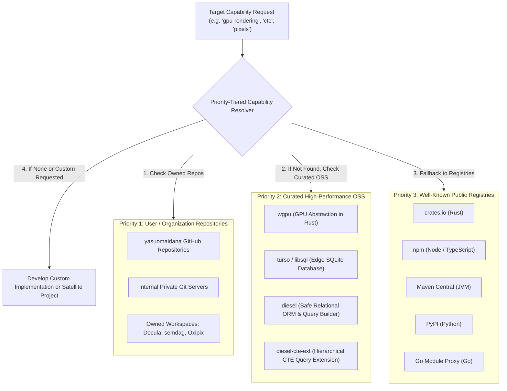
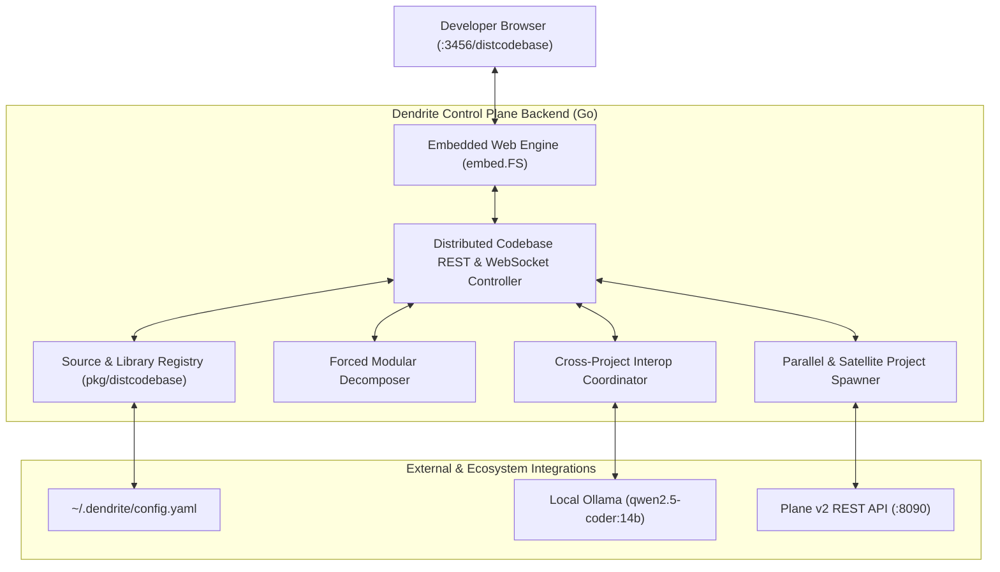

<!-- Imported from Dendrite docs/features/FEAT-026-distributed-codebase-ecosystem.md @ 69ea048 on 2026-10-18. Source of truth for this repo's scope; keep in sync with the Dendrite copy until the extraction umbrella lands. -->

---
id: FEAT-026
title: Distributed Codebase Ecosystem, Modular REA & Cross-Project Interoperability Coordinator
status: approved
plane_epic: PROJ-E-03
dependencies: [FEAT-003, FEAT-005, FEAT-011, FEAT-016, FEAT-025]
repository: dendrite
tags: [distributed-codebase, ecosystem, modular-rea, interoperability, plane, local-llm, rust-translation]
---

# FEAT-026: Distributed Codebase Ecosystem, Modular REA & Cross-Project Interoperability Coordinator

## 1. User Story & Architectural Concept

### What is a "Distributed Codebase"?
In modern multi-repository and organization-scale engineering, developers and projects rarely build everything in isolation from scratch. Instead, developers maintain their own internal repositories, git servers, and private packages containing established utilities, high-performance engines, and domain tools. In parallel, the broader open-source ecosystem provides proven registries (crates.io, npm, Maven, PyPI, Go proxy) and battle-tested libraries.

Re-implementing existing tools from scratch wastes token budgets, causes regression risks, and delays project delivery. The **Distributed Codebase Feature** turns Dendrite into an ecosystem-aware orchestrator that recognizes distributed sources, prioritizes user/organization-owned repositories first, seamlessly incorporates curated open-source engines, forcibly decomposes monolithic systems into reusable modules, and coordinates cross-project dependencies through local LLMs.

---

## 2. Priority-Tiered Source Resolution Architecture

Dendrite evaluates libraries and codebase hosts in strict priority order ($P_1 > P_2 > P_3$):

### Pre-Configured Ecosystem Sources
1. **Priority 1 (Own Repositories)**:
   - `yasuomaidana-repositories`: `https://github.com/yasuomaidana`
   - Owned projects: `Docula` (AST/Docs reflection), `semdag` (Semantic DAGs), `Oxipix` (SIMD imaging/pixels).
2. **Priority 2 (Curated OSS)**:
   - `wgpu`: `https://github.com/gfx-rs/wgpu` (GPU abstraction, Vulkan, Metal, DX12, WebGPU).
   - `turso`: `https://github.com/tursodatabase/libsql` (Edge SQLite database).
   - `diesel`: `https://github.com/diesel-rs/diesel` (Safe ORM and query builder).
   - `diesel-cte-ext`: `https://github.com/leynos/diesel-cte-ext` (CTE and recursive queries).
3. **Priority 3 (Public Registries)**:
   - `crates.io`, `npm`, `maven-central`, `pypi`, `go-proxy`.

---

## 3. Four Core Execution Scenarios

### Scenario 1: Modular REA with Ecosystem Reuse Probe
- **Forced Modular Decomposition**: By default, monolithic targets (binaries, decompiled code, legacy systems) are divided into bounded, single-responsibility modules.
- **Ecosystem Search & Reuse**: When Reverse Engineering Architecture (REA) analyzes an evidence bundle, it matches extracted function domains against the distributed codebase.
- **Custom Development Gate**: Dendrite only generates custom implementations if:
  1. An explicit user override exists (`UserRequestedCustom: true`), or
  2. A verified technical benefit is demonstrated (e.g., zero-copy memory layout, SIMD vectorization, sub-microsecond latency).

### Scenario 2: Parallel Repository & Project Spawning
- Decomposed sub-modules are generated as decoupled, autonomous codebases in parallel.
- Automatically handles filesystem scaffolding (`Cargo.toml`, `go.mod`, `package.json`, `README.md`), Git initialization (`git init`), and Dendrite workspace registration (`pkg/workspace`).

### Scenario 3: Interoperability Coordinator (Local LLM Managed)
- Coordinates multi-project dependencies across user-owned repositories (e.g. `Docula` depending on `semdag` and `Oxipix`).
- **Feature Gap Delegation**: When `Docula` needs a feature not yet in `Oxipix`, the coordinator:
  1. Detects `Oxipix` is owned (Priority 1) and dispatches a feature development ticket to `Oxipix`.
  2. Generates interim fallback code in `Docula` tagged with `// TODO(interop:Oxipix): Replace with Oxipix::feature once implemented`.
  3. Unblocks `Docula` development without stall (vital for 100% Rust translation or large-scale refactoring).
  4. Once `Oxipix` implements and verifies the feature, triggers reconciliation to apply the native integration patch to `Docula`.
  5. Local LLM governance uses zero-cost Apple Silicon Ollama (`qwen2.5-coder:14b`) to evaluate trade-offs and dispatch actions.

### Scenario 4: Generative Satellite Projects & Plane Project Lifecycle
- When translating a complex system (e.g. rewriting the CARLA simulator into 100% Rust), missing subsystems or foreign libraries are spun off into satellite side-projects (e.g. `carla-sensor-rs`, `carla-traffic-rs`).
- Automatically creates dedicated projects in Plane v2 (`POST /api/v1/workspaces/{slug}/projects/`) and tracks their tickets, milestones, and documentation independently.

---

## 4. Acceptance Criteria & Definition of Done

- [x] **Registry & Priority Resolver (`pkg/distcodebase`)**: Priority 1 own repos, Priority 2 curated OSS (`wgpu`, `turso`, `diesel`, `diesel-cte-ext`), Priority 3 registries.
- [x] **Forced Modular Decomposition Engine**: Decomposes targets into reusable modules, mapping existing ecosystem libraries.
- [x] **Interoperability Coordinator**: Dispatches cross-project feature requests, generates interim fallback code with `TODO(interop:...)` markers, and reconciles upon completion.
- [x] **Project & Plane Spawner**: Parallel project scaffolding with Git init, Dendrite workspace registration, and Plane v2 project creation.
- [x] **Native MCP Tools**: `dendrite_dist_sources`, `dendrite_dist_decompose`, `dendrite_dist_interop`, `dendrite_dist_spawn`.
- [x] **CLI Subcommands**: `dendrite dist <sources|resolve|decompose|interop|spawn>`.
- [x] **Test Coverage**: Automated test suites achieve $\ge 85\%$ statement coverage (Current: $89.2\%$).

---

## 5. UI Architecture Specification: Priority-Tiered Source Resolution Control Panel

The Distributed Codebase Control Panel is integrated into the single-binary embedded web application (FEAT-009) hosted at `http://127.0.0.1:3456/distcodebase`. It provides an interactive control plane for human developers and autonomous agents.

### 5.1 Interactive UI Component Panels

1. **Priority-Tiered Source & Registry Manager (Panel 1)**:
   - **Visual Kanban & Priority Columns**:
     - Column 1: **Priority 1 (Own Repositories)** (e.g. `yasuomaidana-repositories`, `Docula`, `semdag`, `Oxipix`).
     - Column 2: **Priority 2 (Curated High-Performance OSS)** (e.g. `wgpu`, `turso`, `diesel`, `diesel-cte-ext`).
     - Column 3: **Priority 3 (Public Registries)** (e.g. `crates.io`, `npm`, `maven-central`, `pypi`, `go-proxy`).
   - **Drag-and-Drop Reordering**: Allows re-ranking priority tiers visually with real-time atomic updates to local configuration.
   - **Add Source / Add Library Modal**: Form inputs for Git server URL, API token/SSH key, package name, language ecosystem, and capability tags.

2. **Interactive Capability Resolution Probe & Live Matcher (Panel 2)**:
   - Search bar supporting instant capability matching (e.g. typing `cte`, `gpu-rendering`, `pixels`, `database`, `orm`).
   - Visual result card highlighting the winning resolved library, priority badge ($P_1, P_2, P_3$), capability match score, and GitHub repository links.

3. **Modular REA Decomposition & Reuse Graph Visualizer (Panel 3)**:
   - Interactive SVG/Canvas Directed Acyclic Graph (DAG) visualizing decomposed modules of a target project (e.g. `CarlaEngine` decomposed into 6 modules).
   - Nodes color-coded by resolution type:
     - 🟢 **Green**: `REUSE -> Library` (mapped to existing registered library).
     - 🟠 **Orange**: `CUSTOM DEV -> Rationale` (gated custom implementation with architectural justification).
     - 🔵 **Blue**: `SATELLITE SPAWN` (satellite side-project for Plane tracking).
   - Toggles: `ForcedModular` (default ON), `UserRequestedCustom` override, and architectural constraint rationale editor.

4. **Local LLM Cross-Project Interoperability Coordinator (Panel 4)**:
   - Visual dependency graph between user-owned projects (e.g. `Docula` depending on `semdag` and `Oxipix`).
   - Real-time lifecycle badges: `[DISPATCHED]`, `[UNBLOCKED WITH FALLBACK]`, `[RECONCILED]`.
   - Side-by-side code diff viewer showing the generated interim fallback `// TODO(interop:Oxipix)` and the final reconciled import patch.
   - Local LLM prompt generator widget targeting local Ollama (`qwen2.5-coder:14b`).

5. **Parallel & Satellite Project Spawner Wizard (Panel 5)**:
   - Project generator form: name, directory path, language scaffold (`rust`, `go`, `typescript`), Git initialization checkbox.
   - **Plane v2 Integration**: Checkbox to automatically provision a dedicated project in Plane (`POST /api/v1/workspaces/{slug}/projects/`) with sprint board, milestones, and initial tickets.

### 5.2 REST & WebSocket API Specifications

| Method | Endpoint | Description |
|:---|:---|:---|
| `GET` | `/api/v1/dist/sources` | List all registered sources and libraries grouped by priority tier |
| `POST` | `/api/v1/dist/sources` | Register a new Git server or repository source |
| `PUT` | `/api/v1/dist/sources/priority` | Atomically update source priority rankings |
| `POST` | `/api/v1/dist/libraries` | Add a new library with capability tags |
| `POST` | `/api/v1/dist/resolve` | Priority-resolve capability query ($P_1 > P_2 > P_3$) |
| `POST` | `/api/v1/dist/decompose` | Forcibly decompose target project / REA evidence into reusable modules |
| `GET` | `/api/v1/dist/interop` | List active cross-project coordinations and fallback statuses |
| `POST` | `/api/v1/dist/interop/coordinate` | Dispatch cross-project feature request and generate interim fallback |
| `POST` | `/api/v1/dist/interop/reconcile` | Reconcile completed dependency and generate patch |
| `POST` | `/api/v1/dist/spawn` | Scaffold parallel/satellite project and provision Plane project |
| `WS` | `/ws/distcodebase` | Live WebSocket streaming for decomposition events and interop state changes |

---

## 6. Testing Development Plan & Verification Suite

The testing development plan for the Priority-Tiered Source Resolution UI is integrated into Dendrite's automated test harness ([FEAT-023](file:///Users/yasuomaidana/GoLandProjects/Dendrite/docs/features/FEAT-023-developer-test-automation-ui-harness.md)) and enforced through the quality scorecard ([docs/quality/scrum-and-complexity-scorecard.md](file:///Users/yasuomaidana/GoLandProjects/Dendrite/docs/quality/scrum-and-complexity-scorecard.md)).

### 6.1 Testing Levels & Matrix

| Testing Level | Scope / Target | Verifying Test Suite | Success Threshold |
|:---|:---|:---|:---|
| **Level 1: Backend REST Handlers** | `pkg/ui/distcodebase`, HTTP routing | `tests/ui/test_dist_handlers.go` | Statement coverage $\ge 85\%$, zero race conditions (`sync.RWMutex`) |
| **Level 2: Headless E2E Journeys** | Web UI DOM, interactive panels | `tests/ui/dist_ui_e2e_test.js` (k6-browser / Playwright) | 100% journey pass rate, render latency $< 150	ext{ms}$ |
| **Level 3: Real-Time WebSocket Load** | `/ws/distcodebase` event streaming | `tests/perf/dist_ws_benchmark.js` (k6) | 50 concurrent sessions, 100 msgs/sec, zero memory leaks, $\ge 30	ext{ FPS}$ |
| **Level 4: Persistent Layer & Plane** | Disk config & Plane v2 REST API | `tests/integration/test_dist_plane_integration.go` | Real Plane Testcontainers verification (DoD compliant) |

### 6.2 End-to-End (E2E) Headless User Journeys (k6-browser)

1. **Journey 1: Source Priority Reordering & Resolution Verification**:
   - The headless browser loads `http://127.0.0.1:3456/distcodebase`.
   - Simulates dragging a source from Priority 2 to Priority 1.
   - Asserts that DOM updates immediately, writes to backend via `PUT /api/v1/dist/sources/priority`, and subsequent resolve queries prioritize the newly elevated source.
2. **Journey 2: Interactive Capability Probe & Instant Match**:
   - Types query `"cte"` into the Capability Probe input.
   - Asserts that `diesel-cte-ext` renders with Priority 2 badge, capability list, and GitHub link in $< 100	ext{ms}$.
3. **Journey 3: Modular Decomposition & Graph Visualization**:
   - Submits project decomposition for `"CarlaEngine"` with `ForcedModular: true`.
   - Asserts SVG DAG renders 6 modules with exact color coding: 5 green `REUSE` nodes (`wgpu`, `turso`, `diesel-cte-ext`, `Oxipix`, `semdag`) and 1 orange `CUSTOM DEV` node (`api-gateway`).
4. **Journey 4: Cross-Project Interoperability Lifecycle**:
   - Triggers coordination for `Docula` requesting `blend_modes_simd` from `Oxipix`.
   - Asserts that the fallback code card appears in the UI displaying `// TODO(interop:Oxipix)`.
   - Simulates feature completion in `Oxipix` and clicks `Reconcile`; asserts diff card changes to `use oxipix::blend_modes_simd;`.
5. **Journey 5: Satellite Project & Plane v2 Provisioning**:
   - Fills out the Spawner wizard for `carla-sensor-rs` targeting `./projects/carla-sensor-rs` with Plane integration checked.
   - Asserts that project scaffolding succeeds, Git is initialized, and Plane v2 returns HTTP 201 with project identifier `CSEN`.

### 6.3 Definition of Done (DoD) & Quality Scorecard Alignment
- **Traceability**: All 5 user journeys and 10 REST endpoints mapped to automated test suites.
- **Coverage**: Statement coverage $\ge 85\%$ across backend handlers and frontend component logic.
- **No In-Memory Persistent Mocking**: Plane API and file writebacks verified against real filesystem and Testcontainers.
- **Complexity Guardrails**: Cyclomatic Complexity $\le 8$, Cognitive Complexity $\le 10$, function length $\le 65$ LOC.
