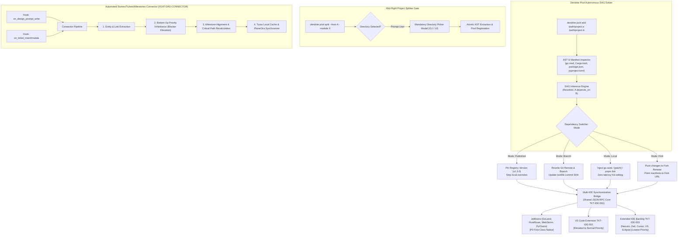

<!-- Imported from Dendrite docs/features/FEAT-029-autonomous-pool-dag-synchronization.md @ 69ea048 on 2026-10-18. Source of truth for this repo's scope; keep in sync with the Dendrite copy until the extraction umbrella lands. -->

---
id: FEAT-029
title: "Autonomous Pool DAG Synchronization, Multi-IDE Lifecycler & Automated DAG Connector"
status: approved
plane_epic: PROJ-E-15
dependencies: [FEAT-005, FEAT-014, FEAT-026, FEAT-036]
repository: dendrite
tags: [pool-dag, multi-project, jetbrains, vscode, dependency-switcher, split-member, goland, rustrover, dag-connector, priority-propagation]
---

# FEAT-029: Autonomous Pool DAG Synchronization, Multi-IDE Lifecycler & Automated DAG Connector

## 1. Executive Summary & Problem Statement

### The Problem
In modern distributed polyglot architectures, engineers maintain multiple co-dependent projects across separate local directories or micro-repositories. Developers waste considerable time manually calculating dependency directions, editing configuration manifests (`go.mod`, `Cargo.toml`, `package.json`, `pyproject.toml`), and troubleshooting broken IDE cross-project symbol indexing when toggling between:
1. Published registry versions (`v1.3.0`),
2. Experimental remote Git branches (`feat/async-stream`),
3. Live local filesystem edits (`go.work use`, Cargo `[patch]`, pnpm `link:`),
4. Custom forks (`fork-url`).

Furthermore, when monoliths or shared modules are extracted into new standalone repositories, tooling frequently performs uncoordinated file moves without user consent on target locations, breaking build configurations and orphan-linking repository dependencies. 

Additionally, as IDE ecosystems diverge across teams (JetBrains GoLand/RustRover/WebStorm/PyCharm vs. VS Code vs. lightweight editors like Neovim/Zed), developers face fractured toolchains. While core JetBrains support is first-class and VS Code requires prompt delivery at `Normal` priority, broader multi-IDE support must be kept at `Lowest` priority so it does not derail immediate sprint milestones. Crucially, whenever design prompts or new tickets are drafted, the system lacks an automated, synchronous connector to recalculate dependency edges and bubble up blocker priorities (e.g. elevating a `Lowest` shared IDE module to `Normal` when required by VS Code).

### User Story & Architectural Pillars
As an architect and systems developer working across multiple repositories and editors, I need `dendrite pool` to:
1. Autonomously inspect manifests, AST exports, and IPC contracts to infer the dependency DAG and seamlessly transition dependency modes (Published $\leftrightarrow$ Branch $\leftrightarrow$ Local $\leftrightarrow$ Fork).
2. Enforce a mandatory interactive target directory prompt before creating any new pool member in CLI and Web UI.
3. Keep JetBrains IDE workspace scopes (GoLand, RustRover, WebStorm, PyCharm) and VS Code workspaces strictly synchronized in real time via a decoupled shared core JSON-RPC client (`TKT-IDE-001`).
4. Execute an automated **Stories / Tickets / Milestones DAG Connector** (`FEAT-DAG-CONNECTOR`) triggered on `on_design_prompt_write` and `on_ticket_insert` that recalculates graph edges and enforces **Bottom-Up Priority Inheritance** across local Turso cache and external issue trackers.



---

## 2. Technical Architecture & Idiomatic Design Patterns

### 2.1 Typestate Pattern for Dependency Lifecycle
In accordance with `/pattern-complexity-auditor`, dependency links are modeled with zero-sized phantom state types to prevent invalid runtime transitions at compile time:
```rust
// Rust Conceptual Typestate Architecture for Pool Dependency Transitions
pub struct Dependency<State> {
    pub name: String,
    pub source_path: PathBuf,
    pub state: State,
}

pub struct Published { pub version: SemVer }
pub struct Branch { pub branch_name: String, pub commit_sha: String }
pub struct Local { pub link_path: PathBuf }
pub struct Fork { pub fork_url: Url, pub remote_branch: String }

impl Dependency<Local> {
    pub fn to_published(self, version: SemVer) -> Result<Dependency<Published>, SwitchError> { ... }
    pub fn to_fork(self, url: Url, branch: String) -> Result<Dependency<Fork>, SwitchError> { ... }
}
```

### 2.2 Multi-IDE Synchronization Matrix & Priority Decoupling
To prevent the broader multi-IDE effort from delaying core releases, the architecture decouples the shared core engine from editor-specific UI adapters:

| IDE Platform | Priority Tier | Manifest Hook | Local Mode Override | Indexing & Scope Synchronization Hook |
|:---|:---:|:---|:---|:---|
| **GoLand** | **P0 (Native)** | `go.mod` | `go.work` (`go work use /path`) | External Tools watcher & Go Workspace sync |
| **RustRover** | **P0 (Native)** | `Cargo.toml` | `[patch.crates-io]` & Workspace members | Cargo reload & `.idea/scopes/` XML generator |
| **WebStorm** | **P0 (Native)** | `package.json` | `pnpm-workspace.yaml` / `link:` / `file:` | TypeScript Server restart & symlink exclusion |
| **PyCharm** | **P0 (Native)** | `pyproject.toml` | `tool.uv.sources` / `pip install -e` | Virtualenv refresh & Sources Root annotation |
| **VS Code (`TKT-IDE-002`)** | **Normal** | `.code-workspace` | Multi-root folder injection & `settings.json` | Language Client restart, Status Bar, SecretStorage |
| **Extended Backlog (`TKT-IDE-003`)** | **Lowest** | Editor configs | Stdout/JSON-RPC stream via `dendrite-daemon` | Neovim (Telescope), Zed (Wasm), Cursor, Eclipse |

### 2.3 Automated Stories / Tickets / Milestones DAG Connector (`FEAT-DAG-CONNECTOR`)

#### Trigger Conditions
The `StoriesTicketsMilestonesConnector` executes automatically as a synchronous post-hook on two lifecycle events:
1. **`on_design_prompt_write`**: Triggered whenever a technical design prompt, architectural RFC, or Penpot UI design specification is generated or modified.
2. **`on_ticket_insert` / `on_ticket_mutate`**: Triggered whenever a new User Story, Ticket, or Milestone is created or imported via the CLI (`dendrite dev ticket set`, `dendrite stories link`), IDE extension, or Plane webhook sync.

#### 4-Stage Reconciliation Pipeline & Mathematical Priority Propagation
1. **Entity & Link Extraction**:
   - Parses the design prompt or ticket payload for explicit references (`FEAT-*`, `STRY-*`, `TKT-*`, `M-*`, `DEN-*`) and semantic component scopes.
   - Creates or updates bidirectional edges in the local Turso DAG store (`Story <-> Ticket <-> Feature <-> Milestone`).
2. **Bottom-Up Priority Inheritance (Blocker Elevation)**:
   - Evaluates topological dependencies across the DAG:
     $$\text{Priority}_{\text{effective}}(u) = \max\Big(\text{Priority}_{\text{assigned}}(u), \max_{v \in \text{Dependents}(u)} \text{Priority}_{\text{effective}}(v)\Big)$$
   - *Rule:* If a ticket with `Normal` or higher priority (e.g., `TKT-IDE-002: VS Code Support`) depends on a foundational ticket or parent component assigned `Lowest` priority (e.g., `TKT-IDE-001: Shared IDE Bridge`), the blocker's **Effective Priority** is automatically elevated to `Normal`, while sibling tickets under `TKT-IDE-003` retain their default `Lowest` priority.
3. **Milestone Alignment & Critical Path Update**:
   - Assigns unmapped blocker tickets to the earliest target milestone of their higher-priority dependents.
   - Recalculates milestone completion weights and flags priority inversions in the workspace status report.
4. **External Tracker Synchronization**:
   - Commits updated DAG edges and effective priorities to the local Turso database first (offline-safe), then asynchronously dispatches batch updates to Plane v2 and updates linked Penpot metadata.

#### Typestate Interface Contract (`internal/connector/dag_linker.go`)
```go
package connector

import "context"

type Priority int

const (
    PriorityLowest Priority = iota
    PriorityLow
    PriorityNormal
    PriorityHigh
    PriorityUrgent
)

type TriggerEvent string

const (
    TriggerDesignPromptWrite TriggerEvent = "on_design_prompt_write"
    TriggerTicketInsert      TriggerEvent = "on_ticket_insert"
    TriggerTicketMutate      TriggerEvent = "on_ticket_mutate"
)

type WorkItem struct {
    ID                string
    ParentFeatureID   string
    MilestoneID       string
    AssignedPriority  Priority
    EffectivePriority Priority
    DependsOn         []string // Blocker IDs
    Blocks            []string // Dependent IDs
}

type StoriesTicketsMilestonesConnector interface {
    Reconcile(ctx context.Context, trigger TriggerEvent, affectedIDs []string) (*SyncReport, error)
}

// PropagatePriorities elevates lower-priority blockers when depended on by higher-priority items
func PropagatePriorities(graph map[string]*WorkItem) {
    changed := true
    for changed {
        changed = false
        for _, item := range graph {
            for _, depID := range item.DependsOn {
                blocker, exists := graph[depID]
                if !exists {
                    continue
                }
                if item.EffectivePriority > blocker.EffectivePriority {
                    blocker.EffectivePriority = item.EffectivePriority
                    changed = true
                }
            }
        }
    }
}
```

### 2.4 Mandatory Target Directory Gate
Whenever `dendrite pool optimize` or `dendrite pool split` triggers member creation:
- **CLI Gate**: Halts execution and presents an interactive prompt (`? Specify the target directory for <member> (required):`).
- **UI Gate**: Opens the Create Pool Member Modal with a filesystem directory picker and DAG dependency edge preview.

---

## 3. Detailed User Stories & Tickets

### Epic: Multi-IDE Ecosystem Support (`FEAT-100` / `FEAT-IDE-ECOSYSTEM`)
- **Assigned Priority**: `Lowest` (Overall Epic Default)
- **Override Rule**: Child tickets inherit `Lowest` priority unless explicitly elevated (VS Code elevated to `Normal`).

#### `TKT-IDE-001` (`TKT-101`): Shared Core Engine & JSON-RPC Client
- **Assigned Priority**: `Lowest` $\to$ **Effective Priority**: `Normal` (Elevated via dependency from `TKT-IDE-002`)
- **Milestone**: `M1 - Foundation & VS Code MVP`
- **User Story**: As a maintainer, I want a platform-agnostic core client handling authentication, state sync, and API communication so that all IDE extensions share a single codebase for business logic.
- **Acceptance Criteria**:
  - [ ] Core communication layer operates independently of IDE UI APIs.
  - [ ] Standardized JSON-RPC 2.0 interface exposed over stdio and local Unix socket (`~/.dendrite/dendrite.sock`).
  - [ ] Unit test coverage reaches $\ge 85\%$ on core request/response handlers with zero memory leaks.

#### `TKT-IDE-002` (`TKT-102`): VS Code Extension (MVP & Marketplace Release)
- **Assigned Priority**: `Normal` | **Effective Priority**: `Normal`
- **Milestone**: `M1 - Foundation & VS Code MVP`
- **User Story**: As a VS Code user, I want to install and configure Dendrite directly from the VS Code Marketplace so I can manage pools, execute stories, and view DAGs without leaving my editor.
- **Acceptance Criteria**:
  - [ ] Command Palette registration, status bar indicator showing active AI execution tier (Ollama vs. Cloud) and Turso cache status.
  - [ ] Sidebar Webview panel rendering interactive Pool DAG and story board.
  - [ ] Secure token storage integrated via VS Code `SecretStorage` API.
  - [ ] Automated CI/CD packaging and publishing via `vsce` to Visual Studio Marketplace and OpenVSX.

#### `TKT-IDE-003` (`TKT-103`): Popular IDEs Backlog Adapters (IntelliJ, Neovim, Zed)
- **Assigned Priority**: `Lowest` | **Effective Priority**: `Lowest`
- **Milestone**: `M3 - Extended IDE Backlog`
- **User Story**: As a polyglot engineer using diverse editors, I want lightweight adapters for Neovim (`dendrite.nvim`), Zed (`dendrite-zed`), and JetBrains IntelliJ plugins so I have consistent pool access across my preferred environment.
- **Acceptance Criteria**:
  - [ ] `dendrite.nvim`: Lightweight Lua client wrapping stdio JSON-RPC with Telescope pickers for pool management and ticket selection.
  - [ ] `dendrite-zed`: WebAssembly extension + MCP bridge integration.
  - [ ] IntelliJ Platform plugin wrapping shared core client targeting current IntelliJ Platform SDK versions.

---

## 4. Behavioral Scenarios (Gherkin)

### Scenario 29A: Quad-Mode Dependency Switching & IDE Sync
- **Given** Project A and Project B are registered in `dendrite pool` where Project A depends on Project B
- **When** the developer switches Project B's mode using `dendrite pool switch project-b --in project-a --mode local`
- **Then** Dendrite injects `go.work use` in GoLand, `[patch.crates-io]` in RustRover, or `link:` in WebStorm and VS Code, and refreshes the IDE workspace without restarting the editor.

### Scenario 29B: Mandatory Target Directory Gate on Member Split
- **Given** a developer runs `dendrite pool split --from project-a --module internal/matcher --name matcher-core`
- **When** the CLI reaches the member initialization phase
- **Then** Dendrite halts execution, prompts `? Specify the target directory for matcher-core (required):`, rejects empty input, and creates the member only after a valid path is provided.

### Scenario 29C: Automated DAG Connector Trigger on Design Prompt Write
- **Given** an architect creates or updates a technical design prompt or RFC referencing `FEAT-IDE-ECOSYSTEM` and `TKT-IDE-002`
- **When** the file is saved or emitted via `dendrite prompt save`
- **Then** the `on_design_prompt_write` hook triggers `StoriesTicketsMilestonesConnector.Reconcile`, extracts graph edges, elevates `TKT-IDE-001` to `Normal`, updates the Turso cache, and outputs the Connector Sync Summary table.

### Scenario 29D: Automated DAG Connector Trigger on Ticket Insertion & Priority Inheritance
- **Given** a new ticket `TKT-IDE-002` (VS Code Extension, Priority `Normal`) is inserted with dependency on `TKT-IDE-001` (Priority `Lowest`)
- **When** `on_ticket_insert` triggers the DAG connector
- **Then** `TKT-IDE-001`'s effective priority is elevated to `Normal` and mapped to Milestone `M1`, while sibling ticket `TKT-IDE-003` remains at `Lowest` in Milestone `M3`.

---

## 5. Acceptance Criteria & Definition of Done

- [ ] **AC-1 (Autonomous Pool DAG Solver)**: Multi-directory scanner parses manifests (`go.mod`, `Cargo.toml`, `package.json`, `pyproject.toml`) and computes deterministic DAG, detecting circular hazards.
- [ ] **AC-2 (Quad-Mode Dependency Switcher)**: Transitions dependencies between `published`, `branch`, `local`, and `fork` modes while synchronizing active JetBrains IDE scopes (`go.work`, `[patch]`, `link:`, `sources`) and VS Code workspace settings.
- [ ] **AC-3 (Interactive Target Directory Gate)**: Prompts user in CLI and Web UI for target directory before extracting AST slice and scaffolding a new pool member.
- [ ] **AC-4 (Automated DAG Connector & Priority Inheritance)**: Synchronously executes on `on_design_prompt_write` and `on_ticket_insert`, applying $\text{Priority}_{\text{effective}}$ propagation across local Turso cache and Plane.
- [ ] **AC-5 (Multi-IDE Ecosystem Decoupling)**: Implements shared JSON-RPC core (`TKT-IDE-001`), elevates VS Code (`TKT-IDE-002`) to `Normal`, and retains extended IDEs (`TKT-IDE-003`) at `Lowest`.
- [ ] **AC-6 (DoD & Complexity Thresholds)**: Workspace and pool state validated via `testcontainers-go`; cyclomatic complexity $\le 15$, cognitive complexity $\le 20$, coverage $\ge 85\%$.
