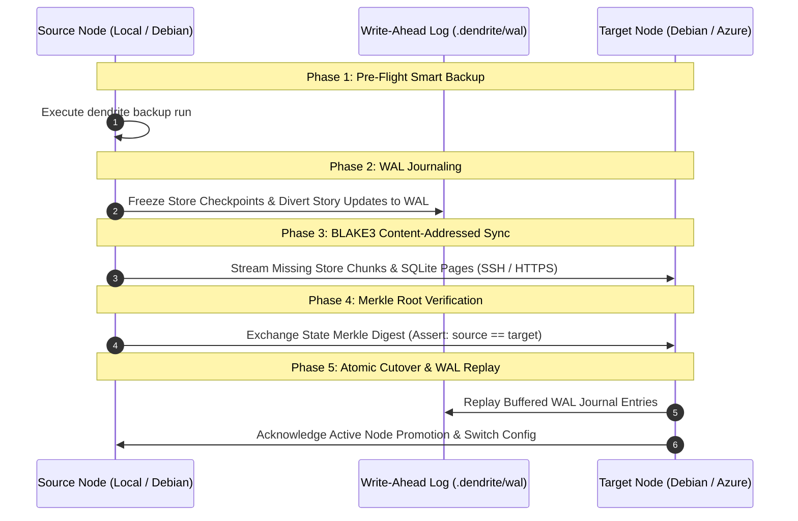

<!-- Imported from Dendrite docs/features/FEAT-033-infrastructure-mobility-smart-backup.md @ 9cbfbeb on 2026-10-18. Source of truth for this repo's scope; keep in sync with the Dendrite copy until the extraction umbrella lands. -->

---
id: FEAT-033
title: "Zero-Data-Loss Infrastructure Mobility & Smart Repo-Aware Backup Engine"
status: approved
plane_epic: PROJ-E-15
dependencies: [FEAT-001, FEAT-007, FEAT-019, FEAT-029, FEAT-031]
repository: dendrite
tags: [node-mobility, smart-backup, wal-journal, git-deduplication, azure-cloud, debian-migration]
---

# FEAT-033: Zero-Data-Loss Infrastructure Mobility & Smart Repo-Aware Backup Engine

## 1. Executive Summary & Problem Statement

### The Problem
Developers frequently need to move background services (analysis daemons, store blobs, JetBrains story state) between local laptops, persistent Debian home servers, and elastic Azure Cloud VMs. Uncoordinated service migration risks store corruption, lost working tree diffs, and IDE disruption. Moreover, standard backup utilities consume tens of gigabytes of disk space by backing up artifacts that are already safely committed and versioned inside the project's Git repository.

### User Story & Architectural Pillars
As an infrastructure engineer and power user, I need:
1. **Zero-Data-Loss Service Migration**: A 5-phase atomic protocol (`dendrite node migrate`) that transitions services across Local $\leftrightarrow$ Debian $\leftrightarrow$ Azure without data loss.
2. **Smart Repo-Aware Backup Engine (`dendrite backup`)**: An intelligent snapshot engine retaining 2 versions by default and automatically reclaiming space by evicting Git-persisted data first (replacing committed files with 40-byte Git SHA pointers).

---

## 2. Technical Architecture & Eviction Priority Protocol

### 2.1 5-Phase Atomic Migration Protocol
1. **Phase 1: Pre-Flight Smart Backup**: Invokes `dendrite backup run` before any network state transfer.
2. **Phase 2: WAL Journaling**: Freezes store checkpoints and routes live IDE story updates into `.dendrite/wal.journal`.
3. **Phase 3: BLAKE3 Content-Addressed Sync**: Transfers only missing store chunks and SQLite pages via SSH or Azure Blob Storage API.
4. **Phase 4: Merkle Root Verification**: Asserts cryptographic parity (`source_blake3 == target_blake3`).
5. **Phase 5: Atomic Cutover & Replay**: Switches daemon endpoint and replays buffered WAL entries.

### 2.2 Smart 3-Priority Backup Eviction Algorithm
When backup directory space limit is reached:
- **Priority 1 (Evict First — Git-Persisted Data)**: Cross-checks objects against `git rev-list --objects --all`. Committed blobs are removed and replaced with a 40-byte pointer (`git://commit-sha/blob-sha`), reducing storage by up to 98%.
- **Priority 2 (Evict Second — Recomputable Static AST Indexes)**: Removes zero-token AST parse trees easily regenerated by Go tree-sitter.
- **Priority 3 (Protected — Never Evicted Automatically)**: Preserves LLM semantic summaries, uncommitted working-tree diffs, and active pool metadata.

---

## 3. Acceptance Criteria & Definition of Done

- [ ] **AC-1 (5-Phase Atomic Service Migration)**: Transitions background services across Local, Debian, and Azure nodes with Merkle root verification and zero data loss.
- [ ] **AC-2 (WAL Journaling & Replay)**: Freezes store checkpoints, diverts live IDE story updates to `.dendrite/wal.journal`, and replays on target node.
- [ ] **AC-3 (Smart Repo-Aware Backup Engine)**: Enforces 2-version cap default and 3-priority eviction (Priority 1: Git-persisted data replaced by 40-byte SHA pointers).
- [ ] **AC-4 (Mandatory Persistent Layer Testing)**: Migration, WAL journaling, and backup eviction tested via multi-container `testcontainers-go`.
- [ ] **AC-5 (Scrum DoD & Zero Warnings)**: Coverage >= 85%, cyclomatic complexity <= 15, zero linter warnings.
