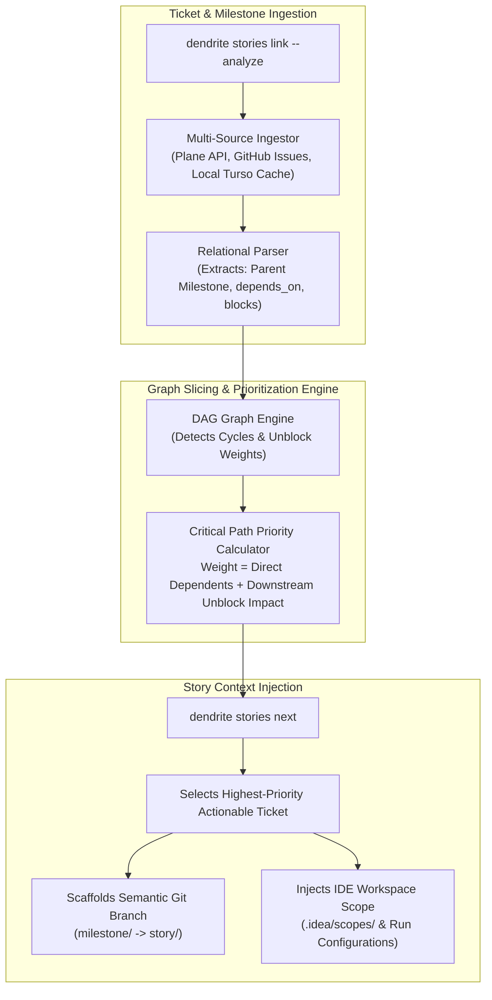

<!-- Imported from Dendrite docs/features/FEAT-036-ticket-milestone-dag-story-prioritization.md @ 9cbfbeb on 2026-10-18. Source of truth for this repo's scope; keep in sync with the Dendrite copy until the extraction umbrella lands. -->

---
id: FEAT-036
title: "Ticket-Milestone DAG Linker & Context-Aware Story Prioritization Engine"
status: approved
plane_epic: PROJ-E-16
dependencies: [FEAT-008, FEAT-014, FEAT-029, FEAT-035]
repository: dendrite
tags: [stories-dag, ticket-linker, story-prioritization, plane, jetbrains, context-injection]
---

# FEAT-036: Ticket-Milestone DAG Linker & Context-Aware Story Prioritization Engine

## 1. Executive Summary & Problem Statement

### The Problem
In complex projects managed across multiple issues, milestones, and epics (in Plane, GitHub Issues, Jira, or local cache), developers and autonomous coding agents lose significant context switching between tickets. Tickets are frequently picked in sub-optimal order—working on downstream features before root architectural foundations are established—leading to blocked PRs, merge collisions, and incomplete test harnesses. Furthermore, agents lack a single-command mechanism (`dendrite stories next`) to analyze graph reachability, resolve the critical path unblock weight, and inject the full story context into the IDE.

### User Story & Architectural Pillars
As a lead architect and developer, I need `dendrite stories` to ingest tickets and milestones from Plane, GitHub, or local cache, construct a directed acyclic graph (DAG) of dependencies and parent milestone links, calculate critical-path unblock weight, and automatically select and load the most relevant ticket into the active JetBrains IDE workspace via `dendrite stories next`.

---

## 2. Technical Architecture & Idiomatic Design Patterns

### 2.1 Graph Formulation & Topological Prioritization
The dependency DAG is represented as a directed graph $G = (V, E)$ where vertices $V$ represent tickets and milestones, and directed edges $E = \{(u, v)\}$ indicate that ticket $u$ blocks ticket $v$ ($v$ depends on $u$).
- **Cycle Detection**: Tarjan's strongly connected components (SCC) algorithm or Kahn's algorithm detects circular blockers.
- **Unblock Weight Formulation**: For an uncompleted ticket $u$, its priority weight $W(u)$ is defined as:
  $$W(u) = S(u) + \sum_{v \in \text{Descendants}(u)} \frac{S(v)}{\text{Depth}(u, v)}$$
  where $S(x)$ represents the story points of ticket $x$, prioritizing tickets that immediately unblock large subgraphs of work.

### 2.2 Semantic Hierarchical Branch Creation
Upon executing `dendrite stories next`:
1. The engine checks if the target ticket's parent milestone integration branch exists (`milestone/<milestone-id>`). If not, it creates it from `main`.
2. It branches `story/<story-id>` directly off `milestone/<milestone-id>`.
3. It refreshes JetBrains IDE custom scopes (`.idea/scopes/Dendrite_Active_Story.xml`) so symbols in scope are prioritized.

---

## 3. Behavioral Scenarios (Gherkin)

### Scenario 2A: Ticket & Milestone Relational Ingestion & Graph Slicing
- **Given** a project repository with active milestones (`M1`, `M2`) and tickets (`T-10`, `T-11`, `T-12`) in Plane or GitHub Issues where `T-11` blocks `T-12`
- **When** the developer runs `dendrite stories link --analyze`
- **Then** Dendrite builds a relational DAG connecting tickets to their parent milestones and dependency chains, persisting the graph edges locally and syncing relationship metadata back to Plane.

### Scenario 2B: Context-Aware `dendrite stories next` Active Story Loading
- **Given** ticket `T-11` is unblocked and has the highest downstream unblock weight while `T-12` is blocked by `T-11`
- **When** the developer runs `dendrite stories next`
- **Then** Dendrite evaluates the DAG, selects `T-11`, creates or checks out branch `story/T-11` off `milestone/M1`, generates the JetBrains active story scope, and displays the acceptance criteria in the terminal.

---

## 4. Acceptance Criteria & Definition of Done

- [ ] **AC-1 (Relational DAG Ingestion)**: Ingests tickets and milestones from Plane API, GitHub Issues, and local cache into a queryable dependency DAG.
- [ ] **AC-2 (Topological Priority Selector)**: Implements critical path unblock weight scoring and selects the optimal next ticket via `dendrite stories next`.
- [ ] **AC-3 (Semantic Branch Binding)**: Automatically roots story branches under their parent `milestone/<id>` integration branch.
- [ ] **AC-4 (DoD & Complexity Thresholds)**: 100% automated test coverage of graph cycle detection and topological sort; statement coverage $\ge 85\%$; cyclomatic complexity $\le 15$; cognitive complexity $\le 20$.
