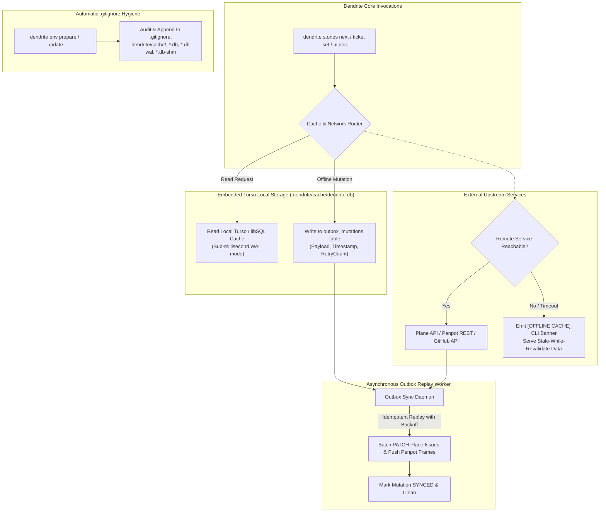

<!-- Imported from Dendrite docs/features/FEAT-040-turso-offline-cache-outbox-sync.md @ 69ea048 on 2026-10-18. Source of truth for this repo's scope; keep in sync with the Dendrite copy until the extraction umbrella lands. -->

---
id: FEAT-040
title: "Offline-First Local Cache (Turso / libSQL) & Outbox Sync Engine"
status: approved
plane_epic: PROJ-E-16
dependencies: [FEAT-008, FEAT-029, FEAT-036, FEAT-037]
repository: dendrite
tags: [turso, libsql, offline-cache, outbox-queue, gitignore-hygiene, plane-sync, penpot-sync]
---

# FEAT-040: Offline-First Local Cache (Turso / libSQL) & Outbox Sync Engine

## 1. Executive Summary & Problem Statement

### The Problem
Autonomous development workflows frequently fail when network connectivity to external services (Plane v2, Penpot, GitHub API, Jira) drops or experiences latency spikes. When an engineer or autonomous agent works offline or on constrained networks, operations like `dendrite stories next`, ticket status mutations, and UI documentation sync fail catastrophically.

Furthermore, when local embedded databases or cache artifacts (`.dendrite/cache/`, `*.db`, `*.db-wal`, `*.db-shm`) are created in the workspace, they risk being accidentally staged and committed into Git repositories by autonomous agents operating in Autonomy Levels 2–5, causing repository bloat and binary conflicts.

### User Story & Architectural Pillars
As an engineer and autonomous agent operator, I need `dendrite cache` and Dendrite's core data layer to:
1. Provide an embedded, high-performance local database powered by **Turso (libSQL / `go-libsql`)** at `.dendrite/cache/dendrite.db` operating in WAL mode.
2. Implement a **Read-Through & Stale-While-Revalidate Cache** that serves tickets, milestones, and Penpot UI metadata instantly during network interruptions with an `[OFFLINE CACHE]` indicator.
3. Provide a **Transactional Outbox Queue** (`outbox_mutations`) that persists local mutations offline and replays them idempotently with exponential backoff once upstream connectivity is restored.
4. Enforce strict **`.gitignore` Hygiene** across `dendrite env prepare` and `dendrite env update` to ensure database binaries and WAL files are never committed to version control.



---

## 2. Technical Architecture & Idiomatic Design Patterns

### 2.1 Database Engine & Schema Definition
The embedded database uses `go-libsql` (Turso's open-source C-go/pure-Go embedded SQLite fork):
- **Location**: `.dendrite/cache/dendrite.db`
- **Pragmas**: `PRAGMA journal_mode = WAL;`, `PRAGMA synchronous = NORMAL;`, `PRAGMA foreign_keys = ON;`

#### Schema Layout
```sql
CREATE TABLE IF NOT EXISTS cached_tickets (
    id TEXT PRIMARY KEY,
    parent_milestone_id TEXT,
    title TEXT NOT NULL,
    priority TEXT NOT NULL,
    effective_priority INTEGER NOT NULL,
    status TEXT NOT NULL,
    assigned_agent TEXT,
    payload_json TEXT NOT NULL,
    updated_at TIMESTAMP NOT NULL,
    cached_at TIMESTAMP DEFAULT CURRENT_TIMESTAMP
);

CREATE TABLE IF NOT EXISTS cached_milestones (
    id TEXT PRIMARY KEY,
    title TEXT NOT NULL,
    due_date TIMESTAMP,
    is_active BOOLEAN NOT NULL DEFAULT 1,
    payload_json TEXT NOT NULL,
    cached_at TIMESTAMP DEFAULT CURRENT_TIMESTAMP
);

CREATE TABLE IF NOT EXISTS outbox_mutations (
    mutation_id TEXT PRIMARY KEY,
    entity_type TEXT NOT NULL, -- 'ticket', 'story', 'penpot_frame'
    entity_id TEXT NOT NULL,
    operation TEXT NOT NULL,   -- 'INSERT', 'UPDATE', 'STATUS_CHANGE'
    payload_json TEXT NOT NULL,
    retry_count INTEGER NOT NULL DEFAULT 0,
    status TEXT NOT NULL DEFAULT 'PENDING', -- 'PENDING', 'IN_FLIGHT', 'SYNCED', 'FAILED'
    created_at TIMESTAMP DEFAULT CURRENT_TIMESTAMP,
    last_error TEXT
);
```

### 2.2 Transactional Outbox & Exponential Backoff Replay
When a mutation occurs while offline:
1. The local state is updated immediately inside a SQLite transaction:
   $$\text{BEGIN TRANSACTION} \implies \text{UPDATE cached\_tickets} \implies \text{INSERT INTO outbox\_mutations} \implies \text{COMMIT}$$
2. The UI or CLI completes immediately without blocking the user.
3. The background sync worker (`pkg/cache/outbox.go`) listens for network connectivity events:
   $$\text{Retry Delay} = \min(60\text{s}, 2^{\text{retry\_count}} \times 1\text{s}) \pm \text{Jitter}$$
4. Mutations are dispatched idempotently using UUID mutation IDs to prevent duplicate actions in Plane or Penpot.

### 2.3 Strict `.gitignore` Hygiene Rule
Whenever `dendrite env prepare` or `dendrite env update` is invoked, the `.gitignore` sanitizer reads `.gitignore` and asserts the presence of:
```gitignore
# Dendrite Embedded Cache & Database Artifacts
.dendrite/cache/
*.db
*.db-wal
*.db-shm
.dendrite/worktrees/
```
If missing, patterns are appended idempotently without disrupting existing comments or formatting.

---

## 3. Behavioral Scenarios (Gherkin)

### Scenario 7A: Seamless Offline Ticket Fetching & Mutation Queuing
- **Given** Plane and Penpot servers are unreachable due to network loss
- **When** the developer runs `dendrite stories next` and completes a UI story
- **Then** Dendrite resolves the highest-priority ticket from the local Turso cache, displays the `[OFFLINE CACHE]` banner, records the story completion and Penpot documentation payload in the local `outbox_mutations` table, and automatically syncs both to Plane and Penpot once connectivity is restored.

### Scenario 7B: Cache Exclusion in `.gitignore`
- **Given** a repository where `.gitignore` does not yet ignore local database artifacts
- **When** `dendrite env prepare` or `dendrite env update` is executed
- **Then** `.dendrite/cache/` and Turso SQLite WAL/SHM patterns are idempotently appended to `.gitignore` so cache binaries are never accidentally committed by Levels 2–5 agents.

---

## 4. Acceptance Criteria & Definition of Done

- [ ] **AC-1 (Embedded Turso Engine)**: Manages local SQLite/libSQL database in WAL mode at `.dendrite/cache/dendrite.db`.
- [ ] **AC-2 (Read-Through Cache)**: Returns cached tickets and milestones with `[OFFLINE CACHE]` warning when upstreams timeout ($< 500\text{ms}$ failover).
- [ ] **AC-3 (Transactional Outbox)**: Atomically logs offline mutations and replays them idempotently with exponential backoff on reconnection.
- [ ] **AC-4 (Automatic .gitignore Hygiene)**: Idempotently ensures all cache and database patterns are ignored before any agent commit occurs.
- [ ] **AC-5 (DoD & Complexity Thresholds)**: Validated via Testcontainers SQLite / libSQL integration tests; cyclomatic complexity $\le 15$; cognitive complexity $\le 20$; test coverage $\ge 85\%$.
